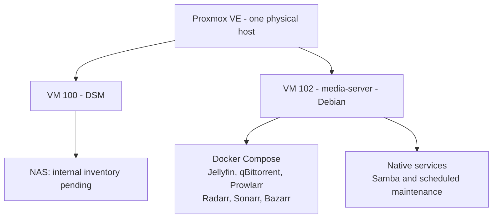

# Homelab


A gradually evolving home server, built to make everyday life easier—not to run as many services as possible.

**Status:** Modular Proxmox lab; DSM inventory and media automation documented; movie import/playback verified; remaining automation tracked in its module · **Last reviewed:** October 17, 2026.

This is the lab index, not a combined installation guide. Each VM or LXC owns its configuration, roadmap, procedures, scripts and tests in a separate directory with a README. Only shared inventory, conventions and tooling live at this level.

## Current Setup

| Component | Observed configuration |
| --- | --- |
| Hypervisor | Proxmox VE 9.2.21 on Debian 13.7 |
| CPU | Intel Core i5-4440, 4 cores / 4 threads |
| Memory | 16 GB installed, 2 × 8 GB DDR3 |
| Power supply | LNZ XS550-PS, black; 550 W declared rating (owner-confirmed) |
| Connected storage | 512 GB Micron NVMe + 2 × 2 TB WD HDDs; device ownership is recorded in the host inventory |
| Network | Realtek Fast Ethernet, 100 Mbps full-duplex |
| Running guests | DSM and `media-server`; see the shared guest inventory for resource allocations |
| LXC guests | None observed; Docker containers run inside the media-server VM |

## Lab Map

Deployment overview: one physical host, its permanent VMs and their service groups. Arrows mean **contains / runs**, not application traffic. Internal workflows belong to each module's diagrams; roadmap ideas are not shown as installed.



Open [DSM](dsm/README.md) for its inventory scope or [media-server](media-server/README.md#workflow) for acquisition, playback and maintenance flows. Ports, storage paths, script rules and validation limits stay inside their module, not in this overview.

No LXC workload is configured/documented yet. A legacy test guest is intentionally omitted from this map and module list; its historical resource record remains in the shared inventory. No guest was deleted or changed.

## Workload Modules

| Module | Deployment | Purpose |
| --- | --- | --- |
| [dsm](dsm/README.md) | VM 100; existing NAS | File storage; internal services and backup acceptance still need inventory |
| [media-server](media-server/README.md) | VM 102; Debian, six Compose services, native Samba and scheduled maintenance | Movie/TV acquisition, organization, subtitles and playback; detailed status in the module |

Read a module's README before running its scripts. DSM currently has an honest inventory/remaining-work entry, not an invented installer. No empty LXC or experimental-guest modules are created merely to fill a template. Host-wide facts belong in shared docs; workload procedures have one source of truth inside their module. Update this map/table when a workload is added, removed or changes verified status; update service-level details in its own module.

## Priorities

- Protect existing data and verify an independent backup destination.
- Inventory the remaining hardware before designing storage.
- Review network filtering separately before changing exposure or adding workloads.
- Address the observed 100 Mbps network bottleneck when needed.
- Explore files and Mac backups, photos, documents, home automation, media, and remote access incrementally.

These are planning priorities, not completed deployments. A passing SMART result is not a backup or a guarantee against disk failure.

## Documentation

The README is in English. Other documents use Spanish prose, English headings, and English `kebab-case` filenames.

- [Hardware Inventory](docs/hardware-inventory.md) — currently connected hardware and health snapshot.
- [Planned Hardware](docs/planned-hardware.md) — devices not yet connected and discovery checklist.
- [Installed Services](docs/installed-services.md) — confirmed guests and host services, with unknowns clearly marked.
- [Service Roadmap](docs/service-roadmap.md) — useful applications, dependencies, and resource trade-offs.
- [Security and Access](docs/security-and-access.md) — SSH, data protection, and publication safeguards.
- [Public Repository Guide](docs/publication-guide.md) — audited scope, ignore rules, known public exceptions and first-push checklist.
- [Operations Runbook](docs/operations-runbook.md) — safe inventory refresh and maintenance workflow.
- [Repository Layout](docs/repository-layout.md) — structure and contribution conventions.
- [Shared Stack Guide](docs/stack-guide.md) — common Compose requirements; manifests stay with their workload.
- [Decision Log](docs/decision-log.md) — accepted choices versus open proposals.
- [Shared Documentation](docs/README.md), [Scripts](scripts/README.md), [Tests](tests/README.md), and [Reference Resources](resources/README.md) — folder indexes and boundaries.
- [Sources Catalog](resources/sources.md) — collected videos, PDFs and links, separate from installation procedures.

## Repository Structure

```text
homelab/
├── README.md
├── images/               # Reviewed artwork for the lab overview
├── docs/                 # Shared host inventory, policies and conventions
├── scripts/              # Shared inventory tools and local test runner
├── tests/                # Shared inventory/privacy/layout tests only
├── resources/            # Shared reference material
├── dsm/                  # Existing VM: observed scope and documentation still needed
├── media-server/         # Self-owned VM module: README, roadmap, docs, scripts, tests
├── .local/               # Private host inventory and access notes (ignored)
└── tmp/                  # Temporary working files (ignored)
```

## Refresh the Inventory

From the repository root on the administration Mac:

```sh
rtk proxy ssh -o BatchMode=yes proxmox-homelab 'hostname'
rtk proxy sh scripts/collect-inventory.sh
rtk proxy sh scripts/run-tests.sh
```

The collector streams Python over SSH without installing anything on Proxmox. It saves a private JSON snapshot under `.local/inventory/`. Review it before updating public docs; even filtered captures can contain private resource names. The test runner is local-only and runs shared and module suites; it can also be run without RTK as `sh scripts/run-tests.sh`.

## Publication Safety

Do not commit private keys, tokens, raw configuration exports, VM backups, personal files or unreviewed inventories. The root ignore rules protect every module; workload-specific runtime rules belong to that module's `.gitignore`. Keep `.env.example`, manifests, image locks, scripts, tests and reviewed docs visible.

See the [qBittorrent lab login example](media-server/docs/qbittorrent.md#laboratory-login-example) for the login fields. Choose a unique password for each installation; do not reuse documented example credentials.

Before the first commit/push, run the local preflight and review the [publication checklist](docs/publication-guide.md):

```sh
python3 scripts/check-publication.py --acknowledge-public-lab-password
sh scripts/run-tests.sh
```

The preflight does not connect to servers or publish anything. `.gitignore` does not remove already tracked files or erase history; review staged changes and use a dedicated secret scanner for history if one exists. The initial privacy review on October16 preceded Git initialization. The owner then confirmed [jdfesa/homelab](https://github.com/jdfesa/homelab) as the public destination. `main` uses ordered English Conventional Commits, with a single push after the local review; see the publication guide for the recorded scope and verification commands. No server deployment is performed by committing these files.

## License

Original lab code and documentation are available under the [MIT License](LICENSE), as selected by the owner. Third-party reference material retains its own rights and attribution; the supplied PDF is not relicensed by this repository.
