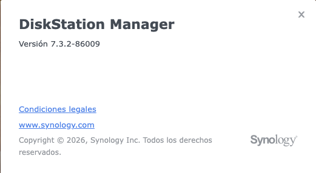
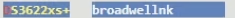
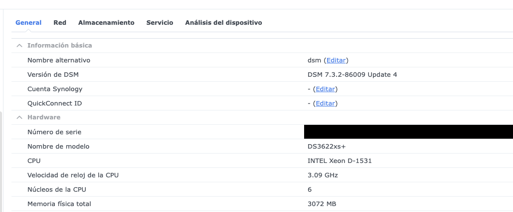
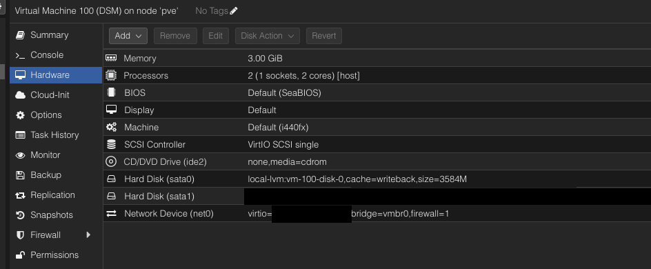
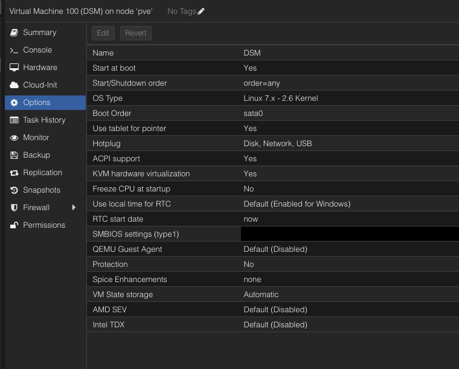

# DSM Installation Guide

**Status:** Observed configuration; manual installation procedure incomplete · **Updated:** 2026-10-22.

## Scope and Hardware

Referencia breve para reconstruir la instalación manual de DSM sobre Proxmox. **Según el propietario, la instalación se hizo con el hardware físico actual del laboratorio**, descrito en el [inventario de hardware](../../docs/hardware-inventory.md). No es una receta universal para otro equipo o modelo emulado.

Las capturas muestran la configuración **actual**, no todas las decisiones del primer despliegue. La RAM se ajustó después a 3 GiB; ese valor no demuestra cuánta memoria se utilizó al instalar. No se reinstaló, reinició ni modificó DSM para preparar esta guía.

## DSM and Loader

| Item | Information and evidence |
| --- | --- |
| DSM actual | **7.3.2-86009 Update 4**, visible en el Centro de información |
| Loader utilizado | **RR**, proyecto [RROrg/rr](https://github.com/RROrg/rr) |
| Versión confirmada de RR | **`rr-26.9.0`** |
| Imagen de RR utilizada | Imagen descargada conservada para una futura reinstalación |
| Modelo Synology emulado | **DS3622xs+**, confirmado y visible en el recorte de selección |
| Plataforma | **`broadwellnk`**, visible junto al modelo |

El propietario reporta funcionamiento relativamente estable. No equivale a una garantía de compatibilidad entre cualquier versión de RR, DSM y hardware. La versión actual de DSM tampoco demuestra cuál se instaló originalmente.

Captura real de DSM; sin cambios visuales. El diálogo muestra la versión base, sin el nivel de actualización que aparece en el Centro de información. No muestra el modelo emulado ni la versión de RR.

Recorte real aportado para confirmar el modelo elegido y su plataforma; sin cambios visuales. No muestra otras opciones del loader.

### Emulated Hardware Warning

El **Centro de información de DSM es una referencia de la identidad emulada, no un inventario del hardware físico**. El Xeon, la frecuencia y los seis núcleos mostrados no se utilizan como datos reales del host ni como asignación de CPU de la VM. El hardware físico se consulta en el inventario compartido; la asignación de la VM se toma de Proxmox: **2 vCPU, tipo `host`**.

Este panel sí muestra la versión completa **Update 4**, el modelo emulado y **3072 MB** de memoria, coherentes con los 3 GiB asignados en Proxmox; no es la memoria total del servidor físico.

Captura real de referencia, recortada hasta la fila de memoria para omitir sensores y datos transitorios de reloj/actividad. El número de serie se cubrió con un bloque negro opaco, aunque sea emulado; todos los demás píxeles del área conservada permanecen sin cambios. Los datos de CPU visibles deben interpretarse con la advertencia anterior.

## Proxmox Hardware Reference

Valores visibles en la captura de **Hardware** de VM 100 (`DSM`):

| Setting | Observed value |
| --- | --- |
| Memory | 3.00 GiB (3072 MiB), asignación actual; no mínimo de instalación probado |
| Processors | 1 socket, 2 cores; tipo `host` |
| BIOS | `Default (SeaBIOS)` |
| Machine | `Default (i440fx)` |
| Display | `Default` |
| SCSI Controller | `VirtIO SCSI single` |
| CD/DVD (`ide2`) | Sin medio: `none,media=cdrom` |
| Disco de arranque (`sata0`) | Disco virtual en `local-lvm`, `size=3584M`, `cache=writeback` |
| Disco de datos (`sata1`) | HDD físico dedicado, asignado mediante `/dev/disk/by-id/<DATA_DISK_ID>`; 2 TB según el inventario compartido |
| Red (`net0`) | `VirtIO`, bridge `vmbr0`, flag `firewall=1`; MAC omitida |

La selección de un controlador SCSI no cambia que los dos discos observados están conectados como SATA. El flag de firewall no prueba filtrado efectivo. La caché `writeback` se registra como estado observado, no como recomendación general ni garantía de protección frente a cortes eléctricos.

Captura real con censura: se cubrieron el valor completo del disco físico y la MAC mediante bloques negros opacos. No se modificaron los demás píxeles ni se reconstruyó la interfaz. Los identificadores de otro equipo deben obtenerse de ese equipo, no copiarse de una captura.

## Proxmox Options Reference

La captura de **Options** muestra arranque automático habilitado, **Boot Order: `sata0`**, virtualización KVM y ACPI habilitados, y **QEMU Guest Agent: `Default (Disabled)`**. El resto de las opciones queda visible en la captura; no se afirma que todas sean requisitos de RR.

La etiqueta de Proxmox **OS Type: `Linux 7.x - 2.6 Kernel`** es una selección de la VM, no una comprobación del kernel que está ejecutando DSM.

Captura real con censura: se cubrió el valor completo de SMBIOS/UUID mediante un bloque negro opaco. Los demás píxeles se conservaron sin cambios.

## Installation Coverage

Todavía faltan el método de creación/importación de la VM y la secuencia de configuración del loader e instalación de DSM (descarga automática o archivo `.pat`). También falta confirmar el tipo de grupo de almacenamiento y sistema de archivos. **La configuración anterior aún no constituye un procedimiento completo de reinstalación.**

El [README de RR](https://github.com/RROrg/rr#readme) es la fuente del proyecto. Su método de instalación actual no demuestra qué método se utilizó aquí; no se incorpora ni ejecuta su instalador como si hubiera sido validado en este laboratorio.

## Reinstallation Boundary

**Instalar desde cero en discos vacíos no es lo mismo que recuperar una VM conservando datos.** Esta guía no valida una restauración ni autoriza inicializar, formatear, reparar o sobrescribir el HDD existente. El disco de DSM no debe montarse ni reutilizarse desde Proxmox o `media-server`; ver el [límite de seguridad del módulo](../README.md#safety-boundary).
