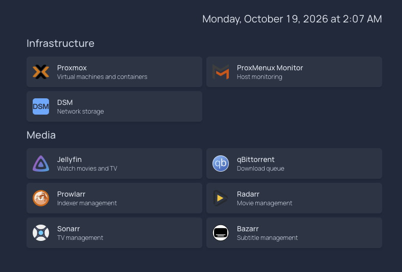

# Homepage

**Status:** Native Homepage installed; internal healthcheck and LAN browser rendering verified. English clock, service restart and nine local icons confirmed by HTTP hashes and browser appearance.

**Updated:** 2026-10-19.

## Purpose

Provide a single entry point to homelab services using [Homepage](https://gethomepage.dev/), independently of the workloads it links to.

## Current Snapshot

Real, unedited capture of the portal on October 19, 2026. Homepage is a living bookmark hub for this homelab: its links, service cards and this screenshot will be reviewed and updated as services, VMs and LXC containers are added, changed or retired. This is a point-in-time view, not a live inventory or an availability monitor.

## Scope and Boundaries

- Dedicated, unprivileged Debian 13 LXC, with native standalone Homepage and a non-login service user.
- This module owns the portal, not the applications it links to. Media processing, downloads and shared storage stay outside this guest.
- Selecting a card navigates the LAN browser directly to that service; Homepage is not a proxy and does not replace the destination's login, availability or maintenance.
- Initial access is direct HTTP from the trusted LAN, without web authentication or other-service API tokens. Do not expose it to the Internet.
- Credentials and site-specific values remain outside versioned examples. Temporary files and private evidence are not reconstruction dependencies.

Placement follows the shared [workload ownership contract](../docs/repository-layout.md#purpose-and-placement).

## Documentation

1. [LXC installation guide](docs/installation-guide.md) — guest creation, approved screenshots, warnings and base checks.
2. [Native service setup](docs/service-setup.md) — canonical source build, configuration, systemd deployment, measurements and operational limits.
3. [Configuration](config/README.md), [local icon assets](icons/README.md) and [offline tests](tests/README.md).

## Verification Limits

The service runs, its healthcheck responds inside the guest, and LAN browser rendering, the English clock and a manual service restart were confirmed by the owner. The nine local icons are deployed, their served hashes verified and their browser appearance confirmed in the real snapshot above. Destination links, Host rejection, guest reboot, representative load and restoration remain unverified; see the service guide for exact evidence. The unit is enabled inside Debian, but Proxmox guest autostart remains disabled. No shutdown policy has been introduced.

## References

- [Homepage documentation](https://gethomepage.dev/)
- [Native installation reference](https://gethomepage.dev/installation/source/)
