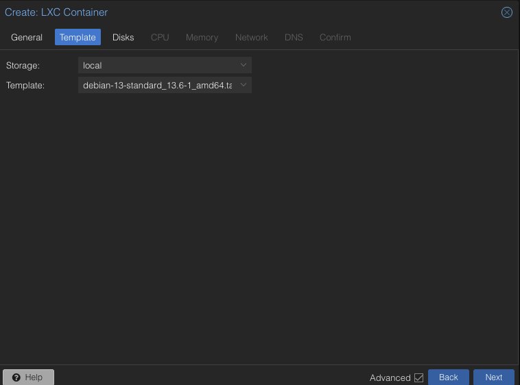
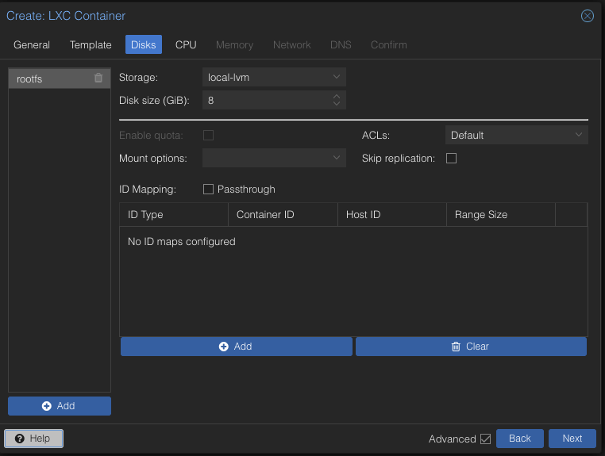
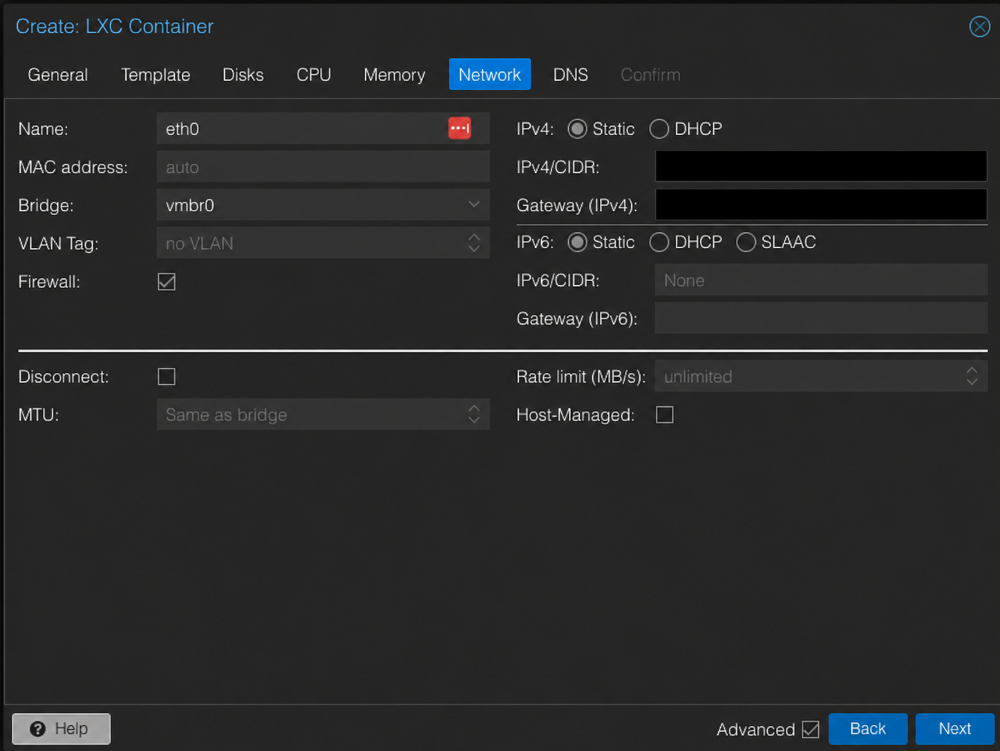
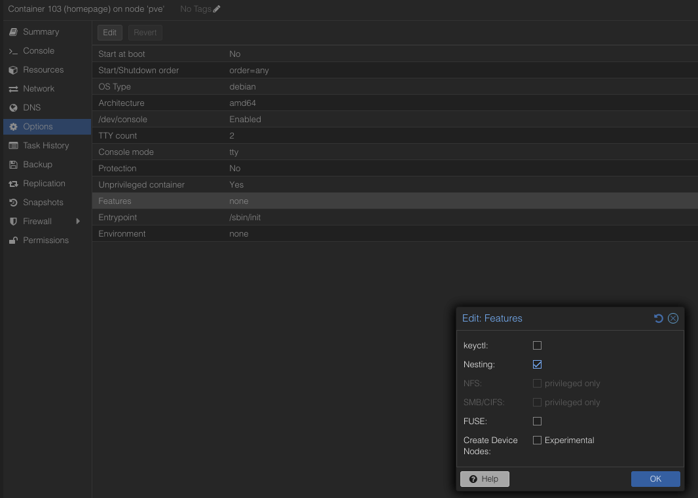
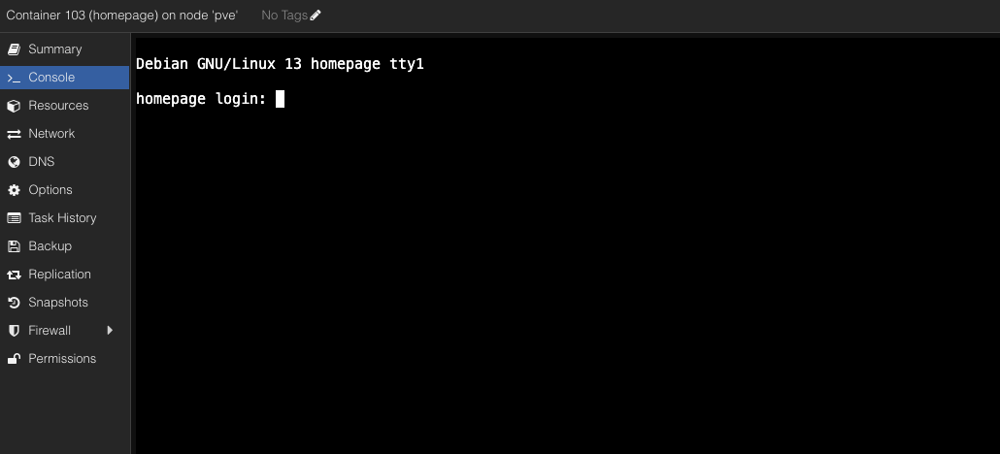

# Installation Guide

**Status:** LXC creation and base checks verified. Native application deployment is documented separately.

**Updated:** 2026-10-19.

## Scope and Prerequisites

Creación del LXC dedicado y no privilegiado de Homepage en Proxmox. El sistema base arrancó y pasó las comprobaciones indicadas. Continuar con la [receta canónica del servicio nativo](service-setup.md) para instalar la aplicación y consultar su validación; este documento no es un procedimiento de restauración.

Se necesita acceso administrativo a Proxmox, un CT ID disponible y una plantilla de contenedor Debian 13 Standard para `amd64`. La plantilla LXC no es una ISO de instalación de una VM.

## 1. General

Abrir **Create CT** en el nodo de destino y completar:

| Field | Setting | Reason |
| --- | --- | --- |
| Node | `<node>` | Nodo donde se alojará el LXC; valor propio del sitio. |
| CT ID | `<available-ct-id>` | Identificador libre y único en Proxmox. |
| Hostname | `homepage` | Propósito explícito del huésped. |
| Unprivileged container | Checked | Mantener el contenedor no privilegiado. |
| Nesting | Checked | Compatibilidad con capacidades de aislamiento de systemd; ver Features and First Boot. |
| Add to HA | Unchecked | Este procedimiento no configura alta disponibilidad. |
| Resource Pool | Empty | No se requiere una agrupación administrativa adicional. |
| Password / Confirm password | Set privately | Contraseña única para `root` del LXC, establecida por el propietario y fuera del repositorio. |
| SSH public keys | Empty initially | No se incorpora una clave en esta etapa; no introducir nunca una clave privada. |

Nesting no es una opción exclusiva de Docker: Proxmox también la relaciona con el aislamiento de servicios de systemd. Se eligió habilitar sólo esa capacidad para este Debian 13, manteniendo el huésped no privilegiado. Es una decisión de compatibilidad que amplía acceso a procfs/sysfs, no una prueba de que el sistema no pueda arrancar sin ella. Ver [opciones de Features de Proxmox](https://github.com/proxmox/pve-container/blob/master/src/PVE/LXC/Config.pm).

La configuración General fue revisada, pero no se conserva su captura: los campos de contraseña no aportan evidencia necesaria para reproducir estos valores.

## 2. Template

Usar la plantilla **Debian 13 Standard, `amd64`** del catálogo de Proxmox. El almacenamiento de plantillas y el del futuro disco raíz son elecciones distintas; seleccionar aquí `local` no determina dónde se creará el disco del LXC.

Si la plantilla no está disponible:

1. Abrir Proxmox en otra pestaña del navegador para conservar el asistente en curso.
2. Seleccionar el nodo y **local → CT Templates → Templates**.
3. Buscar `debian-13-standard` y seleccionar la arquitectura `amd64`.
4. Pulsar **Download** y esperar a que la tarea termine correctamente (`TASK OK`).

Si Debian 13 no aparece, revisar el catálogo y la compatibilidad de la versión instalada de Proxmox antes de elegir otra distribución o modificar el host. Proxmox documenta la [descarga de plantillas desde su catálogo](https://github.com/proxmox/pve-docs/blob/master/pct.adoc#system-container-templates).

En la pestaña **Template** del asistente:

| Field | Reviewed setting |
| --- | --- |
| Storage | `local` |
| Template | Debian 13 Standard, revision `13.6-1`, `amd64` |
| Template archive | `debian-13-standard_13.6-1_amd64.tar.zst` |



Captura real revisada: se excluyeron metadatos del archivo sin modificar dimensiones ni datos de píxeles. La etiqueta está truncada en esta pantalla; el nombre completo del archivo se verificó en **Confirm**. Una plantilla seleccionada por sí sola no demuestra que el contenedor exista.

## 3. Disks

Configurar sólo el disco raíz `rootfs`, sin agregar discos ni montajes del host:

| Field | Reviewed setting | Reason |
| --- | --- | --- |
| Storage | `local-lvm` | Almacenamiento seleccionado para el disco raíz; en otro host, elegir uno habilitado para contenedores con capacidad libre suficiente. |
| Disk size (GiB) | `8` | Tamaño inicial para sistema y aplicación, sin contenido multimedia; no es una medición del espacio necesario para compilar Homepage. |
| Enable quota | Disabled / unchecked | No activar cuotas adicionales en esta configuración. |
| ACLs | `Default` | Mantener el comportamiento predeterminado del almacenamiento. |
| Mount options | Empty | No añadir opciones especiales. |
| Skip replication | Unchecked | No se configura replicación en este procedimiento. |
| ID Mapping: Passthrough | Unchecked | No se requiere compartir identidades con almacenamiento del host. |
| ID maps | No custom maps | Mantener el mapeo propio del contenedor no privilegiado. |



Captura real revisada, con metadatos excluidos sin modificar dimensiones ni datos de píxeles. No se agregan puntos de montaje para otros servicios: Homepage conserva un propósito independiente.

Los `8 GiB` permitieron el primer build y despliegue; el [margen de disco observado y sus límites](service-setup.md#verification-and-resource-evidence) se documentan con el servicio. Comprobar espacio antes de nuevas compilaciones y actualizaciones; no se ha validado conservar varias releases. El nombre `local-lvm` por sí solo no identifica el disco físico que lo respalda. Ver [Mount Points de Proxmox](https://github.com/proxmox/pve-docs/blob/master/pct.adoc#mount-points).

## 4. CPU

Mantener la asignación inicial de un núcleo y los valores predeterminados de planificación:

| Field | Reviewed setting | Meaning |
| --- | --- | --- |
| Cores | `1` | Limita el conjunto de CPU disponible para el contenedor a un núcleo lógico. |
| CPU limit | `unlimited` | Sin una cuota adicional de tiempo de CPU; no elimina la restricción de `Cores`. |
| CPU units | `100` | Peso relativo de planificación con cgroup v2; no representa un porcentaje. |

Estos valores son un punto de partida, no una medición de rendimiento. La compilación de la aplicación puede tardar más con un núcleo; no asignar más recursos permanentes sin comprobar la necesidad. Ver [CPU de Proxmox](https://github.com/proxmox/pve-docs/blob/master/pct.adoc#cpu).

## 5. Memory

Mantener los valores iniciales revisados, sin reducir la RAM al valor predeterminado de `512 MiB` antes de medir la aplicación:

| Field | Reviewed setting | Meaning |
| --- | --- | --- |
| Memory (MiB) | `1024` | Límite inicial de `1 GiB` de RAM para el LXC; no es consumo fijo ni reserva permanente de esa cantidad. |
| Swap (MiB) | `1024` | Límite adicional de swap, sujeto a que exista swap habilitada y disponible en el host. |

Configurar swap en el asistente no crea swap en el host ni convierte disco en RAM física. La presencia de swap activa en el host se comprobó después del arranque; no acredita rendimiento bajo presión de memoria. Ver las opciones `memory` y `swap` en la [definición oficial de configuración de Proxmox](https://github.com/proxmox/pve-container/blob/master/src/PVE/LXC/Config.pm).

La compilación y el servicio tienen necesidades distintas. El [procedimiento nativo](service-setup.md#3-build-with-temporary-memory) registra el aumento temporal de RAM usado para compilar, su devolución al límite habitual y las mediciones verificadas. No aumentar permanentemente recursos ni cambiar otros huéspedes por rutina.

Evaluar una reducción a `512 MiB` sólo después de medir el servicio bajo uso representativo, revisar presión de memoria y comprobar que no haya fallos por falta de memoria; un consumo bajo en reposo no basta.

## Network Prerequisites

Antes de completar **Network**, verificar los valores del sitio. Una dirección consecutiva a las ya utilizadas es una candidata, no una garantía de disponibilidad. Elegir una IP dentro de la subred correcta, fuera del pool DHCP dinámico o excluida de él, y comprobar que no esté asignada estáticamente ni reservada para otro equipo. La ausencia de respuesta a un ping no demuestra que esté libre.

| Site value | Public placeholder | Verification |
| --- | --- | --- |
| Homepage IPv4 and prefix | `<homepage-ip>/<prefix-length>` | Confirmar IP libre y prefijo real de la LAN; no inferir la máscara a partir del orden de las direcciones. |
| IPv4 gateway | `<lan-gateway>` | Dirección LAN del router para esa subred, no necesariamente la dirección de Proxmox. |
| Bridge | `<lan-bridge>` | Bridge conectado a esa LAN en el nodo de destino. |

Las direcciones [RFC 1918](https://www.rfc-editor.org/rfc/rfc1918.html#section-3) no son credenciales ni direcciones públicas de Internet. Aun así, publicar el direccionamiento exacto aporta detalles de la topología sin mejorar la receta: esta guía usa placeholders y los valores reales del sitio quedan fuera de Git, en `.local/`. Los originales con IP o MAC reales se conservan como evidencia privada. Una versión censurada debe identificarse como referencia editada, nunca como prueba sin editar.

## 6. Network

Completar la interfaz para la LAN, usando valores comprobados del sitio:

| Field | Reviewed setting |
| --- | --- |
| Name | `eth0` |
| MAC address | `auto` |
| Bridge | `<lan-bridge>`; `vmbr0` en la pantalla revisada |
| VLAN Tag | No VLAN |
| Firewall | Checked |
| IPv4 | Static |
| IPv4/CIDR | `<homepage-ip>/<prefix-length>` |
| Gateway (IPv4) | `<lan-gateway>` |
| IPv6 | Static; IPv6/CIDR and Gateway (IPv6) empty |
| Disconnect | Unchecked |
| MTU | Same as bridge |
| Rate limit | Unlimited |
| Host-Managed | Unchecked |

La máscara y el gateway se confirmaron con el propietario y coinciden con la captura original revisada; los valores reales no se publican. El indicador Firewall no acredita por sí solo que existan reglas activas. Dejar vacíos los campos IPv6 no equivale a demostrar que IPv6 esté deshabilitado globalmente.



**Referencia visual censurada y editada con IA, no evidencia sin editar.** Se solicitó ocultar por completo los campos IPv4/CIDR y Gateway (IPv4) con rectángulos opacos. El resultado fue revisado visualmente; puede variar en escala y renderizado. La validación de los valores procede del original privado y de la tabla, no de esta ilustración. No acredita conectividad ni ausencia de conflictos de IP.

## 7. DNS

| Field | Reviewed setting |
| --- | --- |
| DNS domain | Empty — use host settings |
| DNS servers | Empty — use host settings |

Al dejar ambos campos vacíos, Proxmox utiliza el dominio de búsqueda y los servidores DNS del host. No introducir la IP de Homepage, una URL ni un dominio inventado. Esta selección se verificó en el asistente, pero la resolución efectiva debe comprobarse dentro del huésped después del arranque. Ver [opciones de DNS de Proxmox](https://github.com/proxmox/pve-container/blob/master/src/PVE/LXC/Config.pm).

## 8. Confirm and Create

Revisar que **Confirm** conserve el hostname, el ID libre elegido, un núcleo, `1024 MiB` de RAM y swap, `unprivileged=1`, el disco raíz de `8 GiB`, la plantilla exacta y la red estática esperada. Los valores del sitio se contrastan con el inventario privado, no con una IP de ejemplo de esta guía.

Mantener **Start after created** desmarcado y pulsar **Finish**. Esto crea el sistema base, no instala Homepage ni acredita su funcionamiento. La creación observada completó volumen, filesystem, extracción y generación de claves SSH, pero terminó con **TASK WARNINGS: 1**, no con un resultado limpio **TASK OK**.

### Creation Warnings

- **Old PV header:** se observaron avisos de LVM durante la creación. No equivalen por sí solos a un fallo del contenedor ni demuestran que el almacenamiento esté sano. No modificar metadatos LVM, RAID, particiones o discos desde este procedimiento de Homepage; cualquier diagnóstico del host requiere alcance y validación propios.
- **Systemd / Nesting:** Proxmox detectó systemd `257` con Nesting desactivado. Su [comprobación oficial](https://github.com/proxmox/pve-container/blob/master/src/PVE/LXC/Setup/Base.pm) genera este aviso preventivo para versiones de systemd posteriores a `241`; no demuestra que ya haya fallado un servicio. Nesting también permite capacidades usadas por systemd, no sólo contenedores anidados.

No repetir **Create CT**, borrar el huésped ni preparar de nuevo sus discos sólo por estas advertencias. El estado de Features y el arranque se verifican por separado.

## 9. Features and First Boot

En **Options → Features**, guardar únicamente **Nesting** activado. Mantener `keyctl`, FUSE y Create Device Nodes desactivados, sin habilitar montajes adicionales ni convertir el contenedor en privilegiado. La configuración guardada se comprobó como `features: nesting=1` y `unprivileged: 1`; no basta con marcar una casilla sin pulsar **OK**.



Captura real de la selección correcta: sólo **Nesting** está marcado. El diálogo aún está abierto y la fila del fondo muestra el valor anterior; el guardado se confirmó posteriormente mediante `pct config`, no por esta imagen. Sólo se excluyeron metadatos del archivo, sin modificar los píxeles.

Pulsar **Start** y abrir **Console**. El sistema base debe llegar al prompt de login:



Captura real revisada, sin IP, contraseña ni token visibles. Sólo se excluyeron metadatos del archivo; dimensiones y datos de píxeles permanecen intactos. Este prompt demuestra arranque hasta la consola, no que Homepage esté instalado ni que todos los servicios estén sanos.

Para el acceso inicial:

1. En `homepage login:`, escribir `root` y pulsar Enter.
2. Introducir la contraseña privada establecida al crear el LXC. La consola no muestra caracteres mientras se escribe; es normal.
3. Confirmar el prompt `root@homepage:~#`.

Se trata de la cuenta integrada del sistema operativo para la preparación inicial, no de una cuenta administrativa web de Homepage. No guardar ni compartir la contraseña en la guía o en capturas.

## 10. Read-Only Base Verification

Desde el Mac administrador se verificó el huésped por el acceso SSH existente a Proxmox, usando `pct exec`; no fue necesario habilitar acceso SSH de `root` dentro del LXC. El alias SSH y el ID deben corresponder al inventario del despliegue. Estos comandos usan el ID del módulo:

```sh
rtk proxy ssh -o BatchMode=yes -o StrictHostKeyChecking=yes proxmox-homelab \
  'pct status 103; pct config 103; pct exec 103 -- systemctl is-system-running; pct exec 103 -- systemctl --failed --no-pager'
rtk proxy ssh -o BatchMode=yes -o StrictHostKeyChecking=yes proxmox-homelab \
  'pct exec 103 -- ip -4 -brief address; pct exec 103 -- ip -4 route; pct exec 103 -- cat /etc/resolv.conf; pct exec 103 -- getent ahostsv4 deb.debian.org'
rtk proxy ssh -o BatchMode=yes -o StrictHostKeyChecking=yes proxmox-homelab \
  'pct exec 103 -- free -m; pct exec 103 -- df -h /; swapon --show=TYPE,SIZE,USED --bytes'
```

`rtk` se ejecuta en el Mac, no se presupone instalado en Proxmox ni en el LXC. Las salidas de configuración y red contienen valores del sitio: conservarlas en `.local/`, no publicarlas como ejemplos.

Comprobado: huésped `running`, Nesting guardado y contenedor no privilegiado, ninguna unidad fallida, IPv4 y ruta esperadas, DNS heredado con resolución de `deb.debian.org`, espacio y memoria disponibles, y swap activa en el host. Son verificaciones del sistema base, no pruebas de capacidad para compilar Homepage, acceso web ni ausencia de conflictos de IP. El consumo de Debian recién arrancado no sirve para reducir todavía el límite de RAM.

## Verification Limits

Las comprobaciones de esta guía acreditan creación, configuración guardada y arranque del sistema base, no la operación del portal. La instalación posterior, el healthcheck HTTP interno y las comprobaciones todavía pendientes tienen una sola fuente: [Native Service Setup](service-setup.md#verification-and-resource-evidence). La ausencia de conflictos de IP y la recuperación no se han probado.
