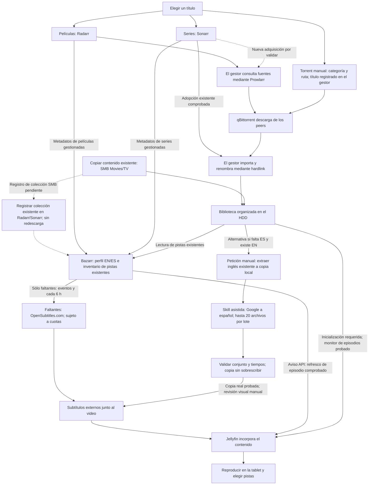
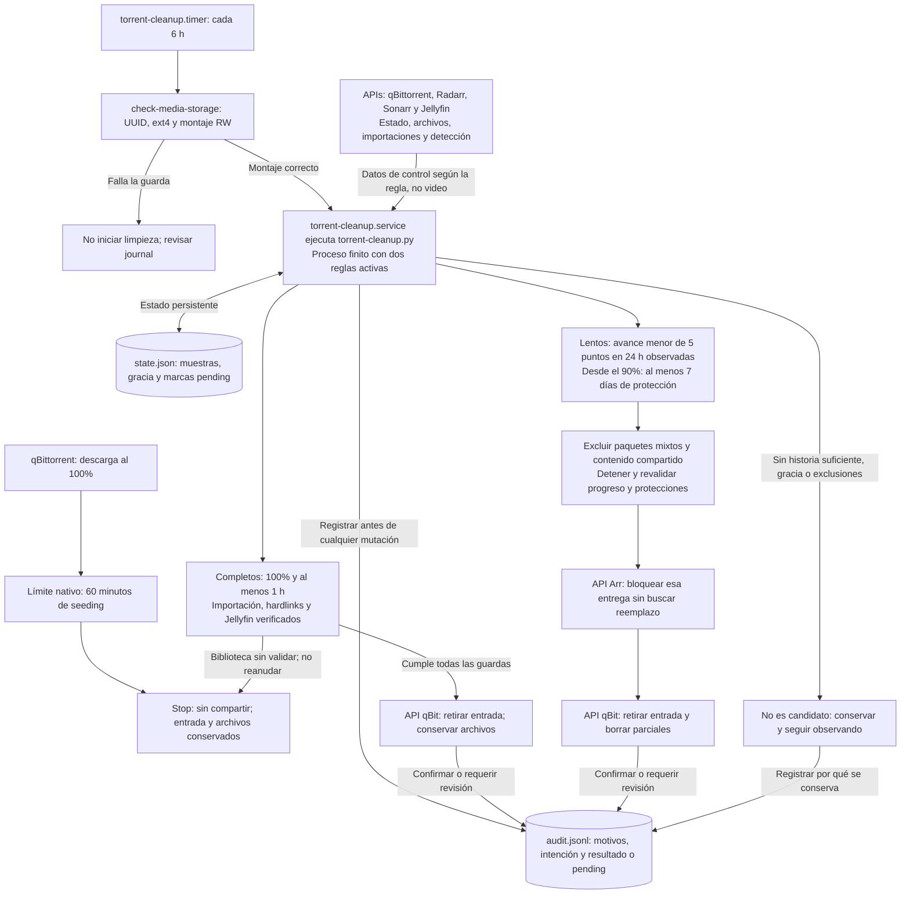

# Media Server

Servidor multimedia sobre Debian con servicios multimedia Docker Compose independientes y acceso a archivos mediante Samba nativo. Configuración y bases de datos en NVMe; descargas y biblioteca en un HDD ext4 montado en `/data`.

**Comprobado:** búsqueda y descarga de películas, importación/renombrado mediante hardlink y reproducción desde una tablet con selección de subtítulos incluidos. También se comprobaron adopción de series por hardlink y detección automática de episodios en Jellyfin tras inicializar TV. La adquisición nueva de series desde Sonarr sigue por validar.

## Start Here

**[RUNBOOK — orden de instalación y recuperación](RUNBOOK.md)**. Es la entrada breve para reconstruir el servidor; las guías de cada servicio se consultan sólo cuando corresponden. El objetivo de pocos minutos aún requiere backup y restauración medidos.

## Workflow

| Acción | Interfaz |
| --- | --- |
| Buscar y añadir una película | **Radarr → Add New**, TCP7878 |
| Añadir series y temporadas | **Sonarr**, TCP8989; adopción existente probada |
| Copiar películas/series que ya existen en otro equipo | **Finder → SMB Movies/TV**, TCP445; [guía](docs/samba.md) |
| Revisar idiomas y subtítulos faltantes | **Bazarr**, TCP6767; EN/ES existentes y búsqueda automática de faltantes |
| Traducir inglés existente cuando falta español | **Skill asistida**, [uso y límites](docs/bazarr.md#translate-english-exports-with-google); por petición, no automática |
| Ver contenido de la biblioteca | **Jellyfin**, TCP8096 |
| Consultar la limpieza automática y sus motivos | **Auditoría privada del mantenimiento**, [guía](docs/torrent-cleanup.md) |

Prowlarr y qBittorrent trabajan detrás del gestor para adquirir contenido nuevo. Una colección existente entra por SMB sin pasar por ellos. El buscador de Jellyfin consulta la biblioteca existente.

### Acquisition and Playback

Este es el recorrido del contenido. La limpieza periódica es un proceso independiente, no un requisito para reproducir; se detalla en el [flujo de mantenimiento](#periodic-maintenance).

El recorrido de películas está probado. Sonarr ya adopta descargas existentes con hardlinks y Jellyfin detecta episodios nuevos; falta validar una adquisición nueva iniciada por Sonarr. Las líneas discontinuas representan capacidades pendientes; Bazarr busca EN/ES faltantes y avisa a Jellyfin; descarga externa y refresco automático de episodio comprobados, sujetos a disponibilidad/cuotas. El contenido copiado por SMB requiere registro adicional en el gestor para aparecer en Bazarr. Prowlarr devuelve resultados/enlaces; los videos llegan desde los peers. [Uso cotidiano](docs/workflow.md) · [Mapa técnico](docs/stack-plan.md).

La [traducción asistida por el skill](docs/bazarr.md#translate-english-exports-with-google) es una alternativa manual cuando Bazarr no consigue español y existe inglés exportable, no otro proveedor ni un servicio en la VM. Navegador, validación, copia y entrega en Jellyfin se comprobaron con una temporada real; la calidad y reproducción se revisan por temporada.

### Periodic Maintenance

qBittorrent detiene el seeding con su límite nativo, independientemente de la biblioteca. Por separado, un único `torrent-cleanup.py` evalúa dos reglas de retiro mediante una unidad systemd finita. No es otro contenedor ni un proceso Python residente. El timer está habilitado con acciones reales; conserva las muestras entre revisiones y sólo retira cuando se cumplen los plazos y las guardas.

Las flechas describen el **flujo configurado**, no que todos los casos hayan sucedido. El Stop nativo y la ejecución programada están comprobados; las ventanas reales de 24 h/gracia semanal y el borrado de parciales aún requieren validación. La biblioteca nunca es objetivo del borrado. Una revalidación fallida puede dejar una acción `pending` para revisión, sin reintento automático. [Reglas, excepciones y auditoría: guía canónica](docs/torrent-cleanup.md).

| Recurso | Función en operación |
| --- | --- |
| [check-media-storage.py](scripts/check-media-storage.py), instalado como `check-media-storage` | Guarda de lectura previa al arranque: exige el HDD correcto; no prepara ni formatea discos. |
| [torrent-cleanup.py](scripts/torrent-cleanup.py) y [unidades systemd](config/torrent-cleanup/) | Evalúan ambas políticas cada seis horas, conservan muestras y registran motivos/resultados. El borrado se solicita por API, no escribiendo desde Python a la biblioteca. |
| [Instaladores y herramientas administrativas](scripts/README.md) | Primer despliegue o diagnóstico manual cuando corresponde; no forman parte del ciclo periódico. Los ayudantes privados de una intervención tampoco son servicios permanentes. |

## Storage and Boundaries

- `/srv/media-server/appdata/`: configuración y bases de datos en NVMe.
- `/data/downloads/{movies,tv}`: archivos gestionados por qBittorrent.
- `/data/media/{movies,tv}`: biblioteca organizada para Jellyfin.
- Radarr y Sonarr usan **un único bind `/data:/data`** para permitir hardlinks. Bazarr sólo recibe `/data/media` RW para archivos de subtítulos. Jellyfin recibe la biblioteca como `/media`, de sólo lectura.
- Un hardlink evita otra copia del mismo video; no es un backup. El disco físico no queda respaldado automáticamente con el disco virtual de la VM.
- Mantener DSM y su HDD fuera del alcance de este módulo. No publicar paneles en Internet ni cambiar router/VPN como efecto secundario.

## Reference

- [Índice de guías](docs/README.md) y [accesos](docs/service-access.md).
- [Scripts reutilizables](scripts/README.md), [contratos/pruebas locales](tests/README.md) y [módulos Compose](compose/README.md).
- [Configuración de referencia](vm-config.json): no es un export ejecutable de Proxmox ni un inventario de descargas.
- [Política de Radarr](docs/radarr-profile-policy.json): declarativa; resolver IDs por nombre en cada instalación.
- [Decisiones de diseño](docs/decision-log.md), [alcance y límites](ROADMAP.md) y [pendientes técnicos](TODO.md).

Los valores del sitio permanecen en `.local/`. Las notas de trabajo y pruebas transitorias van en `tmp/`, fuera de Git. La guía conserva procedimientos comprobados, no una bitácora por título descargado. El [ejemplo de acceso qBit](docs/qbittorrent.md#laboratory-login-example) ilustra los campos; no reutilizar sus valores en otras instalaciones.
