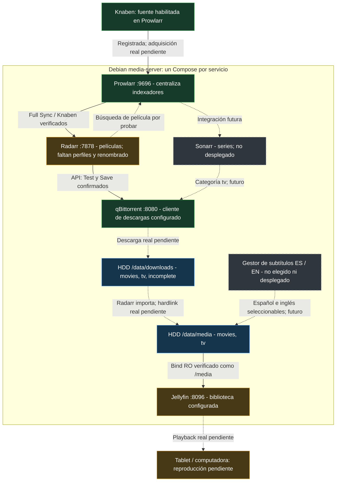

# Media Server

**Status:** Jellyfin/qBittorrent configured; Prowlarr/Knaben synchronized with Radarr; Radarr account/root verified and qBittorrent Test + Save confirmed by UI. Next: profiles/naming, then a real movie test. Sonarr, subtitles and playback acceptance pending.\
**Updated:** October 16, 2026.

Reproducible configuration and operational notes for the `media-server` VM. The first milestone covers movies and TV shows; books and music are deferred.

## Workflow at a Glance

**Checkpoint — 2026-10-16:** cuatro servicios desplegados. Prowlarr → Radarr sincronizado; Radarr → qBittorrent probado y guardado. **Todavía no se verificó ninguna descarga, importación ni reproducción real.**



**Leyenda:** verde = configuración del componente/conexión confirmada, **no** flujo completo; ámbar = aceptación/configuración restante; azul = almacenamiento preparado; gris = futuro. Flechas continuas = conexión o montaje comprobado; punteadas = recorrido real aún no probado o integración futura. Knaben es una fuente externa, no otro contenedor de la VM. qBittorrent obtiene los datos de los peers; Prowlarr aporta resultados/enlaces, no almacena los videos.

| Componente / etapa | Qué tenemos | Qué falta |
| --- | --- | --- |
| [Prowlarr](docs/prowlarr.md) | Knaben habilitado; Full Sync con Radarr verificado | Búsqueda real;1337x/EZTV y FlareSolverr aplazados en [TODO](TODO.md) |
| [Radarr](docs/radarr.md) | Cuenta, raíz `/data/media/movies`, Knaben y qBit con Test + Save; categoría `movies` | **Siguiente:** perfiles de calidad/idioma, límites y renombrado |
| [qBittorrent](docs/qbittorrent.md) | Rutas/categorías, login e integración Radarr configurados | Primera descarga, política de seeding/limpieza |
| [Jellyfin](docs/jellyfin.md) | Cuenta, bibliotecas Movies/Shows y lectura RO | Primer contenido y reproducción desde clientes |
| Importación / hardlinks | Filesystem y bind común `/data` comprobados | Importación real de Radarr; comprobar dispositivo/inode |
| Sonarr / subtítulos | Plan y preferencias: audio original, inglés como fallback; subtítulos ES/EN seleccionables | Desplegar/configurar después de la primera película; no hay garantía de esas pistas todavía |
| Backup / recuperación | Procedimientos y límites documentados | Copia independiente y restauración probada |

**Orden inmediato:** Radarr **Settings → Profiles**, revisar preferencias/límites; después renombrado; luego una película autorizada hasta Jellyfin. No repetir el alta del cliente ni buscar torrents manualmente. Al cerrar cada paso, actualizar su guía/capturas, este diagrama/tabla, [handoff](docs/session-handoff.md), [roadmap](ROADMAP.md), [TODO](TODO.md) y [estado declarativo](vm-config.json), distinguiendo evidencia UI, API y prueba real.

## Files

- [Session handoff](docs/session-handoff.md) — **start here when resuming**: Jellyfin configured; qBittorrent deployed, user login/password change confirmed; no manual download started; playback pending.
- [Service access directory](docs/service-access.md) — servicios desplegados, puertos y URLs de referencia; direcciones reales en `.local/service-access.md`.
- [Prowlarr module](compose/prowlarr/README.md) and [service guide](docs/prowlarr.md) — deployed indexer manager; authentication verified; Knaben saved/enabled; all EZTV URLs blocked per user; not saved.
- [qBittorrent module](compose/qbittorrent/README.md) and [service guide](docs/qbittorrent.md) — deployed downloader, verified paths/categories; user login/password change confirmed; no manual download started.
- [Jellyfin module](compose/jellyfin/README.md) and [service guide](docs/jellyfin.md) — deployed Compose, pinned official image, persistence and user setup steps.
- [Radarr module](compose/radarr/README.md) and [service guide](docs/radarr.md) — gestor de películas con Compose, imagen fijada, instalador de primer despliegue y configuración/integración documentadas en orden; consultar la guía para su checkpoint real.
- [Roadmap](ROADMAP.md) — explicit goals, phases, agreed storage layout, efficiency requirements, and pending decisions.
- [TODO](TODO.md) — deferred concrete tasks and acceptance checks; includes restoring Prowlarr access to1337x, not discarded.
- [Documentation index](docs/README.md) and [decision log](docs/decision-log.md) — operational guides and decisions owned by this VM.
- [Storage Guide](docs/storage-guide.md) — verified HDD preparation, GPT/ext4 mount, permissions, hardlink probe, mount guard, and recovery limits.
- [Scripts README](scripts/README.md) — reusable shell/Python scripts, execution targets, prerequisites, and safety boundaries.
- [Tests README](tests/README.md) — local validation, pure guards and module-owned tests.
- [VM configuration](vm-config.json) — desired settings and verification status, not an executable Proxmox export.
- [Setup Guide](docs/setup-guide.md) — VM creation, important checkbox screenshots, Debian hostname/domain, users, software selection, GRUB, and acceptance checklist.
- [Post-install Guide](docs/post-install-guide.md) — applied base preparation, network rollback, versions and verified SSH key.
- [Base package lock](base-packages.lock.json) — exact versions of explicitly managed packages.
- [Site settings template](.env.example) — completed network values belong in private storage.
- [Bootstrap script](scripts/bootstrap-debian.sh) and [static IP script](scripts/configure-static-ip.sh) — run inside Debian only.
- [Stack Plan](docs/stack-plan.md) — automation layers, storage layout, modular Compose and planned subtitle manager.
- [Images](images) — user-provided screenshots of the reviewed VM wizard and Debian installer.

## Current Scope

- One Debian VM with independent Docker Compose services.
- NVMe-backed virtual disk for the OS, application configuration, and databases.
- The additional 2 TB WD20EZRZ HDD attached as `scsi1`, prepared as GPT/ext4 and mounted by UUID on `/data` with shared directories and mount guards.
- Leave the existing DSM VM and its HDD unchanged.
- Start with Jellyfin validation, then complete the Prowlarr / Radarr / Sonarr / qBittorrent automation pipeline.

The base, dedicated SSH public key and GPT/ext4 storage are verified. Docker checks the expected filesystem before starting. Four independent modules are deployed: Jellyfin12.2.0, qBittorrent5.2.4, Prowlarr2.6.5.5623 and Radarr6.4.4.10685. Configuration/databases remain on NVMe; downloads/library on HDD. Jellyfin reads the library RO; Radarr has one common `/data` bind. Accounts, libraries/root, Knaben Full Sync and Radarr's qBittorrent Test/Save are confirmed at the checkpoints described above. Actual import/hardlinks/playback remain pending. DSM was not changed. No further system access or credential changes are part of this documentation work.

## Reproduction Status

The base/storage setup and first Jellyfin deployment have been exercised, but this is **not yet a complete tested media deployment recipe**. Jellyfin's image is pinned by version/digest. Still required: playback, installer checksum, remaining service images/integrations, real import checks, backup/restore and an end-to-end test. No physical disk-removal test or post-Jellyfin VM-reboot acceptance was performed.

The user confirmed one Compose module per service for organization, not performance. The real [Jellyfin manifest](compose/jellyfin/compose.yaml) is validated/deployed. qBittorrent has its own validated/deployed module too. Further modules will be added under `compose/<service>/` as configured, each with its README; do not create a parallel global stack or empty manifests.

Keep credentials, local addresses, disk serials, private exports, and runtime data outside versioned files by default. Use the ignored `media-server/.local/` directory for private evidence and machine-specific details. **Explicit owner-selected exception:** the [qBittorrent laboratory login example](docs/qbittorrent.md#laboratory-login-example) records the real lab credential; calling it an example does not make it secret. No other passwords/API keys are published. The owner-approved qBit form screenshot retains a site-specific LAN IP as visual evidence; reusable text/URLs still use placeholders.

## Module Layout and Workflow

```text
media-server/
├── README.md
├── ROADMAP.md
├── TODO.md
├── vm-config.json
├── base-packages.lock.json
├── .env.example
├── compose/              # Independent deployed service modules
├── docs/                 # This VM's guides and decisions; README index
├── scripts/              # This VM's automation; README and execution boundaries
├── tests/                # This VM's local tests; README and safe commands
├── images/               # Reviewed installer evidence; README
└── .local/               # Private site values and evidence, ignored
```

Work from this directory for media changes. Read the roadmap, follow the relevant guide, review the target and destructive boundary of any script, validate locally, then record the actual result in this module. The repository root needs only an index/resource-ownership update, not a second copy of these procedures.

From `media-server/`, run `python3 -m unittest discover -s tests -v`. Tests require Python 3 and Bash, not root, SSH, a server connection or RTK. They do not exercise real disks or deploy services.
