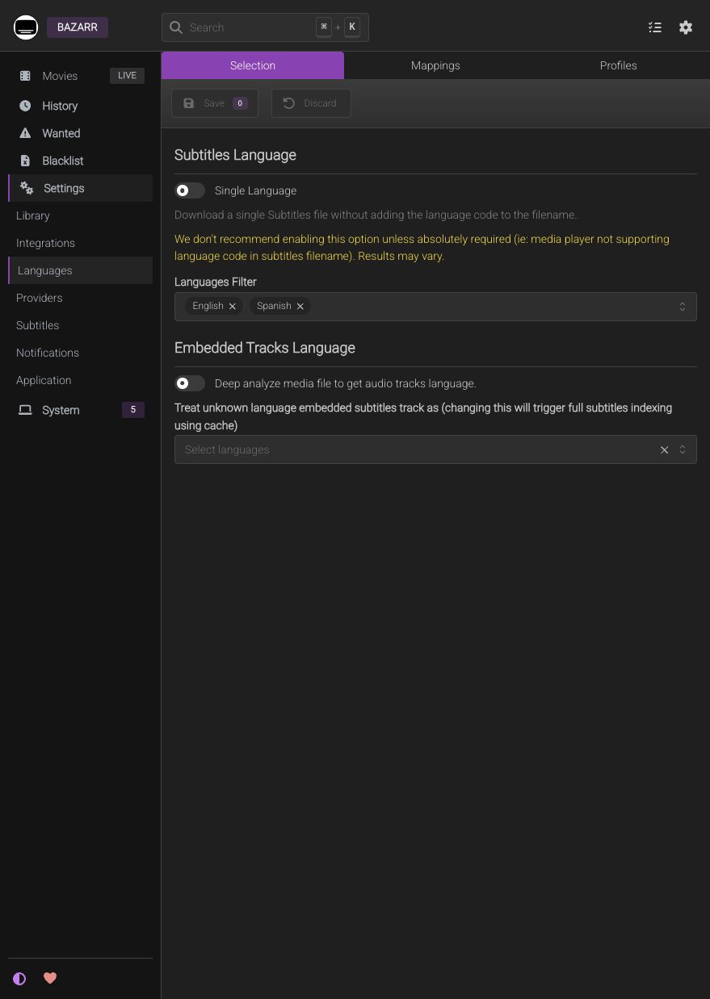
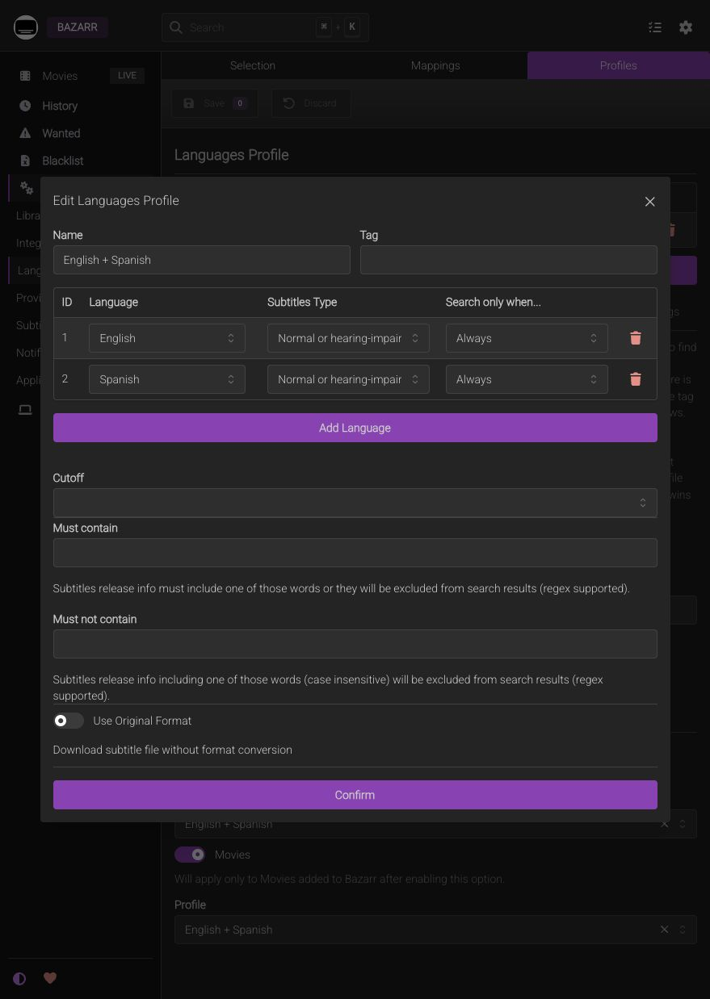
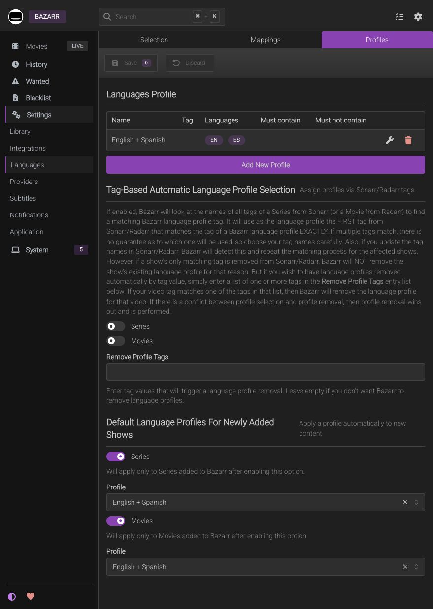
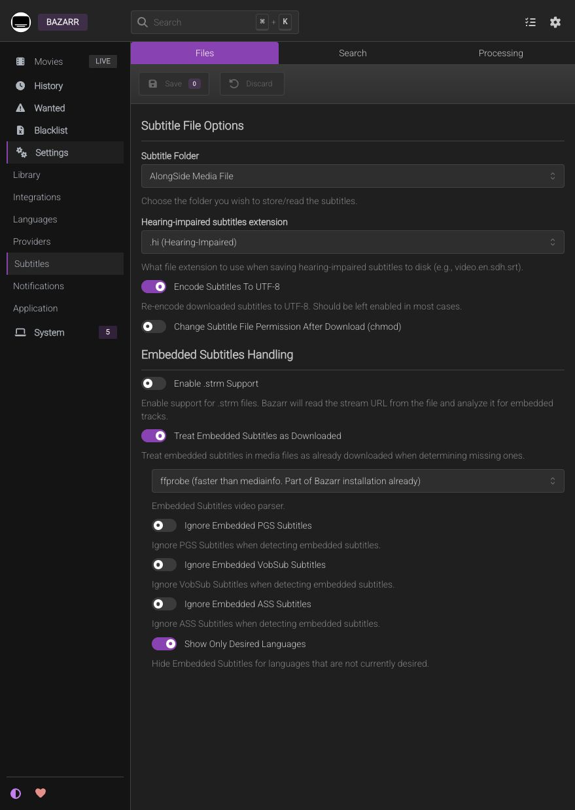
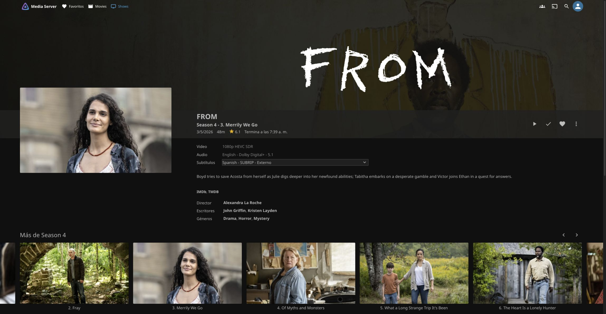
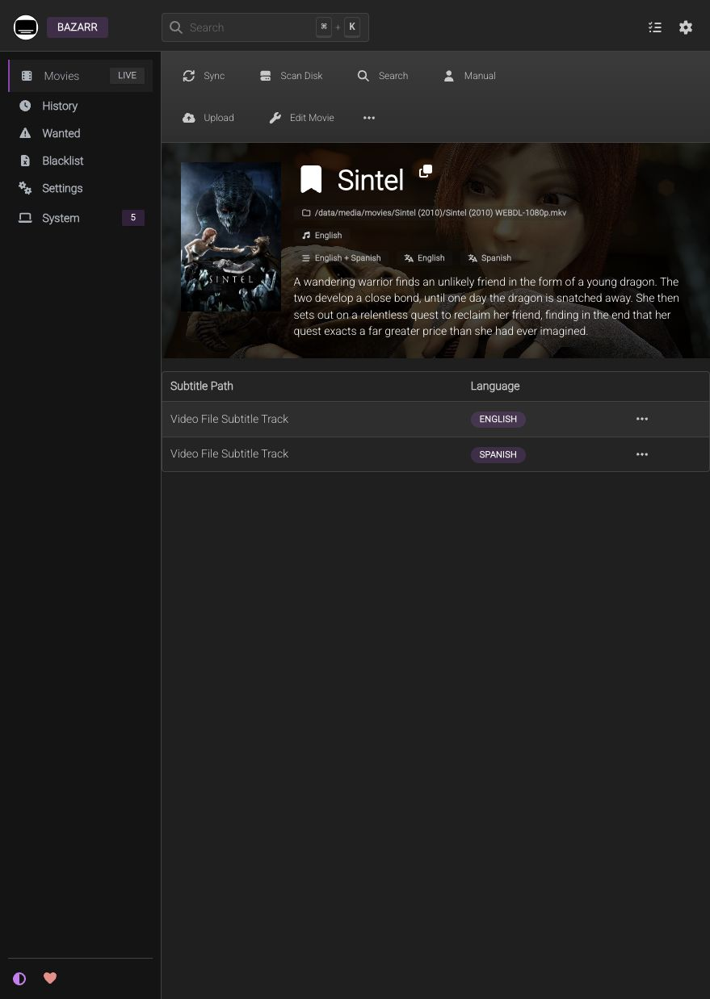

# Bazarr — English + Spanish Subtitles

## Scope and Verified State

**Comprobado:** Bazarr 1.6.2, Forms con usuario `bazarr-admin`, Radarr/Sonarr, perfil English + Spanish y reconocimiento de pistas existentes. OpenSubtitles.com descargó español externo conservando inglés integrado; Jellyfin incorporó una segunda descarga **sin escaneo manual**, mediante el aviso nativo. El propietario confirmó reproducción correcta de la primera prueba. Búsquedas automáticas activas; disponibilidad, cuotas y sincronización de cada edición siguen dependiendo del proveedor.

Jellyfin permite elegir pistas integradas o archivos externos. Bazarr añade inventario y búsqueda de faltantes; **no reemplaza a Jellyfin ni busca películas o torrents**. Obtiene películas de Radarr y series de Sonarr. Ver una carpeta en Jellyfin no significa que ya esté registrada en esos gestores.

## First Deployment

Ejecutar sólo dentro de la VM Debian `media-server`, con privilegios root, almacenamiento previamente preparado y la [guarda de montaje](storage-guide.md) instalada. No ejecutar en el Mac, Proxmox o DSM. No repetir sobre una instalación existente.

1. Copiar `scripts/deploy-bazarr.py`, `compose/bazarr/compose.yaml` y una copia privada de `.env.example` al directorio de preparación root de la VM. Mantener allí los archivos de entrada; no usar el repo como appdata.
2. En el `.env` privado, establecer `BAZARR_BIND_ADDRESS` a la IPv4 LAN asignada y conservar el digest de [image-lock.json](../compose/bazarr/image-lock.json). No usar `latest` ni `0.0.0.0`.
3. Descargar únicamente la imagen revisada y ejecutar el instalador. Ejemplo desde el directorio de preparación en Debian:

```sh
sudo docker pull lscr.io/linuxserver/bazarr@sha256:e3313a245b92d7c055e2a8e370b54bc1aeb4b3b4c36420ce18809a6e87c687b2
sudo python3 deploy-bazarr.py --apply \
  --compose-file bazarr-compose.yaml --env-file bazarr.env \
  --username bazarr-admin
```

El prompt privado pide una contraseña inicial única de al menos 20 caracteres. El instalador también admite `--password-stdin` para un pipe privado, **nunca una contraseña como argumento**. En la instalación comprobada, la orquestación privada generó una credencial inicial aleatoria y la pasó por stdin; el propietario inició sesión y establece su clave definitiva en **Settings → Application → General → Security**. No publicar claves ni capturas de esa sección: también contiene la API key.

El script Python valida Debian/hostname, guardas, imagen/plataforma exactas, LAN, ausencia de estado previo y montajes. Prepara Forms **antes de publicar la WebUI**, inicia únicamente `media-bazarr`, comprueba versión/API y crea/elimina probes ocultos únicos bajo la identidad de la aplicación. No es un daemon ni un cron y no cambia discos, cuentas de otros servicios o medios existentes. Si encuentra estado previo o falla, detenerse y revisar; no borrar appdata para repetirlo.

| Contrato | Valor |
| --- | --- |
| Imagen | LinuxServer `v1.6.2-ls368`, digest fijado, `linux/amd64` |
| WebUI | `http://<VM_LAN_IP>:6767`, sólo IPv4 privada asignada |
| Identidad | PUID1000, PGID2000, UMASK002 |
| Config/DB | `/srv/media-server/appdata/bazarr:/config`, NVMe |
| Biblioteca | `/data/media:/data/media` RW; sin downloads, socket Docker ni dispositivos |
| Protección | Forms, `no-new-privileges`, sin actualizaciones automáticas |
| Carga inicial | Un job concurrente; proveedores, upgrades y autosync desactivados |

Bazarr necesita escribir archivos de subtítulos junto al video; no necesita escribir en descargas. Jellyfin conserva `/data/media:/media:ro`. El instalador no cambia permisos recursivamente. El formato de hash de contraseña corresponde al mecanismo nativo de esta versión de Bazarr, no a una implementación de autenticación propia; mantenerlo fuera de Internet y proteger su configuración/backups.

## Library Connection

En **Settings → Library**, habilitar Radarr y configurar su IPv4 LAN, TCP7878, sin SSL en esta LAN y Base URL `/`. Introducir privadamente la API key de Radarr. No usar `localhost`: son proyectos Compose separados.

Las rutas de Radarr y Bazarr coinciden en `/data/media/movies`, por lo que **no hay Path Mappings**. La conexión API y SignalR quedó comprobada. Se conserva sincronización periódica cada 60 minutos más eventos; no requiere un cron externo. Sonarr también está conectado por IPv4 LAN, TCP8989, Base URL `/`, SSL OFF y su propia API key privada. Series/episodios sincronizados, perfil English + Spanish y pistas integradas indexadas; sin Path Mappings en `/data/media/tv`. Se conserva Only Monitored OFF y Sync Only Monitored Series/Episodes OFF: no es necesario activar adquisiciones en Sonarr para inventariar subtítulos de archivos existentes. No cambiar esas opciones sin revisar su alcance.

Para contenido copiado por [SMB](samba.md), registrar primero la colección **ya existente** en Radarr/Sonarr sin búsqueda ni redescarga. La receta de importación de esa colección y su detección externa en Bazarr son parte de la siguiente validación; no suponerlas por la reproducción correcta en Jellyfin.

## Language Policy

Valores guardados y leídos nuevamente por API, comprobados además en la interfaz. [Política declarativa](bazarr-profile-policy.json), sin secretos ni IDs del sitio; el `profileId` local debe resolverse por nombre si se automatiza en otra instalación.

### Selection

En **Settings → Languages → Selection**:

- Languages Filter: **English**, **Spanish**.
- Single Language: **OFF** para conservar sufijos `.en` y `.es`.
- No asignar globalmente un idioma a pistas `und`; corregir los casos ambiguos individualmente.



### Profile

En **Languages → Profiles**, perfil **English + Spanish**:

- English y Spanish, ambos **Normal or hearing-impaired**, no forced-only.
- Search only when: **Always** en ambos. El audio inglés no suprime los subtítulos ingleses.
- Cutoff vacío: encontrar un idioma no detiene la búsqueda del otro.
- Sin filtros Must contain/Must not contain ni tags adicionales.
- Predeterminado para películas y series nuevas; aplicado además al inventario de series existente. No asigna retroactivamente futuras colecciones copiadas: registrarlas y comprobar su perfil.





Si se automatiza contra la API 1.6.2, los items usan `audio_exclude` y `audio_only_include` con strings `"False"`, no las propiedades camelCase de los componentes frontend. Un perfil mal formado puede guardarse y después fallar al calcular faltantes. Leerlo nuevamente y probar **Scan Disk**, no sólo HTTP204 al guardar.

### Existing Subtitles

En **Settings → Subtitles → Files**:

- Subtitle Folder: **AlongSide Media File**.
- Treat Embedded Subtitles as Downloaded: **ON**; parser **ffprobe**.
- No ignorar globalmente PGS/VobSub/ASS; primero comprobar compatibilidad real del cliente.
- Encode Subtitles To UTF-8: **ON** para nuevas descargas.
- No aplicar chmod posterior ni extraer/reemplazar toda la colección.



Para archivos externos manuales, usar la misma carpeta y nombre base del video:

```text
Movie (2020)/
  Movie (2020).mkv
  Movie (2020).en.srt
  Movie (2020).es.srt
```

Jellyfin los presenta como externos y permite elegirlos; esa etiqueta describe su ubicación, no una menor capacidad. Mantener el idioma explícito y comprobar codificación, permisos y edición del video. El nombre no garantiza sincronización. [Convenciones oficiales de Jellyfin](https://jellyfin.org/docs/general/server/media/movies/).

### Manual Sidecars

Para SRT obtenidos por otra vía y copiados por SMB:

1. Usar la **carpeta de biblioteca que contiene el video**, no la carpeta del torrent. Copiar el nombre base **completo y actual** del MKV, incluidos espacios/calidad, y sustituir la extensión por `.es.srt` o `.en.srt`. No basta estar junto al video ni compartir sólo `S01E01`: Sonarr puede haber cambiado el nombre original de la descarga.

   ```text
   Series - S01E01 - Title WEBRip-1080p.mkv
   Series - S01E01 - Title WEBRip-1080p.es.srt
   Series - S01E01 - Title WEBRip-1080p.en.srt
   ```

2. Si hay dos versiones, conservar una con el nombre canónico `.es.srt` y otra como `.variant-b.es.srt`, sin sobrescribir. Jellyfin permite distinguir esa alternativa; **Bazarr 1.6.2 reconoció la canónica, no las variantes con etiqueta arbitraria** en la prueba realizada. No usar `forced` o `hi` sólo para diferenciar versiones: tienen otro significado. El orden no indica cuál sincroniza mejor.
3. Se comprobó incorporación de un SRT renombrado en Jellyfin sin enviar un refresco manual. El monitor puede demorarse; recargar la ficha o reabrir el reproductor si conserva las pistas anteriores. No modificar el MKV ni volver a descargarlo para asociar un SRT. Un archivo local no consume cuota del proveedor.
4. **Bazarr no inventaría inmediatamente cada archivo pegado por SMB.** Su indexado de disco está en **Daily, 4:00**, distinto de la búsqueda de faltantes cada 6 horas. Para que reconozca la tanda ahora y no siga considerándola ausente, abrir la serie en Bazarr y pulsar **Scan Disk**, no Search. La prueba dirigida reconoció los SRT manuales y conservó EN integrado, sin descargar ni reemplazar archivos.

El aviso Immediate a Jellyfin se dispara desde las operaciones de subtítulos de Bazarr; no equivale a vigilar cualquier copia SMB. La detección, el idioma y la sincronización audiovisual son comprobaciones distintas. [Nombres y etiquetas oficiales para series](https://jellyfin.org/docs/general/server/media/shows/#external-subtitles-and-audio-tracks).



## Provider and Automatic Searches

Después de comprobar el inventario y asignar el perfil bilingüe:

1. Crear y verificar una cuenta en **OpenSubtitles.com**, no asumir que una cuenta `.org` sirve. En **Settings → Providers → Subtitles**, añadir **OpenSubtitles.com**. Introducir privadamente **username**, no correo, y contraseña: el frontend de Bazarr rechaza email aunque la web lo acepte para iniciar sesión. No hace falta crear una API key propia del proveedor para esta integración.
2. **Use Hash ON**, traducciones AI y machine-translated **OFF**. Conservar validación HTTPS; no habilitar solucionadores de CAPTCHA ni comprar servicios para esta receta.
3. Para la primera prueba, poner **Application → Scheduler → Search for Missing Series/Movies Subtitles: Manually**. Solicitar sólo un idioma ausente de un episodio, no Search de toda la serie. Comprobar `.es.srt`, inglés conservado y faltantes recalculados. `Providers: Good` sólo significa que no está temporalmente bloqueado; una descarga real verifica el acceso.
4. Tras validar reproducción y el aviso descrito debajo, dejar el proveedor habilitado y ambas búsquedas en **6 Hours**. Conservar un job concurrente, eventos Sonarr/Radarr activos y **Defer searching… until scheduled task execution OFF**. El inventario se sincroniza cada hora y por eventos; no añadir cron ni una automatización del agente.
5. En **System → Tasks**, ejecutar una vez **Search for Missing Series Subtitles** y **Search for Missing Movies Subtitles** para iniciar el inventario pendiente. Las siguientes ejecuciones son autónomas; no volver a pulsar Search repetidamente.

Mantener **Treat Embedded Subtitles as Downloaded ON**, upgrades **OFF** y autosync **OFF**. Autosync se refiere a retocar tiempos, **no** a descargar automáticamente. Una pista identificada como EN/ES evita buscar ese idioma; `und` no demuestra que falte físicamente. Revisar el idioma de esos casos sin asignarlo globalmente ni editar un MKV hardlinkeado.

La búsqueda automática no garantiza encontrar todos los archivos ni descargarlos en una sola pasada. Bazarr respeta el bloqueo temporal del proveedor y vuelve a intentarlo en sus tareas. Ante cuota o rate limit, esperar el `Retry` de **System → Providers**, no resetearlo para forzar solicitudes. **Wanted** muestra los idiomas todavía ausentes. El contenido visto sólo en Jellyfin pero no registrado en Radarr/Sonarr queda fuera de este inventario.

## Automatic Jellyfin Refresh

El monitor que detecta episodios nuevos no sustituye esta conexión: en la primera prueba el nuevo SRT necesitó una relectura del episodio. Para evitar escaneos manuales:

1. Como administrador de Jellyfin, **Dashboard → API Keys → New API Key**, nombre **Bazarr**. Reutilizar la existente al continuar una instalación, no crear duplicados. Estas claves conceden acceso amplio: requieren autorización del propietario y almacenamiento privado.
2. En Bazarr, **Settings → Integrations → Jellyfin**, habilitar y establecer `http://<VM_LAN_IP>:8096` con esa key. **Test** debe devolver servidor y versión; guardar. No usar `localhost` entre proyectos Compose separados.
3. Seleccionar **Movies** como Movie Library y **Shows** como Series Library, por sus tipos `movies`/`tvshows`. Habilitar ambos **Refresh … metadata after downloading subtitles** y elegir **Immediate**. Leer nuevamente la configuración guardada. No requiere Path Mappings: Bazarr resuelve el elemento mediante metadatos; el SRT comparte nombre y carpeta con el video.
4. Probar **otro episodio** sin español que aún no se haya refrescado: descargar sólo ES desde Bazarr y abrir/recargar su ficha Jellyfin. Deben aparecer EN integrado y Spanish/SUBRIP externo **sin** pulsar Scan/Refresh. Esta prueba independiente quedó comprobada; probar sólo el botón Test no valida el flujo.

**Immediate** relee el elemento sin reemplazar todos sus metadatos/imágenes. Si no lo resuelve, la implementación puede recurrir al refresco de biblioteca: revisar IDs y bibliotecas antes de ampliar escaneos. No publicar la API key, contraseñas, configuración completa ni capturas de las páginas de secretos. Los valores permanecen en appdata; las plantillas del repo no los contienen.

## Validation and Remaining Scope

La prueba inicial **Scan Disk** reconoció EN/ES integrados sin escribir archivos. Después se validó descargar únicamente ES de episodios con EN integrado: SRT junto al video, inglés conservado, ningún video modificado ni servicio reiniciado. Un segundo caso apareció automáticamente en Jellyfin por la integración anterior. Las capturas con inventario personal permanecen privadas, no en esta guía.



La captura usa [Sintel, Blender Foundation, CC BY3.0](https://durian.blender.org/sharing/) como ejemplo técnico, no como inventario de biblioteca. Los logs iniciales pueden conservar errores ya corregidos; comprobar **System → Health** y repetir la operación, no deducir el estado actual de un contador histórico.

También quedó comprobado el reconocimiento de SRT manuales en series ya gestionadas, tras corregir nombres y ejecutar Scan Disk dirigido. **Registrar la colección copiada por SMB en Radarr/Sonarr sigue pendiente**: es un paso distinto de añadir SRT a una serie registrada. La configuración de aviso para películas está guardada y conectada; su aceptación con una descarga real de película queda pendiente, mientras que el caso de episodio sí está probado. No se considera resuelta una pista defectuosa por detectarla como existente: un desfase constante y uno progresivo requieren diagnóstico distinto. Los [pendientes técnicos](../TODO.md) mantienen estos límites sin tareas por título.

## Operations

```sh
# Dentro de Debian; la salida de logs/config puede contener secretos.
sudo /usr/local/sbin/check-media-storage
sudo docker compose --project-directory /srv/media-server/compose/bazarr ps
```

Para detener sólo Bazarr: `sudo docker compose --project-directory /srv/media-server/compose/bazarr stop`. No borrar appdata ni usar `down -v` como diagnóstico. Los subtítulos ya presentes seguirán disponibles para Jellyfin. Respaldar config/DB junto a los demás servicios; una restauración independiente aún no está probada.

Fuentes primarias: [LinuxServer](https://docs.linuxserver.io/images/docker-bazarr/), [release 1.6.2](https://github.com/morpheus65535/bazarr/releases/tag/v1.6.2), [idiomas](https://wiki.bazarr.media/Additional-Configuration/Settings/Languages/), [subtítulos](https://wiki.bazarr.media/Additional-Configuration/Settings/Subtitles/), [biblioteca](https://wiki.bazarr.media/Additional-Configuration/Settings/Library/), [proveedores](https://wiki.bazarr.media/Additional-Configuration/Settings/Providers/), [integración Jellyfin](https://wiki.bazarr.media/Additional-Configuration/Jellyfin/).
