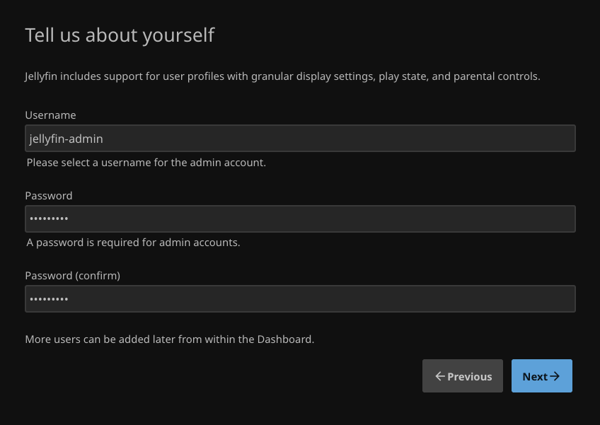

# Jellyfin Service Guide

**Status:** Setup complete and LAN HTTP verified; playback pending · **Updated:** 2026-10-16.

## Verified Deployment

`deploy-jellyfin.py` completed successfully on 2026-10-16. `docker compose config` and `up -d --wait` passed; one Jellyfin container is healthy. Version `12.2.0`, official image digest in [image lock](../compose/jellyfin/image-lock.json), linux/amd64. HTTP200 from the Mac on `/health`, `/System/Info/Public` and `/web/index.html`; startup wizard was subsequently completed and verified through the public API.

Container UID1000:GID2000 can read both library folders and cannot write to the `/media` bind mount. Appdata is on the OS/NVMe filesystem, not `/data`. Existing storage guard and base services passed again with zero failed units; DSM configuration hash and process identity were unchanged before/after. No VM restart or access/credential change was performed.

## Deployment Boundary

Run only inside the existing Debian media VM, not on Proxmox or the administration Mac. This module creates no VM, formats no disk and changes no administrative access. It uses the existing `/data` UUID guard before starting.

The reviewed manifest requires an official image pinned by version and digest, plus the private VM LAN address. Complete a private copy of `.env.example` after image inspection. Copy the manifest, environment and [deployment script](../scripts/deploy-jellyfin.py) to the guest. That script requires explicit `--apply` and rejects an existing stack; it is for first deployment, not upgrades. **The current VM is already deployed: do not rerun this installer.**

```sh
python3 /root/media-server-scripts/deploy-jellyfin.py --apply \
  --compose-file /root/media-server-scripts/jellyfin-compose.yaml \
  --env-file /root/media-server-scripts/jellyfin.env
```

Runtime manifests belong in `/srv/media-server/compose/jellyfin/`. Config/cache use `/srv/media-server/appdata/jellyfin/`; only those new app directories receive UID1000/GID2000 ownership. No recursive permission changes to the HDD.

## Client Setup and Acceptance

Open the VM's HTTP8096 address from a computer/tablet on the LAN. Complete Jellyfin's own setup wizard directly in the browser; no account secrets belong in chat or the repository.

### Wizard Example Values

El usuario pidió que los ejemplos de la guía coincidan con los valores que usaremos realmente, no con placeholders. Para estas pantallas:

| Field | Example / installation value | Status |
| --- | --- | --- |
| Preferred display language | `English` | Elegido por el usuario |
| Server name | `Media Server` | Confirmado posteriormente por la API pública |
| Username | `jellyfin-admin` | Elegido/completado y confirmado en captura; usuario ya avanzó al paso de bibliotecas |
| Password | Elegida por el usuario directamente en Jellyfin | No se documenta su valor |
| Password (confirm) | Repetir la contraseña elegida en la interfaz | No se documenta su valor |

En **Tell us about yourself**, el username corresponde a la cuenta administradora inicial de Jellyfin. Completar los tres campos y pulsar **Next**; no marcar el asistente como terminado por avanzar una pantalla. El idioma de pantalla no define todavía idiomas de audio, subtítulos o metadatos.

### Initial Administrator Screenshot

Captura aportada por el usuario: `jellyfin-admin` es el nombre usado en esta instalación y el ejemplo de la guía. Los campos de contraseña aparecen enmascarados por Jellyfin; su valor no se documenta. La imagen muestra el formulario completado **antes de pulsar Next**, no el asistente finalizado.



### Add Media Libraries

El usuario llegó a **Add Media Library**. Crear primero la biblioteca de series, sin mezclar películas en ella. Valores de Shows confirmados en el formulario final; Movies corresponde al siguiente paso. El listado posterior del asistente confirma ambas entradas:

| Field | TV library | Movie library, later |
| --- | --- | --- |
| Content type | `Shows`, confirmado en la interfaz | `Movies` |
| Display name | `Shows`, como aparece en la captura del usuario | `Movies` |
| Folders | `/media/tv` | `/media/movies` |

En **Folders**, pulsar **+**, introducir o seleccionar `/media/tv` y confirmar la carpeta. Es la ruta **dentro del contenedor**: el bind mount convierte `/data/media` del huésped en `/media` para Jellyfin. No usar `/data/downloads` como biblioteca ni crear una segunda copia del contenido.

Primero completar estos tres campos; revisar las opciones adicionales que muestre el tipo de biblioteca antes de guardar, sin asumir preferencias de idioma de metadatos/audio/subtítulos a partir de English en la interfaz.

### Language Preferences and Reviewed Library Options

El usuario confirmó **audio original → inglés si no hay original** y **subtítulos español e inglés disponibles para elegir**, no simultáneos. Conservar estas preferencias para reproducción, fuentes/versiones y gestor de subtítulos; no confundirlas con idioma de metadatos.

En la captura actual, **Content type = Shows** es correcto. `TV Shows` fue un nombre visible sugerido, no otra opción de tipo que deba buscarse. La captura final ya muestra `/media/tv` agregada correctamente.

### Verified Shows Configuration

**Referencia principal para volver a configurar esta biblioteca:** usar la captura final aprobada y los valores de esta tabla. Corresponden a Jellyfin12.2, con `/media` montado en sólo lectura. La imagen muestra el formulario correcto antes de pulsar **OK**; no demuestra por sí sola reproducción ni fin del asistente.

| Setting | Verified form value | Reason |
| --- | --- | --- |
| Content type / Display name | `Shows` / `Shows` | Biblioteca de series |
| Folders | `/media/tv` | Ruta vista desde Jellyfin |
| Preferred download language | `English` | Idioma de títulos/sinopsis/metadatos; no elige audio ni descarga las dos pistas de subtítulos |
| Country/Region | `Argentina` | Región de metadatos, no un filtro del idioma original |
| Enable the library | On | Hacer visible la biblioteca |
| Enable real time monitoring | On | Detectar cambios de archivos |
| Special season display name | `Specials` | Conservar valor actual |
| Prefer embedded titles / episode information | Off | Conservar valores actuales |
| Disable different types of embedded subtitles | `Allow All` | No bloquear tipos de subtítulos ya incluidos |
| Metadata downloaders — TV Shows / Episodes | TheMovieDb y The Open Movie Database activados, en ese orden | Metadatos de series/episodios |
| Metadata downloaders — Seasons | TheMovieDb activado | Metadatos de temporadas |
| Image fetchers — TV Shows / Seasons | TheMovieDb activado | Carátulas de series/temporadas |
| Image fetchers — Episodes | TheMovieDb, The Open Movie Database, Embedded Image Extractor y Screen Grabber activados, en ese orden | Imágenes de episodios |
| Similar item providers | TheMovieDb desactivado; Local Genre/Tag activado | Conservar selección de la captura |
| Automatically refresh metadata from the internet | `Never` | Conservar valor actual; no añadir actualizaciones completas periódicas |
| Metadata savers → Nfo | Off | No escribir archivos NFO en el montaje RO |
| Save artwork into media folders | Off | Carátulas/metadatos fuera de la biblioteca RO |
| Automatically merge series across multiple folders | Off | Conservar valor actual, una raíz de series |
| Trickplay: las tres casillas | Off | Posponer extracción y almacenamiento de vistas previas |
| Chapter Images: ambas casillas | Off | Evitar trabajo intensivo adicional en la validación inicial |
| Save subtitles into media folders | **Off: desmarcar** | Jellyfin no debe intentar escribir en `/media`, montado RO |


**Última revisión visual antes de guardar: aprobada.** La nueva captura confirma `Shows`, `/media/tv`, `English` para metadatos y `Argentina`; **Save subtitles into media folders está desmarcado**. NFO/artwork/trickplay/chapter images permanecen desactivados y el resto visible coincide con lo indicado. No se observan otros cambios pendientes en esta pantalla: pulsar **OK**. El listado posterior confirmó el guardado y la API pública confirmó después el fin del asistente; la reproducción aún no se probó.

Desmarcar el último ajuste no bloquea leer subtítulos incluidos en el video ni archivos externos ya presentes. La adquisición de español/inglés se configurará en la etapa del gestor de subtítulos; no se instaló ningún proveedor nuevo ni se habilitó escritura de Jellyfin en el HDD.

- TV shows library: `/media/tv` inside the container.
- Movies library: `/media/movies` inside the container.
- Keep automatic port mapping disabled; this milestone is local playback only.
- Initially test direct playback of one authorized episode and movie. Record client, container format/codecs and whether playback is direct/remux/transcoded. Do not equate a healthy HTTP endpoint with successful playback.
- The HDD library is currently empty. Installing Jellyfin does not acquire episodes; acquisition/import automation is the next separate milestone.

### Verified Movies Configuration

**Referencia principal para volver a configurar películas:** captura final revisada y aprobada, antes de pulsar **OK**. Los valores visibles son correctos para esta instalación; no se observa otro cambio pendiente en el formulario.

| Setting | Verified form value |
| --- | --- |
| Content type / Display name | `Movies` / `Movies` |
| Folders | `/media/movies` |
| Enable the library / Enable real time monitoring | On / On |
| Preferred download language / Country/Region | `English` / `Argentina` |
| Prefer embedded titles over filenames | Off |
| Disable different types of embedded subtitles | `Allow All` |
| Automatically add to collection | Off; opción organizativa no necesaria para esta validación |
| Metadata downloaders — Movies | TheMovieDb y The Open Movie Database activados, en ese orden |
| Automatically refresh metadata from the internet | `Never` |
| Metadata savers — Nfo | Off |
| Image fetchers — Movies | TheMovieDb, The Open Movie Database, Embedded Image Extractor y Screen Grabber activados, en ese orden |
| Similar item providers | TheMovieDb desactivado; Local Genre/Tag activado |
| Save artwork into media folders | Off |
| Trickplay: las tres casillas | Off |
| Chapter Images: ambas casillas | Off |
| Save subtitles into media folders | Off, coherente con `/media` de sólo lectura |


**Siguiente acción del usuario:** pulsar **OK** para guardar Movies. Al volver al listado, comprobar que aparezcan **Shows** y **Movies** antes de continuar el asistente. La captura de este formulario no confirma por sí sola el guardado ni la reproducción.

### Configured Libraries Overview

El listado del asistente ya confirma que ambas bibliotecas fueron agregadas:

| Library | Container folder |
| --- | --- |
| `Movies` | `/media/movies` |
| `Shows` | `/media/tv` |


Con ambas entradas correctas, pulsar **Next**. Este listado confirma el alta en el asistente, no que haya contenido, reproducción comprobada o que el asistente ya haya terminado.

### Global Metadata Defaults

En **Preferred Metadata Language**, usar los mismos valores que elegimos para ambas bibliotecas:

| Field | Value |
| --- | --- |
| Language | `English` |
| Country/Region | `Argentina` |

**Captura revisada y aprobada:** `English` y `Argentina` ya están seleccionados correctamente. Usar esta imagen como referencia para repetir la configuración y pulsar **Next** para continuar. Estos son valores globales predeterminados para metadatos (títulos, sinopsis y región); se pueden personalizar por biblioteca. No configuran el idioma del audio ni los subtítulos. La captura confirma los campos antes de avanzar, no el fin del asistente.


### Remote Access Scope

**Elección confirmada del usuario:** dejar **marcada** `Allow remote connections to this server`, pulsar **Next** y finalizar el asistente. No desmarcarla siguiendo la recomendación inicial descartada.


Esta opción permite conexiones que Jellyfin clasifica como externas, sujetas a los permisos y autenticación. **No abre puertos del router ni publica automáticamente el servidor en Internet.** No configuramos WAN, VPN ni proxy; el puerto Docker sigue ligado a la IP privada de la VM. La LAN funciona con ambas posiciones bajo la clasificación local actual. Si después se cambian redes locales o proxies, revisar su clasificación.

Referencias: [Networking — Allowing Access](https://jellyfin.org/docs/general/post-install/networking/#allowing-access), [NetworkManager12.2 — InitializeLan](https://github.com/jellyfin/jellyfin/blob/v12.2/src/Jellyfin.Networking/Manager/NetworkManager.cs#L290-L310) y [controlador del asistente12.2](https://github.com/jellyfin/jellyfin/blob/v12.2/Jellyfin.Api/Controllers/StartupController.cs#L80-L95).

### Setup Completion

El usuario terminó el asistente y llegó a Home. La comprobación pública posterior confirmó **StartupWizardCompleted = true**, nombre **Media Server**, versión **12.2.0** y HTTP200 en health/API/web. Shows y Movies aparecen en el listado del asistente con sus rutas correctas.

**Pendiente:** prueba real de reproducción, no la configuración inicial. El usuario eligió continuar primero con qBittorrent en lugar de aportar un archivo manual de prueba; se probará el primer contenido autorizado cuando esté disponible. No reinstalar ni repetir el asistente.

## Operations

Inside Debian, with normal administrative privileges, run Compose from `/srv/media-server/compose/jellyfin/`: `docker compose ps`, `docker compose logs --tail=100` and `docker compose stop`. The image provides `/health`; verify HTTP and public server version from another LAN device too. A container restart is not a full VM-reboot/missing-disk acceptance test.

Before upgrading, stop only Jellyfin and take a consistent independent copy of its configuration directory, manifest and private environment. Cache is expendable; the HDD media requires its own backup policy. Choose and inspect a new explicit image digest manually, then recreate only this service. To roll back a migration, restore the matching stopped configuration backup and old image together; merely changing the image may not undo a database migration. Backup/restore has not yet been tested.

## Sources

- [Official container guide](https://jellyfin.org/docs/general/installation/container/).
- [Selected release 12.2](https://github.com/jellyfin/jellyfin/releases/tag/v12.2).
- [Official setup wizard](https://jellyfin.org/docs/general/post-install/setup-wizard/).
- [Compose services](https://docs.docker.com/reference/compose-file/services/).
- [Jellyfin12.2 library options model](https://github.com/jellyfin/jellyfin/blob/v12.2/MediaBrowser.Model/Configuration/LibraryOptions.cs) — metadatos y subtítulos son opciones separadas.
- [Chapter images](https://jellyfin.org/docs/general/server/metadata/chapter-images/) — extracción opcional y coste de escaneo.
