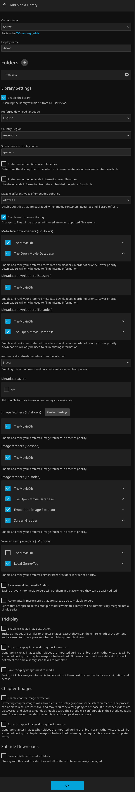
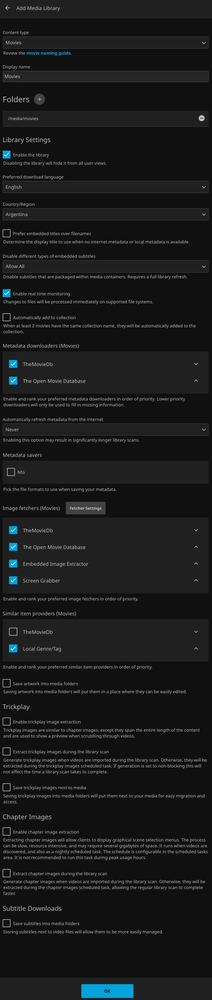
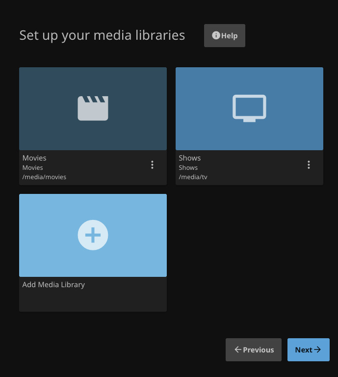
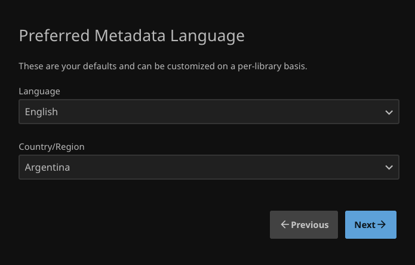
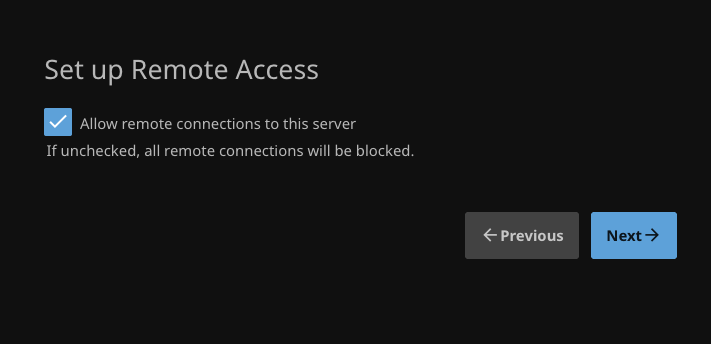

# Jellyfin Service Guide

Jellyfin12.2.0 está desplegado con imagen oficial fijada por digest. Se comprobaron bibliotecas, lectura RO, reproducción LAN desde tablet y selección de subtítulos incluidos. La detección automática de un nuevo episodio se comprobó después de inicializar las raíces de biblioteca; no implica aparición instantánea.

## Deployment

[Compose](../compose/jellyfin/compose.yaml) · [Image lock](../compose/jellyfin/image-lock.json) · [Environment template](../compose/jellyfin/.env.example) · [Script](../scripts/deploy-jellyfin.py).

Ejecutar sólo como root dentro de la VM Debian existente, con Docker/Compose y almacenamiento ya preparados. El script exige guarda UUID/ext4/RW, imagen inspeccionada, IPv4 privada asignada y ausencia de stack/appdata; no sirve para actualizar ni reparar una instalación existente.

1. Copiar el script como `/root/media-server-scripts/deploy-jellyfin.py`, el manifiesto como `jellyfin-compose.yaml` y una copia privada del entorno como `jellyfin.env` (modo0600).
2. Completar `JELLYFIN_BIND_ADDRESS` con la IP LAN de Debian y conservar `JELLYFIN_IMAGE` del lock. Obtener e inspeccionar esa imagen, sin sustituirla por un tag mutable.
3. Ejecutar:

```sh
python3 /root/media-server-scripts/deploy-jellyfin.py --apply \
  --compose-file /root/media-server-scripts/jellyfin-compose.yaml \
  --env-file /root/media-server-scripts/jellyfin.env
```

| Recurso | Configuración |
| --- | --- |
| Runtime | `/srv/media-server/compose/jellyfin/` |
| Config/cache NVMe | `/srv/media-server/appdata/jellyfin/` |
| Biblioteca | `/data/media` → `/media`, **RO** |
| Identidad | UID1000:GID2000 |
| Web | TCP8096 en la IPv4 LAN |

No aplicar cambios recursivos de permisos al HDD. El instalador no crea cuentas, adquiere videos ni modifica DSM.

## Configure the Wizard

1. Abrir `http://<IP_DE_LA_VM>:8096`.
2. Elegir interfaz **English**, nombre **Media Server** y crear la cuenta administradora con una contraseña propia. El idioma de interfaz no elige audio/subtítulos.
3. Crear Shows y Movies con las tablas siguientes. Son rutas del contenedor, no de descargas.
4. Elegir metadatos **English**, región **Argentina** y finalizar el asistente.

### Shows

| Setting | Verified form value | Reason |
| --- | --- | --- |
| Content type / Display name | `Shows` / `Shows` | Biblioteca de series |
| Folders | `/media/tv` | Ruta vista desde Jellyfin |
| Preferred download language | `English` | Idioma de títulos/sinopsis/metadatos; no elige audio ni descarga las dos pistas de subtítulos |
| Country/Region | `Argentina` | Región de metadatos, no un filtro del idioma original |
| Enable the library | On | Hacer visible la biblioteca |
| Enable real time monitoring | On | Detectar cambios de archivos |
| Special season display name | `Specials` | Conservar valor actual |
| Prefer embedded titles / episode information | Off | Conservar valores actuales |
| Disable different types of embedded subtitles | `Allow All` | No bloquear tipos de subtítulos ya incluidos |
| Metadata downloaders — TV Shows / Episodes | TheMovieDb y The Open Movie Database activados, en ese orden | Metadatos de series/episodios |
| Metadata downloaders — Seasons | TheMovieDb activado | Metadatos de temporadas |
| Image fetchers — TV Shows / Seasons | TheMovieDb activado | Carátulas de series/temporadas |
| Image fetchers — Episodes | TheMovieDb, The Open Movie Database, Embedded Image Extractor y Screen Grabber activados, en ese orden | Imágenes de episodios |
| Similar item providers | TheMovieDb desactivado; Local Genre/Tag activado | Conservar selección de la captura |
| Automatically refresh metadata from the internet | `Never` | Conservar valor actual; no añadir actualizaciones completas periódicas |
| Metadata savers → Nfo | Off | No escribir archivos NFO en el montaje RO |
| Save artwork into media folders | Off | Carátulas/metadatos fuera de la biblioteca RO |
| Automatically merge series across multiple folders | Off | Conservar valor actual, una raíz de series |
| Trickplay: las tres casillas | Off | Posponer extracción y almacenamiento de vistas previas |
| Chapter Images: ambas casillas | Off | Evitar trabajo intensivo adicional en la validación inicial |
| Save subtitles into media folders | **Off: desmarcar** | Jellyfin no debe intentar escribir en `/media`, montado RO |



### Movies

| Setting | Verified form value |
| --- | --- |
| Content type / Display name | `Movies` / `Movies` |
| Folders | `/media/movies` |
| Enable the library / Enable real time monitoring | On / On |
| Preferred download language / Country/Region | `English` / `Argentina` |
| Prefer embedded titles over filenames | Off |
| Disable different types of embedded subtitles | `Allow All` |
| Automatically add to collection | Off; opción organizativa no necesaria para esta validación |
| Metadata downloaders — Movies | TheMovieDb y The Open Movie Database activados, en ese orden |
| Automatically refresh metadata from the internet | `Never` |
| Metadata savers — Nfo | Off |
| Image fetchers — Movies | TheMovieDb, The Open Movie Database, Embedded Image Extractor y Screen Grabber activados, en ese orden |
| Similar item providers | TheMovieDb desactivado; Local Genre/Tag activado |
| Save artwork into media folders | Off |
| Trickplay: las tres casillas | Off |
| Chapter Images: ambas casillas | Off |
| Save subtitles into media folders | Off, coherente con `/media` de sólo lectura |







Guardar cada biblioteca y comprobar que ambas aparecen con su ruta correcta. **NFO, artwork, trickplay, chapter images y guardado de subtítulos en carpetas de medios permanecen desactivados**, coherentes con el montaje RO. Esto no impide leer pistas ya presentes.

### Remote Access Scope



El permiso de conexiones remotas está ON en esta configuración; no abre puertos del router ni publica el servicio en Internet. No se configuraron WAN, VPN ni proxy. Mantener port mapping automático desactivado.

## Discovery and Playback

- Movies usa `/media/movies`; Shows usa `/media/tv`. No añadir `/data/downloads` como biblioteca.
- El monitor en tiempo real está habilitado; `LibraryMonitorDelay=60s` no garantiza aparición exacta al minuto.
- Inicializar las bibliotecas con contenido mediante **Scan all libraries**. Una raíz vacía había sido omitida y no tenía watch pese a Realtime Monitor ON; escanear sólo Shows no bastó. Tras inicializarla se comprobó un episodio posterior sin escaneo manual. [Procedimiento y límites](validation.md#library-discovery).
- Las pistas integradas o externas compatibles pueden seleccionarse sin gestor adicional. [Bazarr](bazarr.md#automatic-jellyfin-refresh) busca EN/ES faltantes y avisa a Jellyfin; la incorporación de un SRT de episodio sin escaneo manual está comprobada. No confundirlo con sincronización garantizada para toda edición.
- Validar reproducción y selección de pistas desde el cliente; una respuesta HTTP saludable no sustituye esa prueba.

## Operations and Recovery

Dentro de Debian:

```sh
cd /srv/media-server/compose/jellyfin
docker compose ps
docker compose logs --tail=100
```

Antes de actualizar, detener sólo Jellyfin y obtener una copia privada consistente de configuración, manifiesto y entorno. Elegir una nueva imagen por digest; rollback puede requerir restaurar la base de datos compatible, no sólo cambiar la imagen. Cache es prescindible; contenido del HDD y configuración necesitan políticas de copia separadas. Restauración independiente aún no probada.

## Sources

- [Official container guide](https://jellyfin.org/docs/general/installation/container/).
- [Setup wizard](https://jellyfin.org/docs/general/post-install/setup-wizard/).
- [Networking](https://jellyfin.org/docs/general/post-install/networking/).
