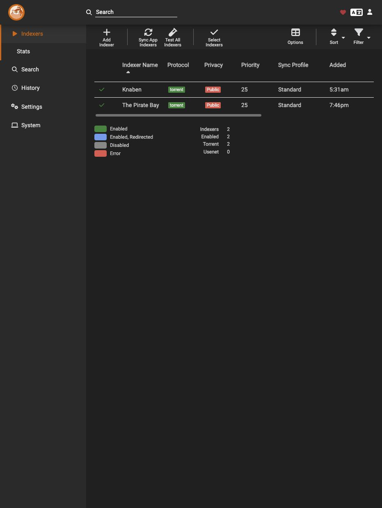
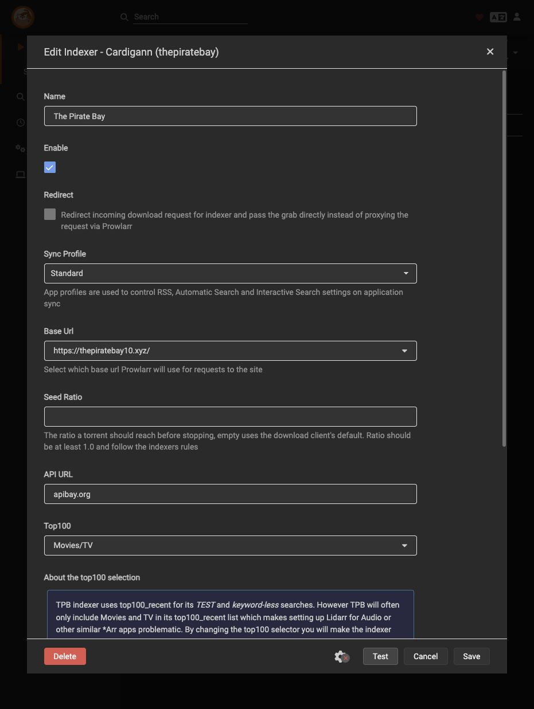
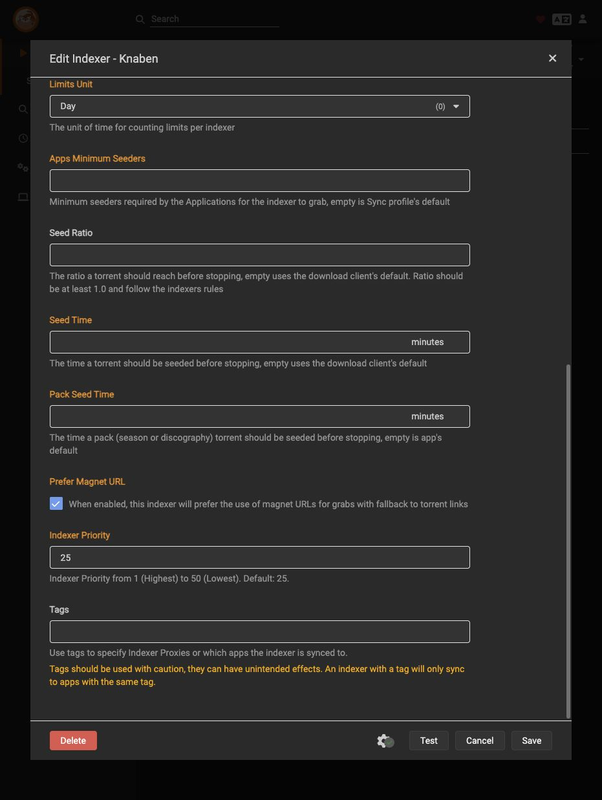
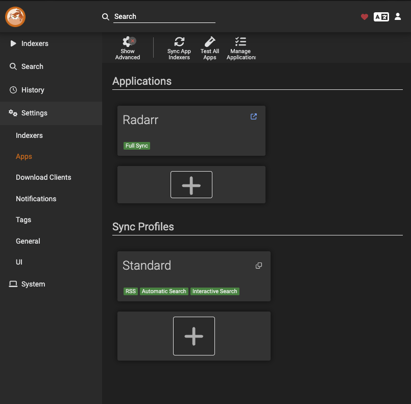

# Prowlarr Service Guide

Centraliza las fuentes consultadas por Radarr y Sonarr. No transfiere videos ni organiza la biblioteca. Las dos fuentes siguientes están guardadas/habilitadas y sincronizadas; su disponibilidad futura depende de los sitios.

## Version, Files and Prerequisites

- Prowlarr **2.6.5.5623**, stable; LinuxServer.io build **2.6.5.5623-ls163**, linux/amd64. Imagen de terceros mantenida por LinuxServer, no imagen oficial del proyecto.
- [Image lock](../compose/prowlarr/image-lock.json) registra release, build y digest inmutable. `latest` sólo se usó para descubrir/inspeccionar la imagen; el despliegue usa digest.
- [Compose](../compose/prowlarr/compose.yaml), [environment template](../compose/prowlarr/.env.example), [first-deployment script](../scripts/deploy-prowlarr.py).
- Requiere la VM Debian existente, Docker/Compose preparados, UID1000, mediaGID2000, guarda `/data` válida y TCP9696 libre. No repetir instalación base ni formato.

## Storage, Permissions and Network

| Element | Value |
| --- | --- |
| Runtime Compose | `/srv/media-server/compose/prowlarr/compose.yaml` y `.env` privado |
| NVMe persistent data | `/srv/media-server/appdata/prowlarr` → `/config` RW |
| Persistent contents | `config.xml`, bases de datos, ajustes, logs y backups internos; potencialmente secretos |
| Application identity | PUID1000, PGID2000, UMASK027; appdata1000:2000 modo750 |
| Initialization | s6 inicializa root; proceso Prowlarr baja al UID/GID indicados |
| HDD access | **Ninguno**: no recibe `/data`, downloads ni media |
| Web/API port | TCP9696 sólo en IPv4 privada asignada a la VM |
| Healthcheck | HTTP local `/ping`, sin imprimir clave API |
| Other access | Sin Docker socket, privileged, dispositivos, redes host ni puertos adicionales |
| Updates | Manuales por digest; mecanismo Docker, actualización interna automática OFF |

La guarda del HDD se mantiene como condición del motor Docker de esta VM aunque Prowlarr no monte contenido. No se cambia router, firewall, SSH, VPN, DSM ni cuentas de otros servicios.

## First Deployment Recipe

**Ejecutar como root dentro de Debian media-server**, nunca en la Mac ni en Proxmox.

1. Revisar manifiesto/lock. Completar una copia privada de `.env.example` con `PROWLARR_BIND_ADDRESS` (IP LAN real de la VM), conservando `PROWLARR_IMAGE` por digest.
2. Obtener e inspeccionar la imagen exacta:

```sh
docker pull lscr.io/linuxserver/prowlarr@sha256:f9151e5bc1025c6d0a630d503210cdcb6bb55a7cc098562609d96a408d838902
docker image inspect lscr.io/linuxserver/prowlarr@sha256:f9151e5bc1025c6d0a630d503210cdcb6bb55a7cc098562609d96a408d838902
```

3. Copiar script, Compose y entorno privados a `/root/media-server-scripts/`; el `.env` de sitio debe ser modo0600 y no publicarse.
4. Ejecutar **sólo para una instalación nueva sin stack ni appdata**:

```sh
python3 /root/media-server-scripts/deploy-prowlarr.py --apply \
  --compose-file /root/media-server-scripts/prowlarr-compose.yaml \
  --env-file /root/media-server-scripts/prowlarr.env
```

El script exige `--apply`, hostname/OS correctos, montaje válido, identidad/puerto/montaje mínimos e imagen inspeccionada. Crea sólo directorios de esta app, escribe configuración inicial, valida Compose y espera health; comprueba versión y cero indexadores/apps/clientes. Rechaza estado existente: **no es un script de actualización ni reparación**. Si falla después de crear estado, inspeccionarlo; no borrar bases de datos para reintentar.

## Authentication

Abrir `http://<IP_DE_LA_VM>:9696` y completar el alta nativa antes de agregar fuentes:

| Campo | Valor |
| --- | --- |
| Authentication Method | Forms (Login Page) |
| Authentication Required | Enabled, también en direcciones locales |
| Username / Password | Cuenta propia y contraseña elegida en la UI |
| Allowed Hosts | Vacío |


Guardar e iniciar sesión. Comprobar que la web sin sesión redirige a login y la API sin clave rechaza acceso. No forzar None/External mediante variables ni dejar el bootstrap como configuración final.

## Indexers — Tested Configuration

En Indexers → Add New Indexer, elegir la definición, completar los valores, ejecutar **Test**, guardar y comprobar la fuente habilitada en el listado.

| Campo | Knaben | The Pirate Bay |
| --- | --- | --- |
| Enable | ON | ON |
| Base URL | `https://knaben.org/` | `https://thepiratebay10.xyz/` |
| API URL | Definida por su implementación | `apibay.org` |
| Prefer Magnet URL | **ON** | OFF |
| Sync Profile | Standard | Standard |
| Priority |25 |25 |
| Redirect | OFF | OFF |
| Tags / Seed Ratio | Vacíos | Vacíos |
| Top100 | No aplica | Movies/TV |





### Knaben — Magnet Fallback

Un grab puede fallar con HTTP501 y el mensaje `Fallback not implemented` aunque la búsqueda responda. **Prefer Magnet URL ON** evitó ese fallback en la configuración probada. Habilitar Advanced para ver el campo, hacer Test y guardar. Confirmar persistencia; no restablecer qBit por un error del indexador.



### Blocked Sources

Los intentos de1337x/EZTV encontraron protección Cloudflare y no se guardaron como funcionales. No forzar Save ni presentar un Test fallido como integración resuelta. FlareSolverr no está desplegado ni validado aquí; no es requisito para las fuentes que ya funcionan.

## Radarr Integration

Settings → Apps → Add Application → Radarr:

| Campo | Valor |
| --- | --- |
| Name | Radarr |
| Sync Level | Full Sync |
| Prowlarr Server | `http://<IP_DE_LA_VM>:9696` |
| Radarr Server | `http://<IP_DE_LA_VM>:7878` |
| API Key | Clave privada de Radarr |
| Tags | Vacío |



Ejecutar Test → Save. Comprobar que ambas fuentes aparecen en Radarr con RSS, Automatic Search e Interactive Search habilitados. No duplicarlas manualmente allí. Los proyectos Compose separados no comparten `localhost`; usar el endpoint verificado de la VM.


El cliente de descarga se configura en cada gestor, no hace falta duplicarlo en Prowlarr para este flujo. La App [Sonarr](sonarr.md#connections) también está guardada con Full Sync y las mismas fuentes; su adopción de descargas existentes está probada, pero falta validar una adquisición nueva iniciada desde Sonarr.

## Operation and Recovery

Operar desde `/srv/media-server/compose/prowlarr/`. Actualizaciones manuales por digest; preservar copias privadas consistentes de appdata, Compose y entorno antes de recrear sólo este servicio. Configuración y bases de datos contienen API keys. Los backups internos del mismo NVMe no son una copia independiente; restauración aún no probada.

## Primary Sources

- [LinuxServer Prowlarr](https://docs.linuxserver.io/images/docker-prowlarr/).
- [Prowlarr application settings](https://wiki.servarr.com/prowlarr/settings#applications).
- [Supported indexers](https://github.com/Servarr/Wiki/blob/master/prowlarr/supported-indexers.md).
