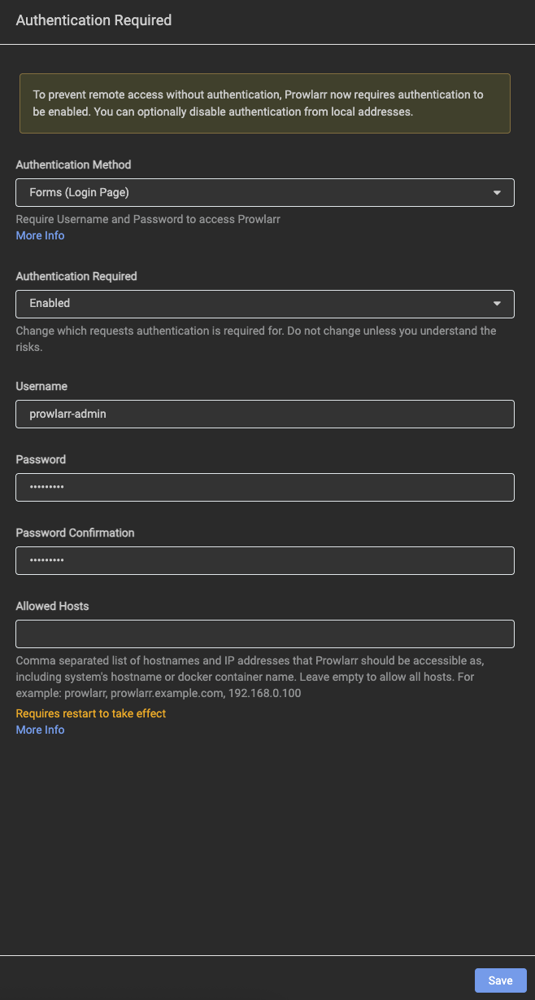
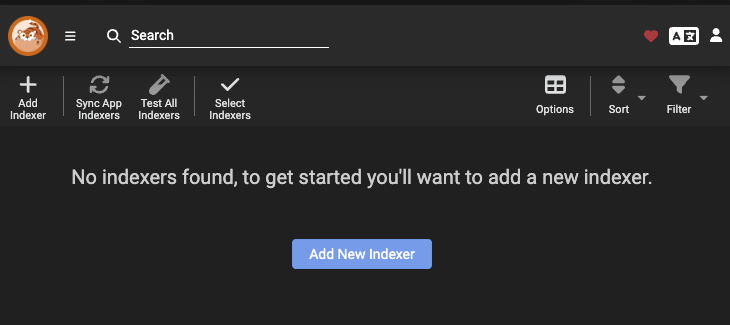
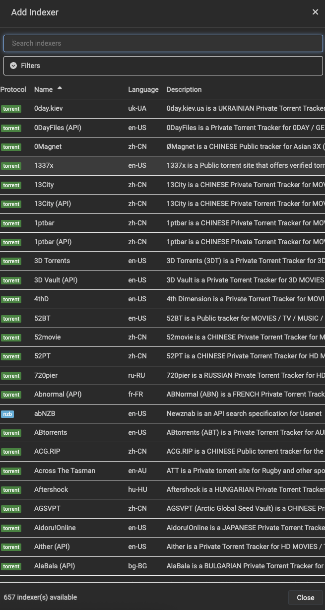
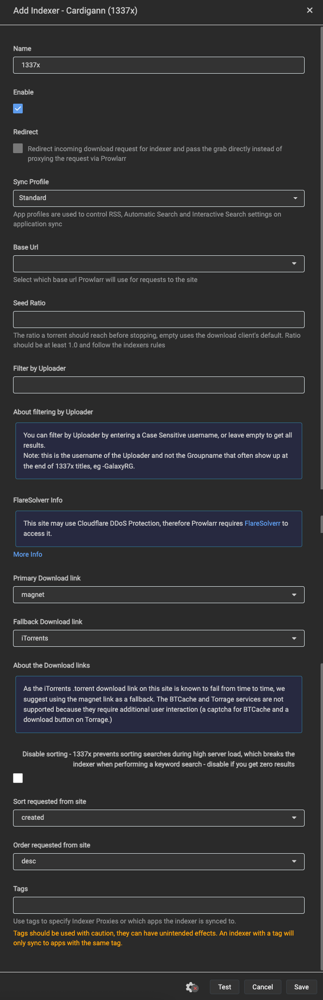
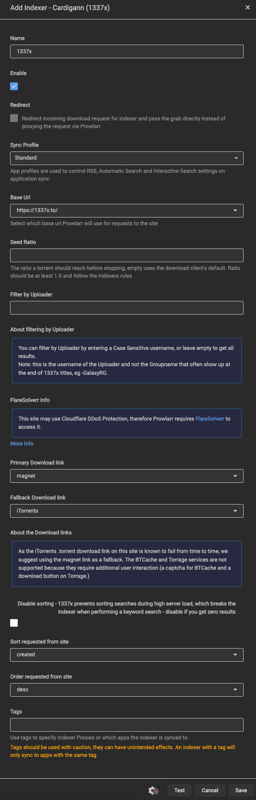
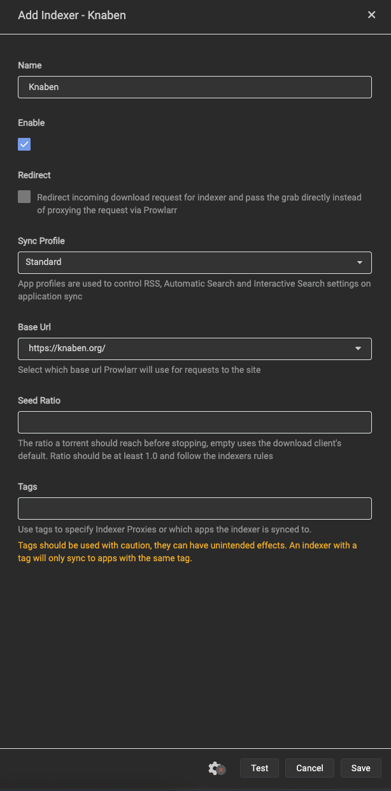
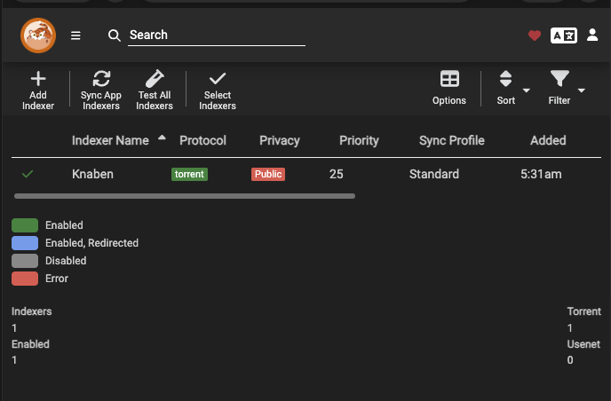
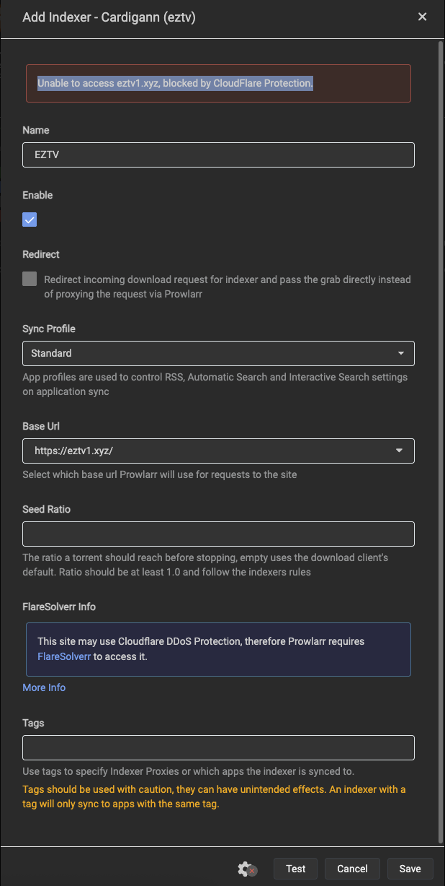

# Prowlarr Service Guide

**Status:** Deployed/healthy; Forms/Enabled, Knaben and Radarr Full Sync verified. Manager download-client setup and end-to-end acquisition pending. **Updated:** 2026-10-16.

## Purpose and Place in the Workflow

Prowlarr centraliza **indexadores/fuentes** para los gestores. No descarga videos ni organiza archivos: las películas se agregan en **Radarr** y las series en **Sonarr**; ellos buscan mediante las fuentes sincronizadas, eligen versiones según perfiles y envían trabajos a **qBittorrent**. Tras descargar, los gestores importan a la biblioteca; **Jellyfin** cataloga y reproduce. Ver [Stack Plan](stack-plan.md#normal-user-workflow).

La receta de despliegue de esta guía instala **sólo Prowlarr** y prepara su acceso inicial; las fuentes e integraciones se registran después. En la ejecución actual, Knaben y la sincronización hacia Radarr ya están verificados; Sonarr sigue pendiente. Ver el checkpoint de integración más abajo. El usuario confirmó que no inició ninguna descarga manual y que ya cambió la contraseña de qBittorrent; la prueba manual no es requisito para continuar.

## Version, Files and Prerequisites

- Prowlarr **2.6.5.5623**, stable; LinuxServer.io build **2.6.5.5623-ls163**, linux/amd64. Imagen de terceros mantenida por LinuxServer, no imagen oficial del proyecto.
- [Image lock](../compose/prowlarr/image-lock.json) registra release, build y digest inmutable. `latest` sólo se usó para descubrir/inspeccionar la imagen; el despliegue usa digest.
- [Compose](../compose/prowlarr/compose.yaml), [environment template](../compose/prowlarr/.env.example), [first-deployment script](../scripts/deploy-prowlarr.py).
- Requiere la VM Debian existente, Docker/Compose preparados, UID1000, mediaGID2000, guarda `/data` válida y TCP9696 libre. No repetir instalación base ni formato.

## Storage, Permissions and Network

| Element | Value |
| --- | --- |
| Runtime Compose | `/srv/media-server/compose/prowlarr/compose.yaml` y `.env` privado |
| NVMe persistent data | `/srv/media-server/appdata/prowlarr` → `/config` RW |
| Persistent contents | `config.xml`, bases de datos, ajustes, logs y backups internos; potencialmente secretos |
| Application identity | PUID1000, PGID2000, UMASK027; appdata1000:2000 modo750 |
| Initialization | s6 inicializa root; proceso Prowlarr baja al UID/GID indicados |
| HDD access | **Ninguno**: no recibe `/data`, downloads ni media |
| Web/API port | TCP9696 sólo en IPv4 privada asignada a la VM |
| Healthcheck | HTTP local `/ping`, sin imprimir clave API |
| Other access | Sin Docker socket, privileged, dispositivos, redes host ni puertos adicionales |
| Updates | Manuales por digest; mecanismo Docker, actualización interna automática OFF |

La guarda del HDD se mantiene como condición del motor Docker de esta VM aunque Prowlarr no monte contenido. No se cambia router, firewall, SSH, VPN, DSM ni cuentas de otros servicios.

## First Deployment Recipe

**Ejecutar como root dentro de Debian media-server**, nunca en la Mac ni en Proxmox. El transporte administrativo actual usa Guest Agent de VM102 y verifica que configuración/proceso de DSM permanezcan iguales; la receta del servicio no depende de volver a instalar SSH.

1. Revisar manifiesto/lock. Completar una copia privada de `.env.example` con `PROWLARR_BIND_ADDRESS` (IP LAN real de la VM), conservando `PROWLARR_IMAGE` por digest.
2. Obtener e inspeccionar la imagen exacta:

```sh
docker pull lscr.io/linuxserver/prowlarr@sha256:f9151e5bc1025c6d0a630d503210cdcb6bb55a7cc098562609d96a408d838902
docker image inspect lscr.io/linuxserver/prowlarr@sha256:f9151e5bc1025c6d0a630d503210cdcb6bb55a7cc098562609d96a408d838902
```

3. Copiar script, Compose y entorno privados a `/root/media-server-scripts/`; el `.env` de sitio debe ser modo0600 y no publicarse.
4. Ejecutar **sólo para una instalación nueva sin stack ni appdata**:

```sh
python3 /root/media-server-scripts/deploy-prowlarr.py --apply \
  --compose-file /root/media-server-scripts/prowlarr-compose.yaml \
  --env-file /root/media-server-scripts/prowlarr.env
```

El script exige `--apply`, hostname/OS correctos, montaje válido, identidad/puerto/montaje mínimos e imagen inspeccionada. Crea sólo directorios de esta app, escribe configuración inicial, valida Compose y espera health; comprueba versión y cero indexadores/apps/clientes. Rechaza estado existente: **no es un script de actualización ni reparación**. Si falla después de crear estado, inspeccionarlo; no borrar bases de datos para reintentar.

## User Intervention — Native First-Run Authentication

Abrir la IP privada de la VM en TCP9696. En una instalación nueva aparece **Authentication Required**. **Antes de agregar fuentes**, completar estos campos:

| Field | Indication | State |
| --- | --- | --- |
| Authentication Method | `Forms (Login Page)` | Confirmado en captura revisada |
| Authentication Required | `Enabled` | Confirmado en captura; también para direcciones locales |
| Username | `prowlarr-admin` | Completado y confirmado en captura; ejemplo real de esta instalación |
| Password | Elegida por el usuario directamente en esta pantalla | No registrar su valor |
| Password Confirmation | Repetir la misma contraseña | No registrar su valor |
| Allowed Hosts | Vacío, con Required=`Enabled` | Confirmado en captura; conservar por ahora |
| Save | Guardar después de completar los campos | Usuario confirma guardado; configuración verificada |

**En una instalación nueva**, antes de guardar, todavía no existe la cuenta del usuario. En esta instalación el alta ya fue guardada y verificada posteriormente (ver siguiente sección). La interfaz de alta nativa todavía no está protegida por una cuenta hasta guardar este formulario; la API puede exigir su propia clave incluso durante bootstrap, como se comprobó aquí; **no equivale a autenticación configurada**. No dejarlo como estado final ni añadir indexadores/cuentas secretas antes de completarlo. No se fuerza `None`/`External` mediante variables del contenedor ni se crea una cuenta oculta: el usuario elige su contraseña en la interfaz. No usamos Basic, deshabilitado por esta versión.

Al guardar puede pedirse iniciar sesión. Confirmar el username real, guardar captura final sin secretos y comprobar después acceso/API sin sesión rechazados. No confundir una respuesta `/ping` correcta con autenticación completa. El formulario final ya tiene una captura propia aprobada a continuación; el guardado fue confirmado después por el usuario y verificado, como se registra en la siguiente sección.

### Reviewed Authentication Form

**Captura revisada y aprobada el 2026-10-16, antes de pulsar Save.** Los campos visibles coinciden con la configuración indicada: **Forms (Login Page)**, **Enabled**, username **`prowlarr-admin`**, contraseña/confirmación completadas y enmascaradas, **Allowed Hosts vacío**. No se necesita cambiar otro campo visible para este paso.



Esta es la referencia visual para repetir el alta de la cuenta. No se documenta el valor de la contraseña ni se puede verificar su coincidencia a partir del enmascarado: **Save** validará el formulario. La imagen **no confirma todavía que se haya guardado ni iniciado sesión**. Al repetir la instalación, pulsar **Save** y, si aparece login, ingresar con la cuenta elegida. En esta ejecución el usuario ya guardó y llegó al listado vacío de Indexers.

### Saved Authentication and First Indexers Screen

El usuario confirmó que pulsó **Save** y aportó esta pantalla posterior. La lista vacía **No indexers found** es normal: todavía no agregamos ninguna fuente; no es un error de despliegue.



Verificación posterior **de sólo lectura**: configuración persistida **Forms** + **Enabled**, Allowed Hosts vacío; acceso web sin sesión redirige a **`/login`** y API sin clave responde **401**. El listado leído por API contiene **cero indexadores**. No se solicitó ni se leyó la contraseña elegida. Evidencia privada: `.local/prowlarr-authentication-verification-result.json`.

**Siguiente paso exacto:** pulsar **Add New Indexer** (botón azul central; el **+ Add Indexer** superior abre el mismo alta) para ver el catálogo. El usuario indicó que **arrancamos desde cero**, sin fuente/cuenta previa indicada. Evaluaremos primero una fuente **Torrent**, compatible con qBittorrent; no agregar un proveedor Usenet esperando descargarlo con qBit. Se puede empezar por opciones públicas sin cuenta, revisando lo disponible y probando conexión. **Aún no hay proveedor concreto elegido ni fuente agregada.** Revisar la siguiente ventana antes de completar parámetros; no añadir muchas fuentes a ciegas ni configurar un cliente duplicado en Prowlarr para este flujo.

Referencia del procedimiento: [Prowlarr Quick Start — Indexers](https://github.com/Servarr/Wiki/blob/master/prowlarr/quick-start-guide.md#indexers).

## Indexer Shortlist Research — 2026-10-16

**Estado:** recomendación para probar, **no fuentes ya configuradas**. El usuario pidió investigar Reddit y otros foros según su preferencia audiooriginal→inglésfallback y subtítulos ES/EN seleccionables; no tiene fuentes/cuentas previas. La lectura de sólo consulta del catálogo de esta instalación devolvió **657 definiciones**; la captura y las definiciones disponibles no prueban conexión, disponibilidad del contenido ni calidad.



### Proposed Initial List

| Name exactly as shown in this installation | Role | Recommendation / limitation |
| --- | --- | --- |
| **Knaben** | Metabuscador público general, películas y series | **Primero a probar**: cobertura general, sin cuenta de tracker previa. Es la implementación nativa `Knaben`, no buscar una entrada separada `Knaben (API)`. No depender sólo de este: resultados/agregación/seeders y acceso pueden variar. |
| **EZTV** | Público especializado en series | Complemento para series si **Test** funciona. Elegir `EZTV`, no `EZTVL` (variante con login). No garantiza toda serie no inglesa ni sus pistas. Hay reportes recientes de bloqueos Cloudflare. |
| **1337x** | Público general | **Reserva**, no primer requisito: aparece mucho en recomendaciones, pero también en reportes Cloudflare2026. No agregar un solver/VPN/proxy automáticamente sólo para forzarlo. |
| **YTS** | Público de películas HD de tamaño reducido | **Opcional**, no única fuente ni prioridad universal: útil si se prefieren archivos compactos. Eso no equivale a máxima calidad, audio multicanal/múltiple ni ES/EN garantizados. Calidad/tamaño aún deben acordarse. |

Lista deliberadamente pequeña. Comenzar sólo con **Knaben**, revisar su formulario y probar antes de guardar; después evaluar EZTV. 1337x/YTS son opciones condicionadas, **no orden de habilitar los cuatro automáticamente**. `LimeTorrents` también existe como alternativa general, pero no se añade por duplicar fuentes sin demostrar necesidad. `RuTracker.org` figura semiprivado, por lo que no se toma como primer paso sin cuenta; no confundir idioma del sitio con pistas de cada archivo.

**Siguiente acción:** en **Search indexers**, escribir **Knaben**, pulsar su fila y revisar captura del formulario antes de **Test / Save**. Conservar los valores predeterminados soportados por esta versión; no inventar mirrors/APIURLs a partir de posts antiguos. Si Test falla, registrar error y reevaluar alternativa/definición; no afirmar que un servicio caído, un403 o Cloudflare se resuelven agregando más contenedores.

### Evidence and Confidence

- [Reddit — Seeing what's out there these days, abril2026](https://www.reddit.com/r/torrents/comments/1sh9vbo/seeing_whats_out_there_these_days/): experiencias que mencionan Knaben/1337x y YTS; también cuestionan calidad de YTS. **Opiniones**, no benchmark ni garantía de idiomas.
- [Reddit — 1337x/Prowlarr, julio2026](https://www.reddit.com/r/1337x/comments/1v9up2j/help_with_flaresolverr_prowlarr_and_1337x/): dificultades Cloudflare y experiencia favorable usando Knaben; no asumir que el resultado de una IP se reproduce en otra.
- [Reddit — EZTV/1337x bloqueados, abril2026](https://www.reddit.com/r/torrents/comments/1sfl68n/cannot_add_eztv_or_1337x_to_prowlarr_blocked_by/): ejemplos de que aparecer en catálogo no demuestra conexión.
- [Lemmy — selección de indexadores en arr](https://lemmy.world/post/43726761/22439685): experiencia con Knaben y otros; anecdótica, con otra pila de descargas distinta de la nuestra. No copiar sus contenedores ni filtros de calidad.
- [Foro Sonarr — Setting up TGX, octubre2023](https://forums.sonarr.tv/t/setting-up-tgx/32716): referencia histórica a fuentes públicas para series; **no usar esa lista antigua como estado actual**. RARBG/TorrentGalaxy no aparecieron entre las definiciones coincidentes leídas en nuestra instalación; no recomendar clones por nombre.
- Fuentes primarias: [Knaben en la versión instalada2.6.5](https://github.com/Prowlarr/Prowlarr/blob/v2.6.5.5623/src/NzbDrone.Core/Indexers/Definitions/Knaben.cs), [definición EZTV](https://github.com/Prowlarr/Indexers/blob/master/definitions/v11/eztv.yml), [definición YTS](https://github.com/Prowlarr/Indexers/blob/master/definitions/v11/yts.yml), [catálogo oficial soportado](https://github.com/Servarr/Wiki/blob/master/prowlarr/supported-indexers.md). Las definiciones pueden cambiar independientemente del digest del contenedor; registrar cambios relevantes al repetir configuración.

Lectura de catálogo real: `.local/prowlarr-indexer-catalog-research.json`. No se inició ninguna búsqueda de películas, Test, fuente, descarga ni servicio adicional en esta investigación. **Que un foro recomiende una fuente no certifica seguridad, legalidad, pistas o disponibilidad de todos sus resultados.** Usar sólo contenidos para los que se tenga autorización; no descargar/ejecutar programas ofrecidos como requisito para ver un video.

### Audio and Subtitle Preferences Are Separate

- **Prowlarr / fuentes:** elegir dónde buscar; la columna **Language** (`en-US`, etc.) es metadato del indexador/sitio, **no un filtro ni garantía del audio de cada video**. No seleccionar fuentes en español únicamente para conseguir subtítulos españoles.
- **Radarr / Sonarr:** planificar perfiles que prioricen **idioma original de la obra**, con inglés como alternativa si no está disponible. No imponer EnglishOnly a todo el catálogo ni OriginalOnly obligatorio, porque ambos pueden contradecir el fallback acordado. Dependerá de títulos/metadatos disponibles y se verificará sobre pistas reales; no fijar puntuaciones arbitrarias todavía.
- **Gestor de subtítulos:** **Bazarr es el candidato recomendado**, no elegido/desplegado aún. Su documentación contempla perfiles de varios idiomas y proveedores separados de los indexadores. Para este usuario el objetivo es **español e inglés ambos disponibles**, no uno u otro al azar ni simultáneos en pantalla. Al configurarlo, no habilitar SingleLanguage, no detener búsqueda al hallar sólo el primer idioma (cutoff mal elegido), ni excluir subtítulos ingleses por coincidir con audio inglés (`Exclude Audio`). Los ajustes exactos se confirmarán en su propia guía/pantallas si se adopta.
- **Jellyfin:** seleccionar pistas encontradas; la interfaz/metadatosEnglish no determina audio ni crea subtítulos. Incluso con perfiles y proveedores puede faltar un subtítulo o una pista: no prometer disponibilidad garantizada.

Primarias para esa separación: [Radarr settings](https://github.com/Servarr/Wiki/blob/master/radarr/settings.md), [Sonarr settings](https://github.com/Servarr/Wiki/blob/master/sonarr/settings.md), [Bazarr Language Profiles](https://wiki.bazarr.media/Getting-Started/Setup-Guide/#languages). Guía técnica complementaria: [TRaSH language formats](https://trash-guides.info/Radarr/Tips/How-to-setup-language-custom-formats/). No aplicar todavía esos perfiles ni instalar Bazarr por haberlo investigado.

## 1337x Form Review — Before Test

El usuario eligió **1337x** primero por tenerlo a mano, en lugar del orden propuesto de Knaben. La shortlist anterior es recomendación, no obligación. Esta sección registra la revisión inicial, **cuando todavía no se había confirmado Test ni Save**. El intento posterior y su error se documentan en la siguiente sección; no hay una fuente declarada funcional.



La captura es evidencia de revisión **antes de completar Base Url**, no referencia final de configuración ya validada. Para esta prueba:

| Field | Indication | Observed state |
| --- | --- | --- |
| Name | `1337x` | Correcto |
| Enable | Marcado | Correcto |
| Redirect | Desmarcado | Correcto; no habilitar sin requisito específico |
| Sync Profile | `Standard` | Conservar |
| Base Url | Seleccionar **`https://1337x.to/`** desde el desplegable | Vacío en captura; completar/comprobar explícitamente |
| Seed Ratio | Vacío, usa valor del cliente | No inventar política de ratio todavía |
| Filter by Uploader | Vacío | No limitar releases por un uploader sin decidirlo |
| Primary Download link | `magnet` | Conservar |
| Fallback Download link | `iTorrents` | Conservar |
| Disable sorting | Desmarcado | Conservar inicialmente; revisar sólo ante problema concreto |
| Sort requested from site | `created` | Conservar |
| Order requested from site | `desc` | Conservar |
| Tags | Vacío | Evitar tags que impidan futura sincronización sin intención |

Primero pulsar **Test**, no Save. Si devuelve éxito/verde, pulsar **Save**. Si devuelve error, revisar el texto/captura antes de guardar; no forzar un indexador no funcional como operativo. Test comprueba acceso/parseo de resultados, **no inicia una descarga de video** ni garantiza la calidad/idiomas de futuras releases.

**En esa captura inicial, FlareSolverr Info era sólo un aviso, no un resultado de error.** El intento posterior sí produjo el bloqueo descrito a continuación. No se instaló FlareSolverr ni otro resolver, VPN o proxy.

Referencia primaria: [definición1337x](https://github.com/Prowlarr/Indexers/blob/master/definitions/v11/1337x.yml), que incluye las URLs y valores de enlaces/orden; [procedimiento oficial Test antes de Save](https://github.com/Servarr/Wiki/blob/master/prowlarr/quick-start-guide.md#indexers). No usar mirrors obtenidos al azar fuera del listado soportado. Lectura de URLs de la instalación, si se necesita contrastar, en `.local/prowlarr-1337x-schema-review.json`.

## 1337x Save Attempt — Cloudflare Blocked

El usuario seleccionó **Base Url = `https://1337x.to/`** y pulsó **Save**. El resto de los campos visibles coincide con la tabla anterior. Reportó este error exacto:

```text
Unable to access 1337x.to, blocked by CloudFlare Protection.
```



**La imagen muestra el formulario completado, no el mensaje de error**; el mensaje fue aportado por el usuario en texto. Se conserva como evidencia de diagnóstico, **no como configuración funcional aprobada**.

El fallo corresponde al acceso automatizado de Prowlarr al sitio protegido, no a las rutas de qBittorrent ni a la contraseña del usuario. Una consulta posterior de sólo lectura **GET `/api/v1/indexer`** confirmó **cero indexadores guardados** el 2026-10-16. Evidencia privada: `.local/prowlarr-indexers-after-1337x-failed-save.json`. No se repitió Test/Save desde el agente.

**Procedimiento indicado tras ese fallo** (el usuario ya llegó al formulario Knaben y probó Test; ver siguiente sección):

1. Pulsar **Cancel** en el formulario fallido; no insistir con Save ni forzar el guardado.
2. En **Indexers**, pulsar **Add New Indexer** o **+ Add Indexer**.
3. Escribir **`Knaben`** en **Search indexers** y seleccionar la entrada exacta **Knaben**.
4. Revisar su formulario y pulsar Test antes de guardar. No se promete disponibilidad por aparecer en el catálogo; el resultado posterior se registra a continuación.

Esta alternativa permite intentar una primera fuente sin añadir otro contenedor. **El usuario confirmó que 1337x se mantiene como objetivo pendiente, no descartado**, y pidió registrarlo en [TODO.md](../TODO.md#prowlarr--recuperar-acceso-a-1337x) para resolverlo después. Ahora seguimos con Knaben; el estado actual se detalla a continuación.

Al retomar1337x, evaluar **FlareSolverr** como servicio adicional con Compose y guía propios: Prowlarr lo integra como **Indexer Proxy** en **Settings → Indexers**, con una misma etiqueta en proxy e indexador y la misma IP de salida. No basta con dejar un campo del formulario diferente ni se garantiza que resuelva cualquier desafío. No se instala automáticamente ni se cambian VPN/router o mirrors al azar.

Referencia: [Prowlarr FAQ — FlareSolverr indexers](https://github.com/Servarr/Wiki/blob/master/prowlarr/faq.md#can-i-use-flaresolverr-indexers).

## Knaben Reviewed Configuration — Test Passed, Save Pending

El usuario eligió **Knaben** y confirmó que, al pulsar **Test**, apareció una tilde de éxito. El formulario visible está correcto y **no requiere cambiar ningún campo** para este paso:

| Field | Reviewed value |
| --- | --- |
| Name | `Knaben` |
| Enable | Marcado |
| Redirect | Desmarcado |
| Sync Profile | `Standard` |
| Base Url | `https://knaben.org/` |
| Seed Ratio | Vacío: usa el valor predeterminado del cliente; no define una política nueva |
| Tags | Vacío: sin restringir sincronización mediante etiquetas en esta etapa |



**Referencia visual aprobada de los campos, antes de Save.** La tilde de Test fue reportada por el usuario y no aparece en esta imagen; no se atribuye a la captura un resultado que no muestra. Test exitoso indica que la prueba de conexión funcionó en ese momento, **no garantiza disponibilidad permanente, idiomas del contenido ni que el indexador esté guardado**. No se ejecutó otra prueba desde el agente.

### Exact Next Steps

1. Sin cambiar los campos revisados, pulsar **Save** (abajo a la derecha).
2. Comprobar que se cierre el formulario y aparezca **Knaben** en el listado **Indexers**.
3. Si aparece un error, conservar el texto/captura y revisarlo; no forzar un guardado fallido.
4. Confirmar el listado guardado con una captura o verificación de sólo lectura. El usuario ya aportó la captura posterior que confirma el guardado, como se registra en la siguiente sección; el recuento API de cero fuentes era anterior a este formulario.

Después de confirmar Save, evaluar **EZTV** como complemento para series según la [shortlist](#proposed-initial-list); no está seleccionado ni probado todavía. No instalar más contenedores ni configurar un cliente de descarga duplicado en Prowlarr para completar este alta. Audio original→inglés de respaldo y subtítulos ES/EN se tratarán en los gestores/reproductor, no mediante los campos de este formulario.

Referencia: [implementación Knaben de la versión instalada](https://github.com/Prowlarr/Prowlarr/blob/v2.6.5.5623/src/NzbDrone.Core/Indexers/Definitions/Knaben.cs) y [Test antes de Save](https://github.com/Servarr/Wiki/blob/master/prowlarr/quick-start-guide.md#indexers).

## Knaben Saved and Enabled

La captura posterior confirma que el formulario se cerró y **Knaben quedó guardado en Indexers**. Campos visibles:

| Item | Confirmed value |
| --- | --- |
| Indexer Name | `Knaben`, con check verde |
| Protocol / Privacy | `torrent` / `Public` |
| Priority | `25` |
| Sync Profile | `Standard` |
| Totals | Indexers **1**, Enabled **1**, Torrent **1**, Usenet **0** |



**Guardado y habilitación confirmados por la UI después de Save**; la prueba de conexión exitosa fue reportada antes por el usuario. Posteriormente, durante el diagnóstico EZTV, una consulta API de sólo lectura confirmó **Knaben como única fuente guardada y habilitada**. No se hizo prueba tras reiniciar; el recuento API0 anterior es histórico. Todavía no se verificó sincronización con gestores, búsqueda de un título concreto, descarga ni importación.

### Proposed Next Indexer — EZTV

Se propuso **EZTV** como complemento público especializado en series, no como requisito para que Knaben funcione ni como reemplazo de una fuente general para películas. No añadir toda la shortlist automáticamente. Su [definición oficial](https://github.com/Prowlarr/Indexers/blob/master/definitions/v11/eztv.yml) declara categorías TV y también contempla protección Cloudflare; el intento posterior produjo el error registrado abajo.

1. Pulsar **+ Add Indexer** arriba a la izquierda.
2. En **Search indexers**, escribir **`EZTV`**.
3. Elegir la fila exacta **EZTV**, no **EZTVL** (variante con login).
4. Revisar el formulario/captura antes de indicar valores y pulsar Test/Save. Si Test falla, registrar el error; no forzar ni instalar un resolver automáticamente.

El usuario ya abrió EZTV; aún no está guardado ni funcional. `1337x` sigue pendiente en [TODO](../TODO.md#prowlarr--recuperar-acceso-a-1337x). Elegir una fuente no garantiza audio original/inglés ni subtítulos ES/EN; esos perfiles se aplicarán en las etapas correspondientes.

### EZTV Attempt — Cloudflare at eztv1.xyz

La captura muestra **un error real en rojo**, no sólo el aviso informativo FlareSolverr:

```text
Unable to access eztv1.xyz, blocked by CloudFlare Protection.
```



Valores visibles: **Name `EZTV`**, Enable marcado, Redirect desmarcado, Sync Profile `Standard`, Base Url **`https://eztv1.xyz/`**, Seed Ratio y Tags vacíos. **Evidencia de diagnóstico, no referencia aprobada de fuente funcional.** No se especificó qué botón generó el intento, por lo que no se declara un Test o Save exitoso.

Consulta de sólo lectura posterior: el esquema de esta instalación ofrece **`https://eztvx.to/` como primera URL**, además de `eztv.wf`, `eztv.tf`, `eztv.yt` y la URL fallida. El listado API contiene **sólo Knaben habilitado** (1 fuente); EZTV **no se guardó**. Evidencia privada: `.local/prowlarr-eztv-block-schema-review.json`. No se lanzó Test/Save desde el agente.

**Actualización posterior del usuario:** ya comprobó **todas las URLs disponibles** y el bloqueo ocurre en todas, no sólo en `eztv1.xyz`. La captura prueba directamente el error de ese host; los demás resultados están confirmados por su relato. La propuesta anterior de probar la primera URL **ya no está pendiente**: no pedirle repetirla ni seguir cambiando mirrors.

### FlareSolverr — Recommended Timing

El aviso del formulario es relevante: Prowlarr admite **FlareSolverr como servicio auxiliar**, añadido como **Indexer Proxy** en Settings → Indexers, con tags coincidentes entre proxy/indexador y la misma IP de salida. Ver [FAQ oficial](https://wiki.servarr.com/prowlarr/faq#can-i-use-flaresolverr-indexers). Es una opción para intentar resolver estos bloqueos, **no una garantía de éxito ni un requisito para usar Knaben**.

**Recomendación del agente, aún no una instalación autorizada:** dejar1337x/EZTV y la evaluación de FlareSolverr en [TODO](../TODO.md#flaresolverr--evaluación-pendiente) y priorizar una primera validación del flujo con Knaben. No añadir otro indexador sólo para acumular fuentes. Si se decide añadir FlareSolverr después, tendrá su módulo Compose y guía propios; primero revisar versión/digest/red y luego comprobar cada fuente por separado.

**Checkpoint histórico tras el bloqueo de EZTV:** se propuso pulsar **Cancel** en el alta fallida de EZTV y conservar Knaben. Próximo trabajo: Radarr para películas y Sonarr para series, uno por uno con sus documentos; integrar Prowlarr y qBittorrent y verificar búsqueda, descarga, importación y reproducción en Jellyfin. En ese momento aún no se había desplegado Radarr; el estado posterior verificado se registra en la sección siguiente. Un indexador guardado no demostraba un pipeline funcional.

## Sources and Integration — Next Stages

Knaben ya está guardado y habilitado, confirmado por UI y posteriormente por API; su Test exitoso fue reportado por el usuario. El usuario confirma bloqueo de todas las URLs de EZTV, que no está guardado. La recomendación es avanzar con los gestores usando Knaben y retomar los bloqueos después. No se promete disponibilidad de cualquier título. El estado de las integraciones siguientes se registra por separado:

1. En **Indexers**, elegir fuentes compatibles con el acceso autorizado del usuario, registrar tipo/configuración no secreta y probar conectividad. Cuentas/APIkeys se introducen privadamente; no publicar exports completos.
2. **Radarr ya está desplegado/healthy**, con cuenta Forms/Enabled y raíz `/data/media/movies` verificadas; seguir su [guía propia](radarr.md). Sonarr aún no desplegado. Radarr ya tiene configNVMe y un bind común `/data:/data` para hardlinks entre downloads/media; lo mismo está previsto para Sonarr.
3. **Prowlarr → Radarr verificado:** Save confirmado por usuario y captura original de Apps; API sólo lectura confirma1AppRadarr/fullSync/Tagsvacío y **Knaben (Prowlarr)** en Radarr, Torrent/Torznab conRSS/búsquedas automáticas e interactivas activadas. Ver [receta y evidencia](radarr.md#saved-application-and-verified-knaben-synchronization). No recrear la App ni duplicar el indexador. **Cliente qBittorrent configurado después en Radarr:** Test y Save confirmados por UI; [capturas](radarr.md#saved-qbittorrent-client--ui-confirmation). Siguiente: perfiles/renombrado, no otro cliente en Prowlarr.
4. En **Radarr/Sonarr → Download Clients**, configurar qBittorrent con su URL privada8080, cuenta `admin` y **contraseña permanente vigente elegida por el usuario**. Categorías `movies`/`tv`; no volver a usar la temporal antigua. Normalmente no hace falta duplicar el cliente en Prowlarr porque aquí la descarga será dirigida por los gestores.
5. Raíces finales `/data/media/movies` y `/data/media/tv`; perfiles coherentes con audiooriginal→inglésfallback y futuros subsES/EN seleccionables. Ver [Roadmap](../ROADMAP.md#content-language-preferences) y [qBittorrent](qbittorrent.md#password-lifecycle--reproducible-procedure).
6. Agregar un título autorizado desde el gestor, verificar búsqueda/descarga/importación real, dispositivo/inode de hardlinks, escaneo Jellyfin y reproducción. No mover videos a mano como flujo normal ni marcar integración por instalar contenedores.

**Prowlarr → Radarr y el registro de Knaben ya están verificados; el cliente qBit en Radarr tiene Test + Save confirmados por UI.** Sonarr, perfiles/renombrado y la prueba completa siguen pendientes; no interpretar estas conexiones como aceptación del pipeline. La política final de fuentes, perfiles, seeding/limpieza y espacio libre se acordará durante esos pasos. Música y libros quedan para después.

## Verification Record

**Despliegue ejecutado el 2026-10-16:** Compose validado y `up -d --wait --pull never` correcto, contenedor healthy. API confirma **2.6.5.5623**, cero indexadores, cero aplicaciones y cero download clients. La appdata está en el filesystem del SO/NVMe, distinto de `/data`. Configuración y proceso de DSM sin cambios; no se reiniciaron VMs ni se modificaron cuentas ajenas.

**Alta del usuario completada y verificada posteriormente:** usuario confirma Save y pantalla Indexers; configuración efectiva Forms + Enabled, web anónima a `/login` y API sin clave401. El estado `None` mencionado en la evidencia del primer despliegue es histórico de bootstrap, **no el estado actual**. El catálogo estaba inicialmente vacío; después se guardó **Knaben**, visible y habilitado en la captura posterior. App Radarr y Knaben sync verificados posteriormente; cliente qBit en Radarr confirmado por Test + Save en su guía. Sonarr y adquisición real siguen pendientes. No repetir el instalador ni el formulario inicial.

Verificación adicional desde la LAN: `/` y `/ping` HTTP200; `/api/v1/system/status` sin clave HTTP401. Proceso Prowlarr UID1000:GID2000 real, cero reinicios, único bind `/config` RW en NVMe y sóloTCP9696 enIPv4privada. Guarda `/data` correcta, cero unidades fallidas, Jellyfin y qBittorrent siguen healthy. Evidencia privada en `.local/prowlarr-verification-result.json`.

Evidencia privada de despliegue en `.local/prowlarr-deployment-20261016T045330Z.json`. La receta pública es el script del servicio; el transporte actual por Guest Agent queda en `.local/` porque contiene detalles del sitio. Un error previo de sintaxis en ese transporte abortó antes de ejecutar comandos remotos; se corrigió y compiló el código generado antes del despliegue correcto, sin reinstalar estado existente.

Aceptar por separado: contenedor healthy/API versión, sólo puerto/montaje previstos, configuración NVMe y sin acceso HDD, cuentas/autenticación efectivas, fuentes/integraciones probadas, adquisición/importación/playback. Una fase no prueba automáticamente las otras.

## Operation, Updates and Recovery

Administración dentro de Debian con privilegios existentes:

```sh
cd /srv/media-server/compose/prowlarr
docker compose ps
docker compose config --quiet
/usr/local/sbin/check-media-storage
docker compose stop
docker compose up -d --wait --pull never
```

No pegar logs completos ni `config.xml` en chat/repositorio: pueden contener APIkeys o credenciales. No cambiar imagen desde el actualizador interno. Para actualizar: parar sólo Prowlarr, hacer backup consistente y privado de appdata/manifiesto/entorno, revisar release/build/digest, recrear sólo este servicio y verificar. Un rollback de migraciones requiere restaurar appdata compatible y la imagen anterior, no sólo cambiar tag.

Los backups internos bajo `/config` están en el mismo NVMe y **no son copia independiente**. Falta elegir destino/retención externa y probar restauración. Bases de datos contienen secretos de indexadores/apps; protegerlas y conservar APIkeys en almacenamiento privado. No se pretende respaldar el HDD multimedia por copiar esta app o la VM.

## Primary Sources

- [LinuxServer Prowlarr](https://docs.linuxserver.io/images/docker-prowlarr/) — imagen, identidad, persistencia y puerto.
- [Stable release2.6.5.5623](https://github.com/Prowlarr/Prowlarr/releases/tag/v2.6.5.5623).
- [First-run authentication form](https://github.com/Prowlarr/Prowlarr/blob/v2.6.5.5623/frontend/src/FirstRun/AuthenticationRequiredModalContent.tsx) y [security options](https://github.com/Prowlarr/Prowlarr/blob/v2.6.5.5623/frontend/src/Settings/General/SecuritySettings.js).
- [Host configuration validation](https://github.com/Prowlarr/Prowlarr/blob/v2.6.5.5623/src/Prowlarr.Api.V1/Config/HostConfigController.cs) y [configuration defaults](https://github.com/Prowlarr/Prowlarr/blob/v2.6.5.5623/src/NzbDrone.Core/Configuration/ConfigFileProvider.cs).
- [Update mechanisms](https://github.com/Prowlarr/Prowlarr/blob/v2.6.5.5623/src/NzbDrone.Core/Update/UpdateMechanism.cs).
