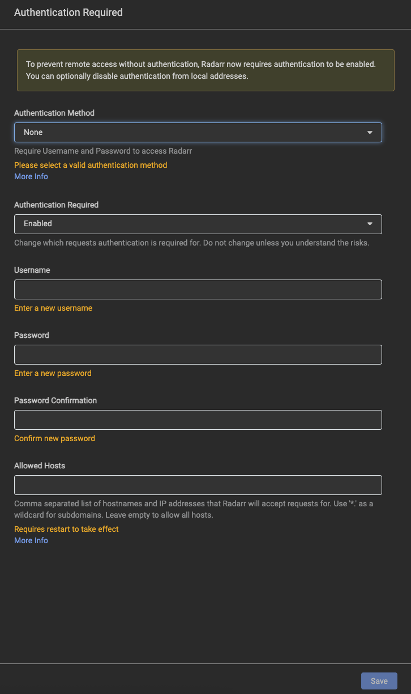
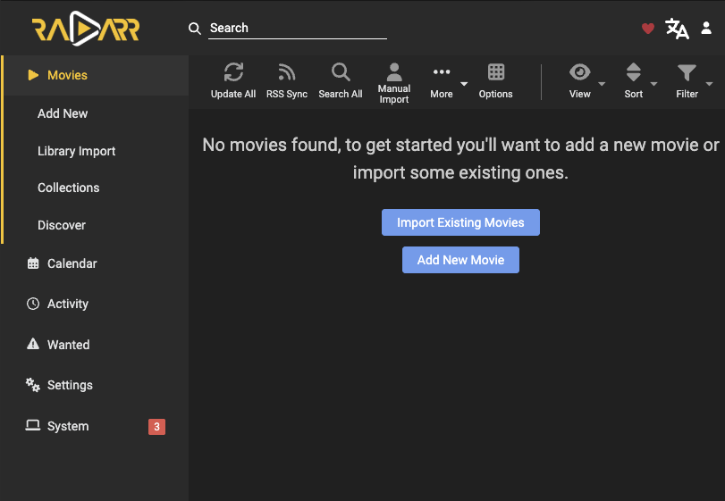
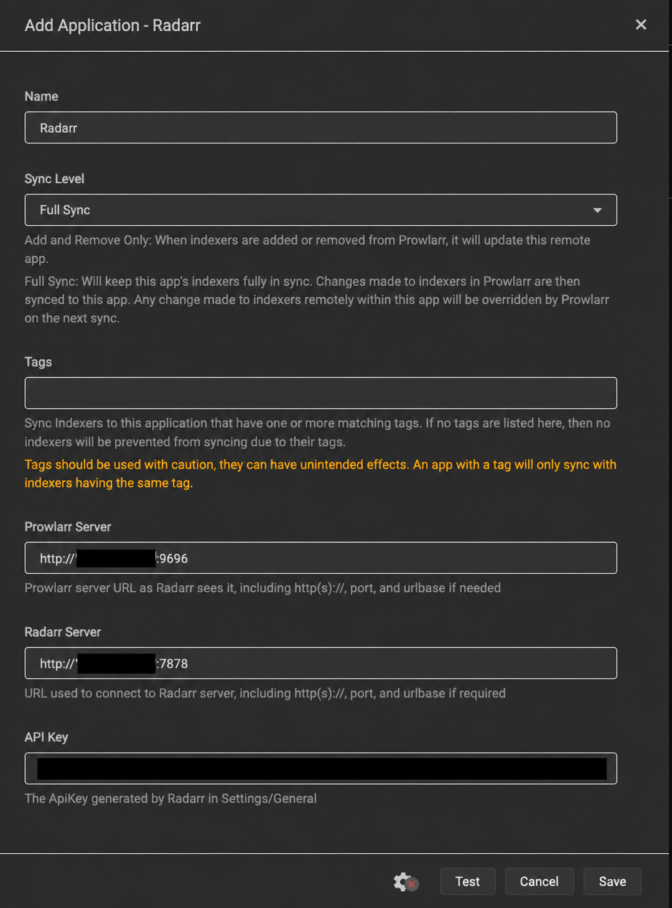
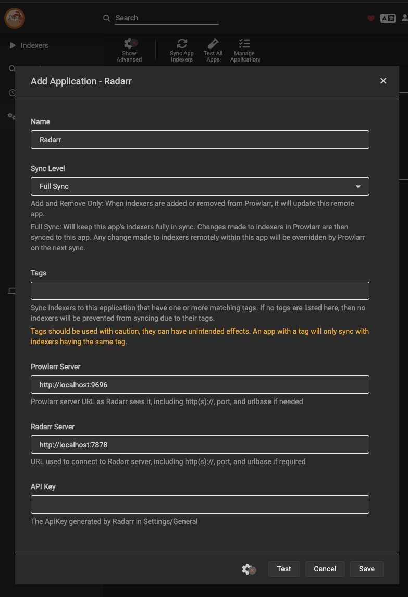
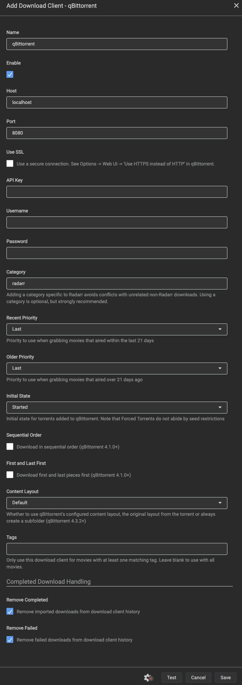

# Radarr Service Guide

**Status:** Deployed and healthy; account/root and Prowlarr/Knaben synchronization verified; qBittorrent Test + Save confirmed by UI. Next: profiles/naming; real download/import/playback pending. **Updated:** 2026-10-16.

## 1. Purpose and Execution Order

Radarr gestiona **películas**: solicita búsquedas en los indexadores, envía descargas al cliente y organiza/importa el resultado. No reemplaza Prowlarr, qBittorrent ni Jellyfin. Las series corresponden a Sonarr, que se configurará después de una primera prueba de película.

Orden de esta guía: **prerrequisitos → imagen/Compose → despliegue → cuenta del usuario → carpetas → integraciones → perfiles → una película de prueba → aceptación**. Instalar un contenedor no prueba los pasos posteriores. No descargar contenido ni añadir películas automáticamente durante el despliegue.

Prowlarr ya tiene **Knaben guardado/habilitado**. Todas las URLs de EZTV fallan según el usuario;1337x y la evaluación FlareSolverr permanecen en [TODO](../TODO.md). No son requisitos para instalar Radarr ni se añaden otros servicios en este paso.

## 2. Version and Module Files

- Radarr **6.4.4.10685**, release estable; LinuxServer build **6.4.4.10685-ls321**, linux/amd64. Es una imagen de terceros mantenida por LinuxServer.
- Imagen: `lscr.io/linuxserver/radarr@sha256:ea6822c956d26db648b237919f41340318f32e5b7dcc4ba702cf256a0f5f3c12`.
- [Compose](../compose/radarr/compose.yaml), [environment template](../compose/radarr/.env.example), [image lock](../compose/radarr/image-lock.json), [module README](../compose/radarr/README.md).
- [First-deployment script](../scripts/deploy-radarr.py) y [local contract tests](../tests/test_radarr.py).

`latest` se utilizó únicamente para descubrir/inspeccionar la imagen estable. Compose y el instalador exigen el digest revisado; no se despliega un tag mutable. Las actualizaciones son manuales por imagen, no mediante el actualizador interno de Radarr.

## 3. Prerequisites and Boundaries

Ejecutar en la **VM Debian `media-server` ya existente**, con los privilegios administrativos disponibles; no en Proxmox ni en la computadora administradora. Requiere Docker/Compose, Python3, grupo `media` GID2000 y UID1000 ya existentes.

Antes de aplicar:

- `/usr/local/sbin/check-media-storage` debe confirmar el HDD esperado por UUID, ext4 y RW.
- `/data/downloads/movies` y `/data/media/movies` ya deben existir, sin symlinks, con GID2000, permisos de escritura y el mismo filesystem.
- Appdata debe estar en el filesystem del SO/NVMe, distinto de `/data`; al menos2GiB libres en SO y1GiB en HDD para este despliegue inicial. Esto no es una política suficiente de espacio para futuras películas.
- TCP7878 libre en la IPv4 LAN asignada a Debian; stack/appdata y proyecto Radarr ausentes. Revisar RAM disponible y servicios existentes antes de añadir la app.
- Jellyfin, qBittorrent y Prowlarr deben continuar funcionando. No detenerlos ni recrearlos para desplegar Radarr.

No reformatear, reinstalar Debian, alterar DSM, cambiar router/VPN/SSH/cuentas del sistema, conceder grupo Docker ni usar `chmod777`. No recorrer/chown recursivamente las bibliotecas.

## 4. Storage, Identity and Access

| Item | Reviewed value |
| --- | --- |
| Runtime Compose | `/srv/media-server/compose/radarr/compose.yaml` y `.env` privado |
| NVMe persistence | `/srv/media-server/appdata/radarr` → `/config` RW |
| Config contents | Bases de datos, configuración, API key, credenciales de futuras integraciones y backups internos; privados |
| HDD bind | **`/data:/data` RW**, único montaje común para descargas/biblioteca |
| Application identity | PUID1000, PGID2000, UMASK002; s6 inicializa root y la app baja a esa identidad |
| Initial config directory | UID1000:GID2000, modo750; no cambios en permisos globales del HDD |
| Web interface | TCP7878 en IPv4 privada de la VM; `http://<IP_DE_LA_VM>:7878` |
| Healthcheck | `/ping` local dentro del contenedor; no usa ni publica API keys |
| Other access | Sin Docker socket, privileged, devices, red host ni puertos adicionales |

**No dividir el HDD en binds `/movies` y `/downloads`.** Un único `/data` permite enlazar dentro del mismo montaje. Mantener los mismos nombres de ruta entre qBittorrent y Radarr: descargas en `/data/downloads/movies`, biblioteca final en `/data/media/movies`. Jellyfin ya ve esa biblioteca como `/media/movies` mediante su propio bind de sólo lectura; esa diferencia de presentación es intencional.

Un hardlink no es una copia ni un backup. Ver [Storage Guide](storage-guide.md) y [Roadmap — Storage Semantics](../ROADMAP.md#storage-semantics).

## 5. First Deployment Recipe

Estos pasos son para **una instalación nueva**, no un mecanismo de actualización/reparación. Si existe appdata/stack, el script se niega a continuar; no borrarlos para conseguir que pase. Un fallo posterior a crear estado requiere revisar qué se alcanzó a hacer.

1. Revisar los archivos del módulo y ponerlos al alcance de root **dentro de Debian**. No hace falta clonar ni guardar todo el repositorio en Proxmox.
2. Copiar `.env.example` a un archivo privado, modo600. Completar sólo `RADARR_BIND_ADDRESS` con la IP real de Debian; conservar `RADARR_IMAGE` por digest. No poner una dirección enmascarada literalmente, la IP de Proxmox o `0.0.0.0`.
3. Dentro de Debian, preparar `/root/media-server-scripts/` y copiar allí el script como `deploy-radarr.py`, el manifiesto como `radarr-compose.yaml` y el entorno privado como `radarr.env`. Script modo700; entradas privadas modo600. No copiar bases de datos o contraseñas al repositorio.
4. Obtener la imagen exacta y revisar plataforma/label contra el lock:

```sh
docker pull lscr.io/linuxserver/radarr@sha256:ea6822c956d26db648b237919f41340318f32e5b7dcc4ba702cf256a0f5f3c12
docker image inspect lscr.io/linuxserver/radarr@sha256:ea6822c956d26db648b237919f41340318f32e5b7dcc4ba702cf256a0f5f3c12
```

5. Ejecutar **como root en Debian**:

```sh
python3 /root/media-server-scripts/deploy-radarr.py --apply \
  --compose-file /root/media-server-scripts/radarr-compose.yaml \
  --env-file /root/media-server-scripts/radarr.env
```

El instalador comprueba entorno/guarda/imagen/identidad/montajes/puerto y estado ausente. Crea sólo su appdata y stack, escribe configuración inicial sin cuenta ni clave predeterminadas, valida Compose y hace `up -d --wait --pull never` **sólo de este proyecto**. No modifica los otros servicios ni crea películas, raíces, indexadores o clientes.

Después verifica APIv3/versión y listas vacías; realiza un probe mínimo de permisos/hardlinks **dentro del contenedor como1000:2000**, con archivos ocultos temporales en las dos carpetas de películas y limpieza. **Eso no verifica una importación de película por Radarr.** No copia videos ni cambia contenido existente.

El transporte administrativo actual usa Guest Agent de VM102 desde Proxmox y conserva evidencia privada con comparación de configuración/proceso DSM antes/después. Es un detalle del sitio bajo `.local/`, no un prerrequisito de la receta pública: otra persona puede ejecutar el mismo instalador con su acceso administrativo normal dentro de Debian.

## 6. User Intervention — Native Account Setup

Abrir `http://<IP_DE_LA_VM>:7878`; las URLs reales están en el catálogo local indicado en [Service Access](service-access.md).

En una instalación nueva se espera el alta nativa **Authentication Required**. Antes de fuentes, clientes o películas, revisar la pantalla. Si coincide, completar:

| Field | Reviewed setting | Confirmation |
| --- | --- | --- |
| Authentication Method | **`Forms (Login Page)`** | Seleccionado en la captura completada; antes estaba en None |
| Authentication Required | **`Enabled`**, también para LAN | Ya seleccionado en la captura; conservar |
| Username | **`radarr-admin`**, nombre real de ejemplo de esta instalación | Confirmado en formulario y alta guardada posteriormente |
| Password / Confirmation | Elegida e introducida directamente por el usuario | Ambos campos completados y enmascarados; no registrar su valor |
| Allowed Hosts | **Vacío** inicialmente, manteniendo Required=`Enabled` | Visible y vacío en la captura; no aparece Trusted Networks en este formulario |
| Save | Guardar después de revisar los campos | Usuario confirma Save; autenticación persistida verificada posteriormente |

### Reviewed Authentication Form

**Referencia visual aprobada antes de Save, recibida el2026-10-16.** Los campos visibles coinciden con la tabla: Forms(LoginPage), Enabled, username `radarr-admin`, password/confirm completados y enmascarados, AllowedHosts vacío. No hace falta modificar otro campo visible para este paso.


La captura confirma los valores seleccionados y el nombre escrito, **no que la cuenta esté guardada ni que las dos contraseñas coincidan**: Save validará el formulario. No se publican contraseñas ni se infieren del enmascarado.

<details>
<summary>Estado inicial histórico antes de completar: no usar como referencia final</summary>

La primera captura mostraba `None`, campos de cuenta vacíos y Save deshabilitado; esos avisos eran normales antes de completarlos. **No copiar esas opciones como configuración final.**



</details>

**Al reproducir el laboratorio:** pulsar **Save**, ya habilitado en la captura revisada. Si aparece login, entrar con `radarr-admin` y la contraseña elegida. En esta ejecución el usuario **ya guardó y llegó a Movies**, como se confirma a continuación; no repetir el alta ni cambiar su contraseña.

El instalador no fuerza AuthenticationMethod por variables de entorno: conserva el alta nativa y Required=`Enabled`. El bootstrap puede mostrar `None` antes de crear la cuenta; es transitorio, **no el estado final ni prueba de autenticación efectiva**. La API usa su clave generada y puede rechazar llamadas anónimas incluso en bootstrap. No continuar integraciones hasta completar Forms/Enabled; después verificar web anónima/login y API sin clave rechazadas. No imprimir `config.xml` ni logs completos.

### Saved Account and First Movies Screen

El usuario confirmó **Save** y aportó esta pantalla posterior. **No movies found** es normal: aún no se añadieron películas ni biblioteca existente. No usar los botones Import Existing Movies o Add New Movie antes de preparar carpetas, integraciones y perfiles.



Verificación independiente de **sólo lectura** después del guardado: configuración persistida **Forms + Enabled**, AllowedHosts vacío, web anónima **302 → `/login`**, API sin clave **401**. No se pidió ni se leyó la contraseña del usuario ni se cerró su sesión. En ese checkpoint, antes de agregar la raíz, API confirmó0películas/0indexadores/0clientes/0raíces. Evidencia privada: `.local/radarr-authentication-verification-result.json`. La raíz configurada posteriormente se registra en §7.1.

Los **3 avisos System** se comprobaron por API, no se deducen sólo del número visible:

| Source | Severity | Meaning at this checkpoint |
| --- | --- | --- |
| IndexerRssCheck | Error | Radarr todavía no tiene indexadores con RSS habilitado |
| DownloadClientCheck | Warning | Falta conectar qBittorrent como cliente de descarga |
| IndexerSearchCheck | Warning | Radarr todavía no tiene indexadores con búsqueda automática habilitada |

Eran las condiciones pendientes **en ese checkpoint anterior a las integraciones**, no otro problema de contraseña ni prueba de que el contenedor falló. Agregar una carpeta raíz no las resolvía por sí solo. Tras completar §7.2, desaparecieron los dos avisos de indexadores y quedaba DownloadClientCheck. Después se guardó qBittorrent en §7.3; la salud posterior a ese Save aún no se volvió a consultar.

## 7. Configuration and Integrations

Después del alta de cuenta, registrar cada resultado/captura antes de avanzar. **§7.1–7.3 completados:** raíz, Prowlarr/Knaben y cliente qBittorrent. **§7.4 es el paso actual:** perfiles, luego renombrado y prueba real.

### 7.1. Media Management

**Completado y verificado el2026-10-16.** Para reproducirlo en una instalación nueva:

1. Pulsar **Settings** en la barra izquierda y entrar a **Media Management**.
2. Bajar a **Root Folders** y pulsar **Add Root Folder**.
3. Seleccionar la carpeta **existente `/data/media/movies`** y confirmar el selector. No crear otra carpeta, usar downloads como biblioteca ni elegir `/media/movies` (esa ruta pertenece a Jellyfin).
4. Comprobar que `/data/media/movies` aparezca en la tabla **Root Folders**, con espacio libre y sin error de acceso. En esta ejecución ya aparece, como muestra la referencia siguiente; no volver a agregarla.

#### Configured Root Folder Reference

**Captura aprobada:** `/data/media/movies` figura en Root Folders, con **1.8 TiB** libres, **0 Unmapped Folders** y **No Changes** en la barra superior.


| Ruta | Función en este laboratorio |
| --- | --- |
| `/data/downloads/movies` | Descargas de qBittorrent con categoría `movies`; Radarr las usa como origen al importar. **No es la raíz de biblioteca.** |
| **`/data/media/movies`** | Biblioteca final de películas en el HDD; **esta es la raíz que se registra en Radarr**. No usar `/data` ni `/data/media` como raíz de películas. |
| `/media/movies` | La misma biblioteca final, vista desde el contenedor Jellyfin mediante su bind de sólo lectura. No es otra copia ni la ruta que debe seleccionarse en Radarr. |

Radarr ve descargas y biblioteca mediante un único bind `/data:/data`; eso permite importar con hardlinks dentro del mismo filesystem. Jellyfin sólo necesita leer la biblioteca final. **Registrar la raíz no descarga ni importa una película, y tampoco demuestra que Radarr ya esté creando hardlinks reales.**

Verificación API posterior a agregar la raíz, **antes de integrar Prowlarr**, sólo lectura: **1 raíz `/data/media/movies`, accesible, 0 carpetas sin mapear; 0 películas, 0 indexadores y 0 clientes**. El espacio libre es una lectura de ese momento, no un valor que otra instalación deba igualar. Evidencia privada: `.local/radarr-root-folder-verification-result.json`. El indexador incorporado después se documenta en §7.2.

Las demás opciones visibles se dejaron **sin cambios en este paso**: Rename Movies OFF, Replace Illegal Characters ON, Colon Replacement `Smart Replace` y Unmonitor Deleted Movies OFF. No constituyen una política definitiva de renombrado; revisarla antes de la primera importación. No hay que pulsar Save otra vez si la raíz ya aparece y la barra indica **No Changes**.

Referencia: [Radarr Quick Start — Root Folders](https://github.com/Servarr/Wiki/blob/master/radarr/quick-start-guide.md#root-folders).

- Revisar **Show Advanced → Importing → Use Hardlinks instead of Copy**, debe estar activado para este diseño. No confundir la casilla con prueba de hardlinks reales; no aceptar una copia silenciosa como éxito.
- No habilitar cambios recursivos de owner/permisos sobre el HDD. Revisar renombrado antes de importar contenido; guardar las opciones concretas elegidas cuando se configure la UI.

### 7.2. Prowlarr → Radarr

**Completado y verificado:** el usuario confirmó Save, Radarr aparece en Apps con Full Sync y la API confirma **Knaben (Prowlarr)** registrado en Radarr. Esta receta permite reproducir la conexión; **no volver a crear la App ni duplicar el indexador** en esta instalación.

En una instalación nueva, en la pestaña de **Prowlarr**, abrir **Settings → Apps → + → Radarr**. Esta conexión sincroniza al gestor la fuente Knaben que ya existe en Prowlarr; no despliega otro contenedor.

Completar los campos en el orden de la pantalla. **Configuración guardada y verificada**, con IP y clave de cada instalación introducidas privadamente:

| Field | Reviewed value | Acción al reproducir la configuración |
| --- | --- | --- |
| Name | `Radarr` | Conservar |
| Sync Level | **`Full Sync`** | Ya seleccionado; conservar |
| Tags | **Vacío** | Conservar; no restringir la sincronización por etiquetas |
| Prowlarr Server | **`http://<IP_DE_LA_VM>:9696`** | Reemplazar `http://localhost:9696` por la URL LAN real de Prowlarr |
| Radarr Server | **`http://<IP_DE_LA_VM>:7878`** | Reemplazar `http://localhost:7878` por la URL LAN real de Radarr |
| API Key | Clave de **Radarr** | Copiarla privadamente desde **Radarr → Settings → General → Security → API Key** y pegarla aquí |

Sustituir `<IP_DE_LA_VM>` por la misma IP real de Debian en ambas URLs; no copiar el placeholder literalmente. Los accesos de esta instalación están en el catálogo privado `.local/service-access.md`.

Para copiar la clave, cambiar a la pestaña existente de **Radarr** (puerto7878), abrir Settings → General y buscar API Key en Security. Copiar la clave existente, **no regenerarla**, volver a este formulario de Prowlarr y pegarla en API Key. No es la contraseña de `radarr-admin` ni la API key de Prowlarr. No enviar ese valor en chat ni capturas; no se necesita modificar ni guardar otros ajustes de General. Referencia: [Radarr Settings — Security](https://github.com/Servarr/Wiki/blob/master/radarr/settings.md#security).

1. Revisar los seis campos y pulsar **Test**.
2. **Sólo si Test da éxito**, pulsar **Save**. Si falla, detenerse y registrar únicamente el mensaje de error, sin la clave; no forzar guardado ni modificar red/autenticación como arreglo preventivo.
3. Confirmar que **Radarr** aparezca en la lista de Apps de Prowlarr y que Knaben se sincronice en **Radarr → Settings → Indexers**, normalmente como **`Knaben (Prowlarr)`**, con categorías de películas. Test exitoso por sí solo no demuestra esa sincronización.
4. Conservar una captura final sin secretos y registrar el resultado antes de pasar a qBittorrent. Todavía no añadir películas ni iniciar búsquedas/descargas.

Con Full Sync, los ajustes del indexador administrado se mantienen desde Prowlarr; los cambios manuales sobre él en Radarr pueden ser sobrescritos. No duplicarlo. Proyectos Compose separados **no comparten DNS automáticamente**: usar las URLs LAN alcanzables revisadas. **`localhost` apunta al propio contenedor**, no a la VM ni al otro servicio. El host LAN puede servir de endpoint entre proyectos sin añadir una red compartida no probada; verificarlo con Test al integrar. Referencia: [Prowlarr Quick Start — Apps](https://github.com/Servarr/Wiki/blob/master/prowlarr/quick-start-guide.md#apps).

**Checkpoint previo — formulario antes de Save, 2026-10-16:** Name `Radarr`, Full Sync, Tags vacío, ambas URLs LAN con9696/7878 y API Key de Radarr introducida. El usuario informó una tilde al pulsar Test; ese indicador no se veía en la captura recibida. El Test por sí solo no equivalía a Save ni a confirmar Knaben; el guardado y la verificación posteriores se documentan a continuación.

#### Reviewed Application Form — Redacted Reference

El usuario aportó una segunda versión censurada del formulario y autorizó incluirla. Para la guía se creó esta **referencia visual derivada con `image_gen`**, cubriendo por completo la API key y los hosts con bloques opacos, sin publicar fragmentos ni el pixelado original. Conserva los campos relevantes revisados: Name `Radarr`, Full Sync, Tags vacío y puertos9696/7878.



**Es una referencia visual editada, no evidencia pixel-exact del estado del servicio.** Los valores a introducir son los de la tabla anterior; cada instalación usa su propia IP y clave. El Test exitoso fue reportado por el usuario, **no se añadió una tilde a la imagen**. Esta imagen corresponde al formulario previo al guardado; la lista de Apps posterior es una evidencia distinta.

Las imágenes originales con clave visible o sólo parcialmente pixelada **no se incorporan al repositorio**, ni se transcribe su valor. No basta ocultar secretos con un overlay en Markdown/HTML si el archivo original sigue accesible. No se regeneró ni modificó ninguna clave para preparar esta documentación.

#### Saved Application and Verified Knaben Synchronization

El usuario confirmó **Save** y aportó esta captura original de **Prowlarr → Settings → Apps**, sin claves ni direcciones del sitio visibles. Muestra **Radarr / Full Sync** y el perfil **Standard** con **RSS, Automatic Search e Interactive Search** habilitados.


La captura prueba que la App figura guardada; se hizo además una comprobación independiente **sólo lectura** de las dos APIs:

| Comprobación | Resultado verificado |
| --- | --- |
| Prowlarr Apps | 1 App: **Radarr**, `fullSync`, Tags vacío |
| Radarr Indexers | 1 indexador: **`Knaben (Prowlarr)`**, Torrent / Torznab |
| Funciones del indexador en Radarr | RSS, Automatic Search e Interactive Search: **activadas** |
| Radarr Download Clients / Movies | **0 / 0**; todavía no se conectó qBittorrent ni se añadieron películas |
| Salud de Radarr | Sólo **DownloadClientCheck — warning**; los avisos IndexerRssCheck e IndexerSearchCheck anteriores ya no aparecen |

Evidencia privada: `.local/prowlarr-radarr-sync-verification-result.json`, 2026-10-16. **Queda verificada la configuración Prowlarr → Radarr y el registro de Knaben**, no la búsqueda de una película, su descarga, importación ni reproducción. No hace falta volver a dar Save, crear manualmente Knaben en Radarr ni conectar un cliente de descarga en Prowlarr para este flujo.

<details>
<summary>Formulario inicial recibido: referencia previa, no configuración final</summary>

Name Radarr, Full Sync seleccionado, Tags vacío, dos URLs todavía en `localhost` y API Key vacía. **No copiar esas URLs como valores finales para este diseño Docker.** Aún no acredita Test/Save ni sincronización.



</details>

### 7.3. Radarr → qBittorrent

**Paso completado el2026-10-16:** formulario revisado, **Test verde y Save confirmados por capturas**; qBittorrent aparece **Enabled** en Download Clients. La receta siguiente permite reproducirlo en otra instalación; no repetir el alta en ésta ni añadir películas antes de revisar perfiles/renombrado.

Completar los campos visibles en este orden. **Valores aprobados del laboratorio**, vistos en el formulario antes de Save; el listado posterior confirma el guardado:

| Field | Valor indicado | Acción respecto de la captura inicial |
| --- | --- | --- |
| Name | **`qBittorrent`** | Conservar |
| Enable | **Activado** | Conservar la casilla marcada |
| Host | **`<IP_DE_LA_VM>`**, sólo la IP LAN real de Debian | Reemplazar `localhost`; **sin `http://` ni `:8080`** en este campo |
| Port | **`8080`** | Conservar |
| Use SSL | **Desactivado** | Conservar desmarcado; el acceso actual a qBit es HTTP LAN |
| API Key | **Vacío** | No pegar claves de Radarr/Prowlarr; aquí se usará usuario/contraseña de qBit |
| Username | **`admin`** | Cuenta vigente de qBittorrent, no `radarr-admin` |
| Password | **Contraseña vigente de qBittorrent** | Usamos el [ejemplo del laboratorio documentado por su propietario](qbittorrent.md#laboratory-login-example); nunca recuperar la temporal antigua |
| Category | **`movies`** | **Reemplazar `radarr`** por la categoría ya creada en qBit |
| Recent Priority | **`Last`** | Conservar |
| Older Priority | **`Last`** | Conservar |
| Initial State | **`Started`** | Conservar; no usar Forced |
| Sequential Order | **Desactivado** | Conservar desmarcado |
| First and Last First | **Desactivado** | Conservar desmarcado |
| Content Layout | **`Default`** | Conservar el comportamiento configurado en qBit |
| Tags | **Vacío** | No restringir el cliente a películas etiquetadas |
| Remove Completed | **Desactivado inicialmente** | **Desmarcar** para la primera prueba |
| Remove Failed | **Desactivado inicialmente** | **Desmarcar** para la primera prueba |

**Autenticación:** API Key y usuario/contraseña son alternativas en esta versión: si API Key está completa, la validación exige Username y Password vacíos. Aquí se elige la cuenta existente de qBittorrent; por eso **API Key queda vacía**. No generar una clave nueva ni reutilizar la usada para conectar Prowlarr a Radarr. Ver [configuración del cliente en Radarr6.4.4.10685](https://github.com/Radarr/Radarr/blob/v6.4.4.10685/src/NzbDrone.Core/Download/Clients/QBittorrent/QBittorrentSettings.cs).

**Rutas y categoría:** `movies` ya corresponde a **`/data/downloads/movies`** en qBittorrent. Es el origen de descarga, no la biblioteca final `/data/media/movies`. `localhost` no sirve para alcanzar el otro contenedor; usar la IP real de Debian. URL Base es una opción avanzada no visible en esta captura: conservar vacío, sin abrir más opciones para este paso. Las rutas ya son coherentes entre contenedores; no añadir Remote Path Mapping como arreglo preventivo.

**Limpieza inicial, no política definitiva:** desmarcar ambos Remove conserva el historial y evita activar limpieza automática durante la primera prueba. **No desactiva la importación automática de Completed Download Handling**, que es un ajuste global separado y debe mantenerse habilitado. Seeding, retención y limpieza se acordarán después de verificar la importación/hardlinks. No interpretar Remove Failed como un mecanismo completo de recuperación de torrents: la documentación limita Failed Download Handling a los clientes Usenet compatibles. Ver [Completed Download Handling](https://github.com/Servarr/Wiki/blob/master/radarr/settings.md#completed-download-handling).

1. Completar/revisar los campos, especialmente Host, API Key vacía, cuenta qBit, Category=`movies` y ambos Remove desmarcados.
2. Pulsar **Test**. Si falla, compartir únicamente el mensaje de error, sin secretos; no forzar Save ni cambiar permisos/red/autenticación sin diagnóstico.
3. **Sólo si Test tiene éxito**, pulsar **Save** y confirmar que qBittorrent figure habilitado en la lista de Download Clients.
4. Compartir la lista guardada, sin mostrar la contraseña. Registrar la conexión antes de pasar a perfiles/renombrado y a la película de prueba. Un Test exitoso no demuestra una descarga ni una importación real.

#### Reviewed qBittorrent Client Form — Test Passed

**Referencia de configuración aprobada antes de Save:** Test verde visible; Enable ON, Host con IP LAN de Debian y puerto8080, SSL OFF, API Key vacía, Username `admin`, Password enmascarada, Category `movies`, prioridades Last, Initial State Started, Content Layout Default, Tags vacíos y Sequential/FirstLast/RemoveCompleted/RemoveFailed OFF. Las dos opciones Remove se dejan así para la primera validación, no como política definitiva de retención.

La captura original se conserva por solicitud del usuario y muestra una IP LAN de este sitio, que **no debe copiarse a otra instalación**. En las instrucciones reutilizables se usa `<IP_DE_LA_VM>`. La IP privada no es una credencial; no se incluyeron API keys ni una contraseña visible. Es evidencia del formulario real, no una imagen editada/generada.

<details>
<summary>Ver formulario completo aprobado con Test correcto</summary>


</details>

#### Saved qBittorrent Client — UI Confirmation

El usuario pulsó **Save** y aportó esta captura: una tarjeta **qBittorrent / Enabled**, barra **No Changes** y **Remote Path Mappings vacío**. Confirma un cliente guardado/habilitado por interfaz; junto con el Test anterior, cierra la conexión de configuración Radarr → qBit. No añadir un mapping preventivo: ambos servicios ya ven el mismo origen `/data/downloads/movies`.


**Alcance de la evidencia:** antes de este Save, la última consulta API tenía0clientes y DownloadClientCheck. Es un checkpoint histórico, no el estado actual de clientes. El listado actual confirma **1 cliente por UI**; no se volvió a consultar API/Health después del guardado, por lo que no se declara todavía eliminado ese aviso por verificación independiente. No se inició ninguna descarga ni se probó importación/hardlink/playback.

**Siguiente pantalla:** **Radarr → Settings → Profiles**. Revisar el perfil con el usuario antes de habilitar búsquedas; después cerrar renombrado en Media Management y seguir con la película de prueba. No repetir Test/Save ni el reset de qBit.

#### Connection Failure and Authorized qBittorrent Recovery

El usuario completó el formulario y reportó **`Unable to connect to qBittorrent`**; también fallaba su login directo en qBit. Que Radarr marque Host con ese error genérico no demuestra una IP incorrecta. Comprobación desde su contenedor: WebUI qBit HTTP200 y API403 sin credenciales, ambos servicios healthy; no se cambió la red ni se bajó la protección de autenticación.

El usuario autorizó [restablecer únicamente la WebUI de qBittorrent](qbittorrent.md#webui-login-recovery--explicit-scoped-reset), con backup y reinicio sólo de ese contenedor. Tras aplicar la credencial elegida, **login qBit HTTP204 y Test no guardado de Radarr HTTP200 correctos**, manteniendo Host/Port y categoría `movies`. No se probó la contraseña temporal vieja. El propietario pidió posteriormente anotar la credencial elegida como [ejemplo canónico de qBit](qbittorrent.md#laboratory-login-example); no se duplican aquí otros secretos.

**Incidencia cerrada para esta conexión:** el usuario actualizó el formulario, obtuvo Test verde y pulsó Save; la tarjeta Enabled se documenta arriba. El paso actual es perfiles/renombrado, no otra recuperación ni alta de cliente/Prowlarr. Una descarga/importación real sigue pendiente.

#### Initial qBittorrent Client Form — Before Configuration

<details>
<summary>Captura inicial recibida: no copiar como configuración final</summary>

Esta captura tiene Host=`localhost`, Category=`radarr`, credenciales vacías y Remove Completed/Failed marcados. **Esos valores deben corregirse siguiendo la tabla**, no son la referencia final aprobada ni evidencia de conexión.



</details>

### 7.4. Language and Quality Profiles

Antes de marcar una película para búsqueda automática, revisar perfil y límites de calidad/tamaño con el usuario. Audio **original de la obra**, inglés sólo como fallback; no imponer English-only ni Original-only ignorando el fallback. La política exacta de perfiles/custom formats **aún no está aplicada**. No confundir idioma de interfaz/metadatos con pista de audio.

Subtítulos **español e inglés disponibles para elegir**, no simultáneos. El gestor de subtítulos se configurará en otra etapa; instalar Radarr no garantiza esas pistas. No instalarlo ahora por efecto secundario.

## 8. End-to-End Acceptance — Pending

1. Elegir desde **Radarr** una película de prueba accesible y autorizada, con raíz/perfil revisados. No pedir buscar un torrent manualmente fuera del gestor.
2. Verificar resultados vía Prowlarr/Knaben y por qué la versión elegida cumple las preferencias; registrar rechazos/idiomas si hay dudas antes de descargar.
3. Confirmar trabajo en qBittorrent con categoría `movies`, descarga en HDD e incompletos separados. No mover archivos a mano.
4. Al completar, verificar que Radarr importe en `/data/media/movies` y mantenga el archivo de descarga si sigue compartiéndose. Comparar **dispositivo e inode** de ambos nombres con `stat -c 'device=%d inode=%i links=%h bytes=%s %n'` dentro de Debian.
5. Confirmar escaneo de Movies en Jellyfin y reproducción desde computadora/tablet. La monitorización de biblioteca puede evitar una conexión de notificación extra; evaluarla sólo si hace falta y probarla por separado.
6. Registrar resultado y límites: un fallo de búsqueda, descarga, importación, audio/subtítulos o playback no se da por resuelto por tener contenedores healthy. Sonarr será el siguiente módulo después de esta primera aceptación.

## 9. Verification Record

Preflight del2026-10-16: almacenamiento válido y directorios de películas en el mismo filesystem; appdata en SO/NVMe, puerto7878 libre, estado Radarr ausente; tres servicios existentes healthy con cero reinicios. Se inspeccionó la imagen indicada en el lock. Evidencia privada: `.local/radarr-preflight.json` y `.local/radarr-image-discovery.json`.

**Primer despliegue completado:** Compose validado y `up -d --wait --pull never` correcto; Radarr6.4.4.10685 healthy con cero reinicios. APIv3 confirmó **cero películas, indexadores, download clients y root folders**. No se crearon cuentas ni integraciones.

**Verificación posterior:** proceso real UID1000:GID2000, únicos binds RW `/config` en SO/NVMe y `/data` en HDD; sólo TCP7878 en IPv4 LAN. Desde la computadora administradora, `/` y `/ping` HTTP200, API sin clave401. Probe de permisos/hardlinks pasó desde el contenedor y no dejó archivos temporales; **importación real sigue sin verificar**. Ajustes leídos, sin modificar: `copyUsingHardlinks=true` y `setPermissionsLinux=false`.

Desde Radarr se comprobó alcance HTTP a Prowlarr (401 sin clave), qBittorrent (403 sin login) y Jellyfin (200 health). Esas respuestas comprueban conectividad, **no autenticación de integraciones ni búsqueda/descarga/importación**.

Configuración, PID, starttime y estado de DSM idénticos antes/después. Jellyfin, qBittorrent y Prowlarr conservaron IDs, imágenes, hora de inicio, health y cero reinicios: no se recrearon ni actualizaron. Evidencia privada: `.local/radarr-deployment-20261016T090404Z.json` y `.local/radarr-verification-result.json`.

**Checkpoint actual: revisar perfiles/renombrado de Radarr.** Cuenta Forms/Enabled, raíz **`/data/media/movies`** y sincronización **Prowlarr → Radarr / Knaben** verificadas. **qBittorrent Test + Save completados por UI**,1cliente Enabled, categoría `movies` y sin Remote Path Mapping; capturas en §7.3. La última lectura API de1indexador/0películas/0clientes y DownloadClientCheck corresponde a antes del Save del cliente; salud posterior aún no revalidada. `None`,0raíces/0indexadores son también estados históricos. Primera película E2E, Sonarr y subtítulos pendientes.

## 10. Operation, Updates and Recovery

Dentro de Debian, con los privilegios administrativos existentes:

```sh
cd /srv/media-server/compose/radarr
docker compose ps
docker compose config --quiet
docker top media-radarr-radarr-1 -eo pid,uid,gid,comm
/usr/local/sbin/check-media-storage
docker compose stop
docker compose up -d --wait --pull never
```

Son operaciones sobre Radarr solamente; no ejecutar todos los comandos como una secuencia obligatoria para verificar. No repetir el instalador sobre estado existente.

Si se usa un formato propio con `docker top`, **incluir la columna `pid`**: omitirla produce `Couldn't find PID field in ps output`, un error del comando de verificación, no de Radarr. La identidad también se contrastó por `/proc` y cgroup sin leer argumentos del proceso ni secretos.

Para actualizar: detener sólo Radarr, hacer backup consistente/privado de appdata y Compose/entorno, revisar release y digest, recrear sólo ese módulo y volver a verificar versión, salud e integraciones. No actualizar desde la app. Un rollback con migraciones exige restaurar bases compatibles, no sólo volver a una imagen anterior.

Los backups internos en `/config` están en el mismo NVMe, **no son una copia independiente**; falta destino externo/retención y una restauración probada. La base contendrá API keys y credenciales de servicios: no publicarla ni subir exports completos. Respaldar esta configuración/VM no respalda automáticamente todo el HDD multimedia.

## Primary Sources

- [Radarr release6.4.4.10685](https://github.com/Radarr/Radarr/releases/tag/v6.4.4.10685).
- [LinuxServer Radarr](https://docs.linuxserver.io/images/docker-radarr/): puerto, UID/GID, persistencia y advertencia sobre mounts/hardlinks.
- [Radarr Quick Start](https://github.com/Servarr/Wiki/blob/master/radarr/quick-start-guide.md).
- [Prowlarr Quick Start — Apps](https://github.com/Servarr/Wiki/blob/master/prowlarr/quick-start-guide.md#apps).
- [Config defaults of the pinned release](https://github.com/Radarr/Radarr/blob/v6.4.4.10685/src/NzbDrone.Core/Configuration/ConfigFileProvider.cs).
- [Docker paths and hardlinks](https://wiki.servarr.com/docker-guide).

Las pantallas/campos pueden variar por versión. Guardar referencias finales no secretas al configurar, y diferenciar siempre ejemplo propuesto, valor elegido y resultado verificado.
