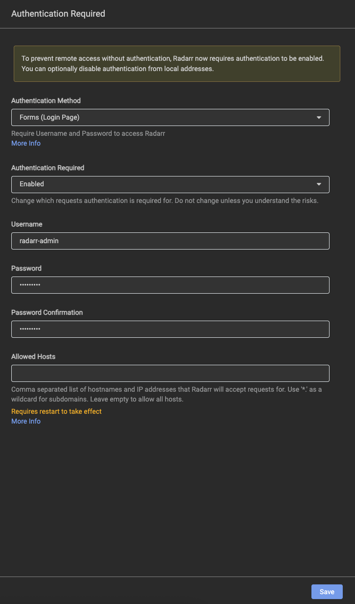
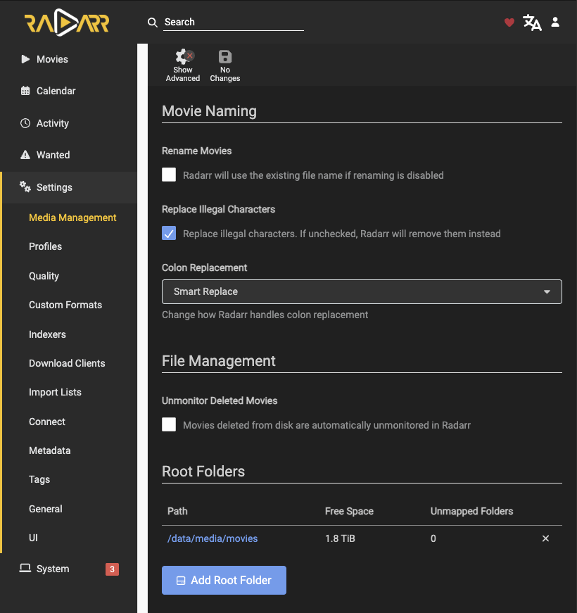
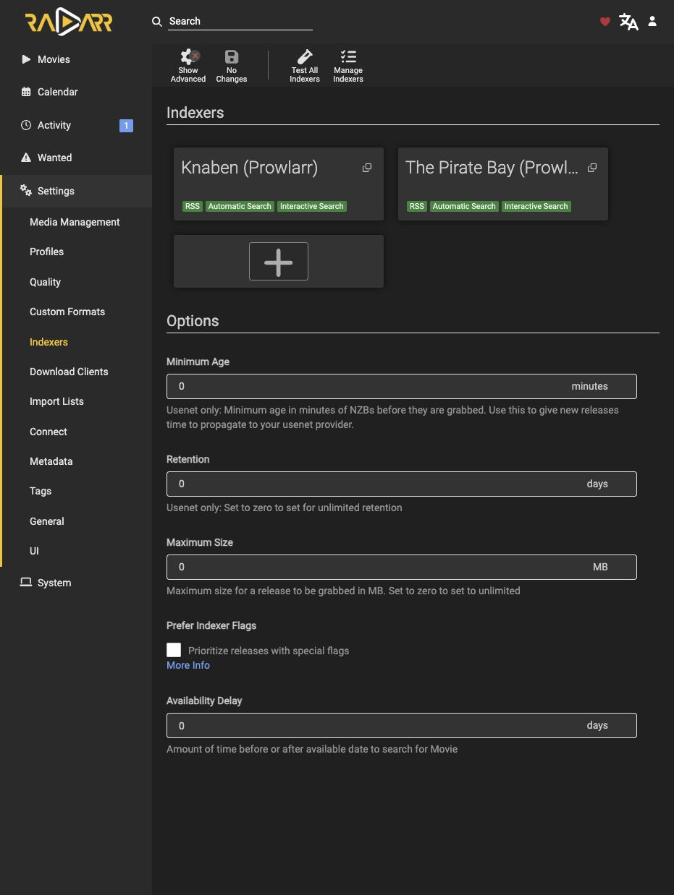
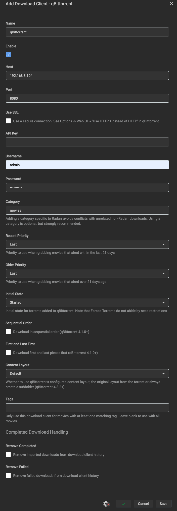
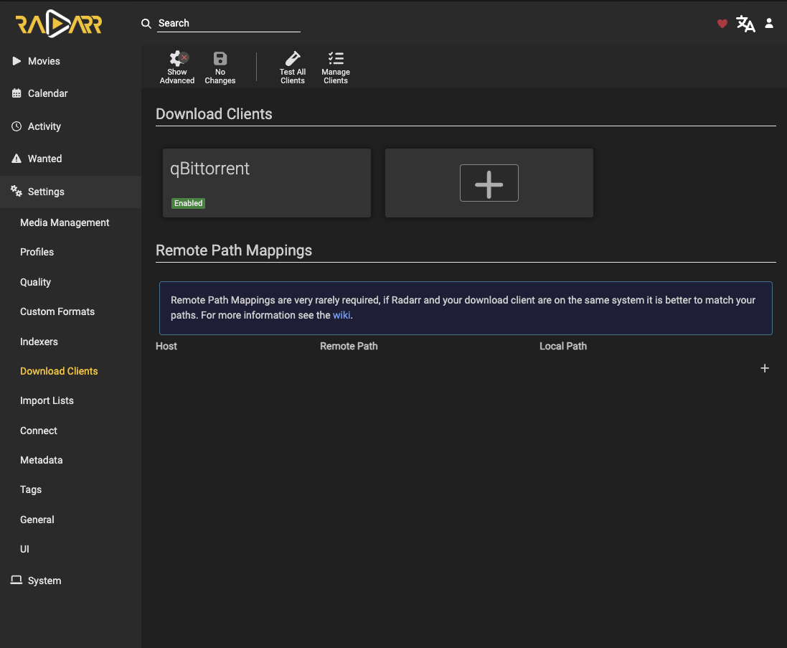
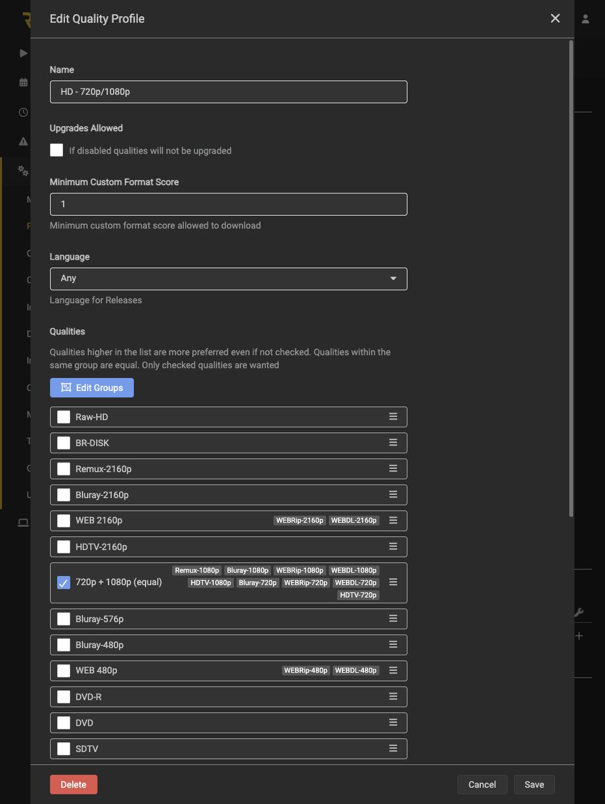
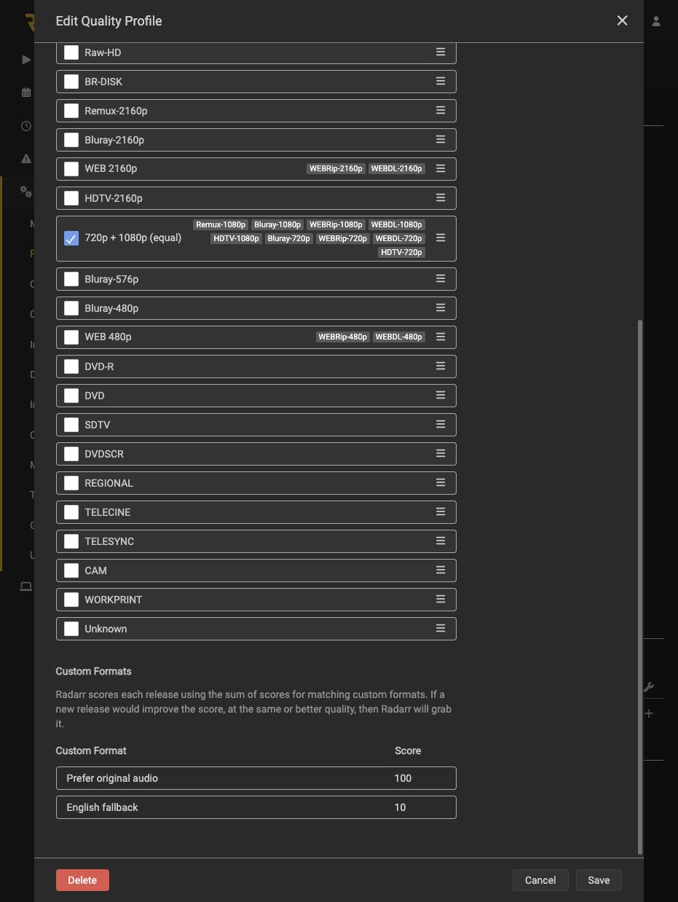
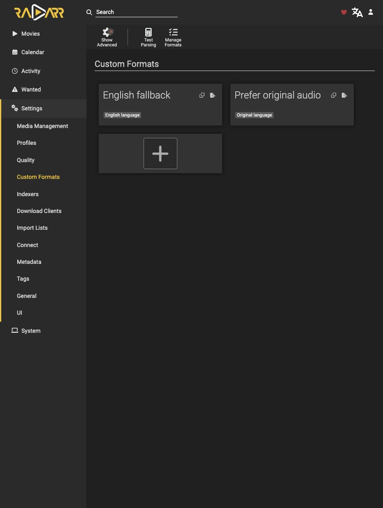
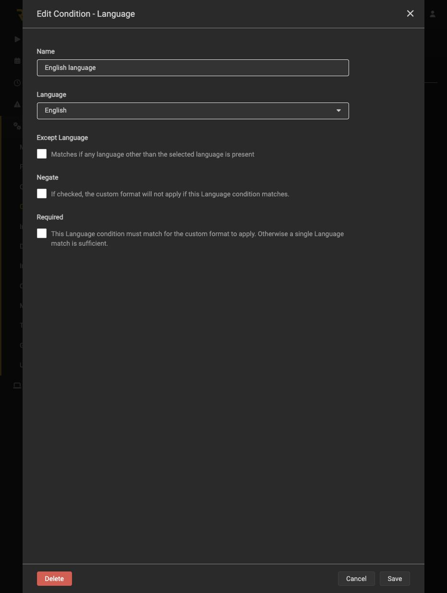
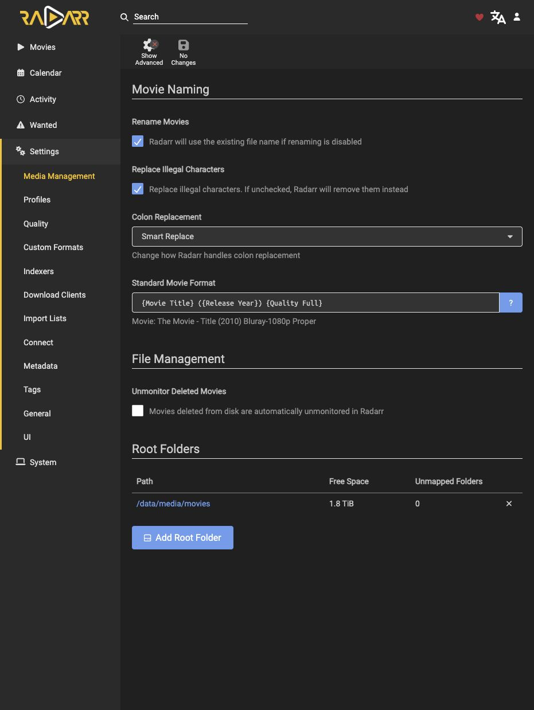

# Radarr Service Guide

Gestor de películas, desplegado y probado con Prowlarr/qBittorrent. Se comprobaron descarga, importación/renombrado automáticos y hardlink real. Las series pertenecen a [Sonarr](sonarr.md), con adopción existente por hardlink ya probada.

## 2. Version and Module Files

- Radarr **6.4.4.10685**, release estable; LinuxServer build **6.4.4.10685-ls321**, linux/amd64. Es una imagen de terceros mantenida por LinuxServer.
- Imagen: `lscr.io/linuxserver/radarr@sha256:ea6822c956d26db648b237919f41340318f32e5b7dcc4ba702cf256a0f5f3c12`.
- [Compose](../compose/radarr/compose.yaml), [environment template](../compose/radarr/.env.example), [image lock](../compose/radarr/image-lock.json), [module README](../compose/radarr/README.md).
- [First-deployment script](../scripts/deploy-radarr.py) y [local contract tests](../tests/test_radarr.py).

`latest` se utilizó únicamente para descubrir/inspeccionar la imagen estable. Compose y el instalador exigen el digest revisado; no se despliega un tag mutable. Las actualizaciones son manuales por imagen, no mediante el actualizador interno de Radarr.

## 3. Prerequisites and Boundaries

Ejecutar en la **VM Debian `media-server` ya existente**, con los privilegios administrativos disponibles; no en Proxmox ni en la computadora administradora. Requiere Docker/Compose, Python3, grupo `media` GID2000 y UID1000 ya existentes.

Antes de aplicar:

- `/usr/local/sbin/check-media-storage` debe confirmar el HDD esperado por UUID, ext4 y RW.
- `/data/downloads/movies` y `/data/media/movies` ya deben existir, sin symlinks, con GID2000, permisos de escritura y el mismo filesystem.
- Appdata debe estar en el filesystem del SO/NVMe, distinto de `/data`; al menos2GiB libres en SO y1GiB en HDD para este despliegue inicial. Esto no es una política suficiente de espacio para futuras películas.
- TCP7878 libre en la IPv4 LAN asignada a Debian; stack/appdata y proyecto Radarr ausentes. Revisar RAM disponible y servicios existentes antes de añadir la app.
- Jellyfin, qBittorrent y Prowlarr deben continuar funcionando. No detenerlos ni recrearlos para desplegar Radarr.

No reformatear, reinstalar Debian, alterar DSM, cambiar router/VPN/SSH/cuentas del sistema, conceder grupo Docker ni usar `chmod777`. No recorrer/chown recursivamente las bibliotecas.

## 4. Storage, Identity and Access

| Item | Reviewed value |
| --- | --- |
| Runtime Compose | `/srv/media-server/compose/radarr/compose.yaml` y `.env` privado |
| NVMe persistence | `/srv/media-server/appdata/radarr` → `/config` RW |
| Config contents | Bases de datos, configuración, API key, credenciales de futuras integraciones y backups internos; privados |
| HDD bind | **`/data:/data` RW**, único montaje común para descargas/biblioteca |
| Application identity | PUID1000, PGID2000, UMASK002; s6 inicializa root y la app baja a esa identidad |
| Initial config directory | UID1000:GID2000, modo750; no cambios en permisos globales del HDD |
| Web interface | TCP7878 en IPv4 privada de la VM; `http://<IP_DE_LA_VM>:7878` |
| Healthcheck | `/ping` local dentro del contenedor; no usa ni publica API keys |
| Other access | Sin Docker socket, privileged, devices, red host ni puertos adicionales |

**No dividir el HDD en binds `/movies` y `/downloads`.** Un único `/data` permite enlazar dentro del mismo montaje. Mantener los mismos nombres de ruta entre qBittorrent y Radarr: descargas en `/data/downloads/movies`, biblioteca final en `/data/media/movies`. Jellyfin ya ve esa biblioteca como `/media/movies` mediante su propio bind de sólo lectura; esa diferencia de presentación es intencional.

Un hardlink no es una copia ni un backup. Ver [Storage Guide](storage-guide.md) y [contrato de almacenamiento](stack-plan.md#storage-contract).

## 5. First Deployment Recipe

Estos pasos son para **una instalación nueva**, no un mecanismo de actualización/reparación. Si existe appdata/stack, el script se niega a continuar; no borrarlos para conseguir que pase. Un fallo posterior a crear estado requiere revisar qué se alcanzó a hacer.

1. Revisar los archivos del módulo y ponerlos al alcance de root **dentro de Debian**. No hace falta clonar ni guardar todo el repositorio en Proxmox.
2. Copiar `.env.example` a un archivo privado, modo600. Completar sólo `RADARR_BIND_ADDRESS` con la IP real de Debian; conservar `RADARR_IMAGE` por digest. No poner una dirección enmascarada literalmente, la IP de Proxmox o `0.0.0.0`.
3. Dentro de Debian, preparar `/root/media-server-scripts/` y copiar allí el script como `deploy-radarr.py`, el manifiesto como `radarr-compose.yaml` y el entorno privado como `radarr.env`. Script modo700; entradas privadas modo600. No copiar bases de datos o contraseñas al repositorio.
4. Obtener la imagen exacta y revisar plataforma/label contra el lock:

```sh
docker pull lscr.io/linuxserver/radarr@sha256:ea6822c956d26db648b237919f41340318f32e5b7dcc4ba702cf256a0f5f3c12
docker image inspect lscr.io/linuxserver/radarr@sha256:ea6822c956d26db648b237919f41340318f32e5b7dcc4ba702cf256a0f5f3c12
```

5. Ejecutar **como root en Debian**:

```sh
python3 /root/media-server-scripts/deploy-radarr.py --apply \
  --compose-file /root/media-server-scripts/radarr-compose.yaml \
  --env-file /root/media-server-scripts/radarr.env
```

El instalador comprueba entorno/guarda/imagen/identidad/montajes/puerto y estado ausente. Crea sólo su appdata y stack, escribe configuración inicial sin cuenta ni clave predeterminadas, valida Compose y hace `up -d --wait --pull never` **sólo de este proyecto**. No modifica los otros servicios ni crea películas, raíces, indexadores o clientes.

Después verifica API v3/versión y listas vacías; realiza un probe mínimo de permisos/hardlinks **dentro del contenedor como1000:2000**, con archivos ocultos temporales en las dos carpetas de películas y limpieza. **Eso no verifica una importación de película por Radarr.** No copia videos ni cambia contenido existente.


## 6. Authentication

Abrir `http://<IP_DE_LA_VM>:7878`, completar el alta nativa con **Forms (Login Page)** y **Enabled**, cuenta propia y contraseña en la UI. Allowed Hosts vacío. Guardar/iniciar sesión y comprobar rechazo de acceso web/API sin autenticación. No forzar None mediante variables del contenedor.



## 7. Configuration and Integrations

### 7.1. Media Management

Settings → Media Management → Root Folders: añadir `/data/media/movies` y comprobar acceso/espacio. No usar `/data/downloads` ni `/media/movies`, que es la vista de Jellyfin. Mantener **Use Hardlinks instead of Copy ON** y no aplicar cambios recursivos de permisos.



### 7.2. Prowlarr → Radarr

Crear la App Radarr con **Full Sync** en Prowlarr, siguiendo su [guía](prowlarr.md#radarr-integration). La API key es la de Radarr y permanece privada. Tras Test → Save, verificar las fuentes gestionadas desde Prowlarr; no crear copias manuales.



### 7.3. Radarr → qBittorrent

Settings → Download Clients → Add → qBittorrent:

| Campo | Valor |
| --- | --- |
| Host / Port | `<IP_DE_LA_VM>` /8080 |
| Use SSL | OFF, configuración LAN actual |
| API Key | Vacío |
| Username / Password | Credencial vigente de qBit |
| Category | `movies` |
| Initial State | Started |
| Content Layout | Default |
| Sequential / First and Last First | OFF |
| Remove Completed / Remove Failed | **OFF / OFF** |
| Remote Path Mappings | Vacío; las rutas ya coinciden |

Test → Save y comprobar tarjeta Enabled. Si falla autenticación, diagnosticar login/ruta/puerto antes de restablecer credenciales; el [reset acotado de qBit](qbittorrent.md#webui-login-recovery--explicit-scoped-reset) tiene requisitos estrictos y no sirve para un cliente poblado.





El formulario original conserva la IP LAN del laboratorio como referencia visual; los ejemplos reutilizables usan placeholders. La [credencial de laboratorio](qbittorrent.md#laboratory-login-example) se mantiene sólo en su sección canónica, no aquí.

### 7.4. Language and Quality Profiles

#### Saved Equal-Priority HD Profile

| Campo | Valor guardado |
| --- | --- |
| Name | `HD - 720p/1080p` |
| Upgrades Allowed | **OFF**: no reemplazar posteriormente una descarga por otra calidad/puntaje |
| Grupo habilitado | **`720p + 1080p (equal)`**, único grupo habilitado; sus miembros tienen la misma prioridad de calidad |
| Miembros 720p | HDTV-720p, WEBDL-720p, WEBRip-720p, Bluray-720p |
| Miembros 1080p | HDTV-1080p, WEBDL-1080p, WEBRip-1080p, Bluray-1080p, **Remux-1080p** |
| Excluidos | Todas las variantes 2160p/4K, BR-DISK, Raw-HD, Unknown y las calidades inferiores/no seleccionadas |
| Language | **Any**, con los filtros/puntajes de idioma descritos abajo; no significa aceptar cualquier idioma sin restricciones |
| Minimum Custom Format Score | **1** |



**Para reproducirlo por UI:** Settings → Profiles → `HD - 720p/1080p` → **Edit Groups**. Reunir las nueve calidades indicadas en **un solo grupo**, sin grupos WEB anidados y sin calidades habilitadas fuera de él; renombrarlo `720p + 1080p (equal)`, terminar la edición de grupos y guardar. Marcar por separado 720p y 1080p conservaría el orden de preferencia de la lista: **no cumpliría la elección de equivalencia**. El orden visual de etiquetas dentro del grupo no establece preferencia; otros criterios de Radarr siguen desempatando resultados.

**Tamaño:** no se cambiaron Settings → Quality ni se fijó un máximo de GB. 1080p no implica un archivo pequeño y REMUX puede ocupar bastante espacio. Revisar el tamaño del resultado concreto antes de cada descarga; acordar límites globales aparte. No sustituir esa decisión por un número inventado.

#### Saved Original Audio and English Fallback

Se crearon dos **Custom Formats**, con una condición **Language** cada uno:

| Custom Format | Condición Language | Puntaje en este perfil |
| --- | --- | --- |
| `Prefer original audio` | **Original** | **100** |
| `English fallback` | **English** | **10** |

En ambas condiciones: **Except Language OFF, Negate OFF, Required OFF**. Al tener una única condición, ésta debe coincidir para obtener el puntaje. **Include Custom Format when Renaming OFF** en ambos formatos. Para reproducirlos: Settings → Custom Formats → **+**, escribir el nombre, añadir condición Language con esos valores y guardar. Después configurar los puntajes en el perfil y guardar. Las definiciones son globales; sus puntajes100/10 se aplicaron sólo al perfil elegido; en otros perfiles permanecen sin puntaje efectivo.

Con **Language=Any** y **mínimo1**, un resultado que coincida con Original suma 100, English suma 10 y ambos suman 110; ninguno suma 0 y queda por debajo del mínimo. Así se prefiere audio original entre las calidades equivalentes, con inglés como alternativa; no se obliga a doblaje inglés de una obra originalmente en otro idioma. **Upgrades OFF** evita descargar después otra versión automáticamente sólo por una mejora de puntaje.

Los puntajes se basan en la información que Radarr puede interpretar de la obra/release. **No certifican las pistas reales**, no esperan indefinidamente a que aparezca una versión original y no configuran la selección de audio del reproductor. Confirmar idioma y pistas al elegir el resultado y durante la reproducción. Estos formatos no descargan ni garantizan subtítulos; Jellyfin puede ofrecer las pistas EN/ES que el archivo ya incluya.



<details>
<summary>Capturas reales de las definiciones de idioma guardadas</summary>






</details>

[Política declarativa](radarr-profile-policy.json): nombres de calidades/grupo, condiciones, puntajes y renombrado. **No es un API payload importable directamente:** resolver IDs por nombre en cada instalación; no copiar IDs locales.

### 7.5. Movie Naming

Settings → Media Management → Movie Naming:

| Campo | Valor |
| --- | --- |
| Rename Movies | ON |
| Replace Illegal Characters | ON |
| Colon Replacement | Smart Replace |
| Standard Movie Format | `{Movie Title} ({Release Year}) {Quality Full}` |
| Movie Folder Format | `{Movie Title} ({Release Year})` |

Guardar y comprobar persistencia. No es una orden de renombrado masivo ni de borrado.



## 8. Validate the Pipeline

Seguir el [procedimiento de validación](validation.md): revisar un resultado autorizado, comprobar bytes reales, importación y mismo dispositivo/inode entre descarga y biblioteca. No mover archivos manualmente para completar la prueba. El monitor automático posterior de Jellyfin está comprobado con episodios, no con una nueva película: no ampliar ese alcance por analogía.

## 9. Operation and Recovery

Dentro de Debian:

```sh
cd /srv/media-server/compose/radarr
docker compose ps
docker compose logs --tail=100
```

Antes de actualizar, detener sólo Radarr y guardar copia privada consistente de appdata, Compose y entorno. Elegir imagen por digest. Para revertir una migración de base puede hacer falta restaurar la copia compatible además de la imagen; restauración independiente aún no probada. Configurar backup de la VM no respalda automáticamente el HDD físico.

## Primary Sources

- [LinuxServer Radarr](https://docs.linuxserver.io/images/docker-radarr/).
- [Radarr Quick Start](https://wiki.servarr.com/radarr/quick-start-guide).
- [Servarr Docker Guide](https://github.com/Servarr/Wiki/blob/master/docker-guide.md).
