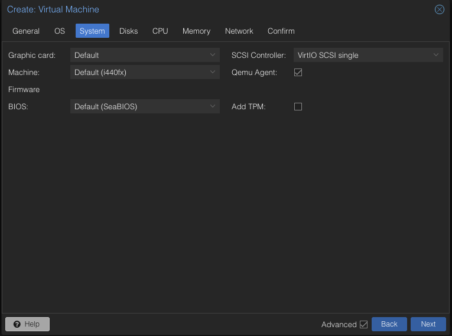
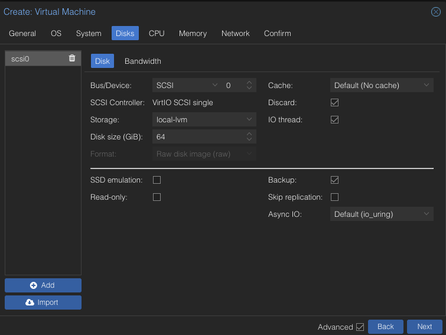
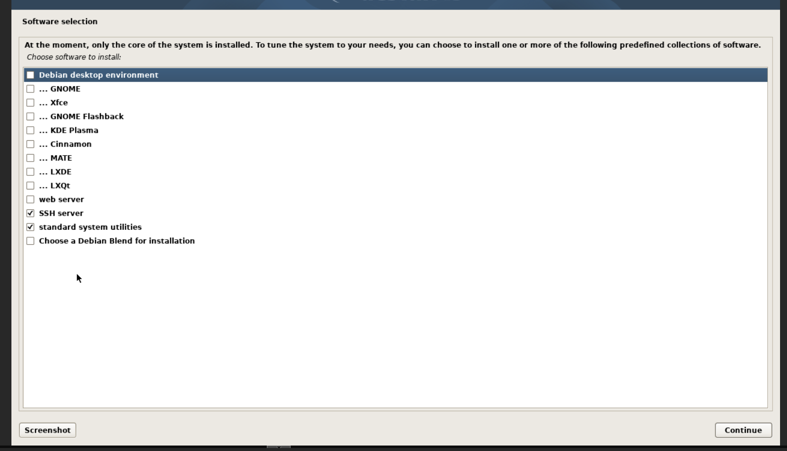
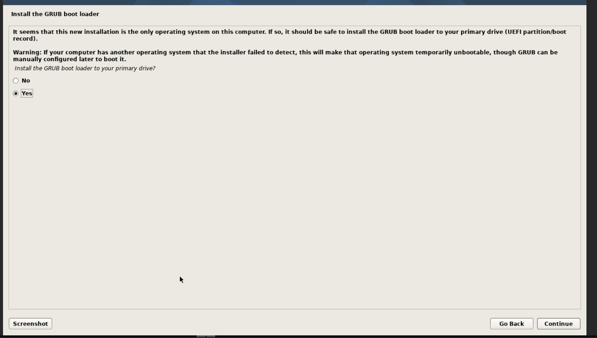

# Setup Guide

**Status:** First boot and base preparation verified / Media deployment pending · **Updated:** 2026-10-16.

## Scope and Safety

Crear una VM Debian para películas y series y, después, configurar las cuatro capas de automatización. Libros y música quedan fuera de esta etapa.

Las capturas conservan el recorrido del instalador. Después se verificaron desde Proxmox y el Guest Agent el primer arranque, Debian 13.7, hostname `media-server`, CPU/RAM, disco virtual con Discard/IO thread, root con contraseña bloqueada y usuario con `sudo`. El dominio efectivo y el checksum del ISO siguen pendientes. Ver [Post-install Guide](post-install-guide.md) para IP estática, Docker/Compose y pública SSH instalada/verificada; [Storage Guide](storage-guide.md) registra la asignación posterior del HDD inicialmente RO y su preparación GPT/ext4 completada. No tocar la VM DSM, su HDD ni los volúmenes mdraid/LVM que el host detecta de ese disco.

## Configuration Reference

[vm-config.json](../vm-config.json) conserva la configuración objetivo y su estado de verificación. Es un formato de referencia de este proyecto: **no copiarlo a `/etc/pve` ni pasarlo directamente a `qm`**.

| Section | Setting |
| --- | --- |
| General | `media-server`; ID de referencia `102`, nodo de referencia `pve` |
| OS | Debian 13.7.0 `amd64` netinst |
| System | Default `i440fx`, Default `SeaBIOS`, `VirtIO SCSI single`, QEMU Agent activado, sin TPM |
| Disks | `scsi0`, `local-lvm` sobre NVMe, 64 GiB, caché Default / No cache |
| Disk options | Discard e IO thread activados; Backup activado; SSD emulation desactivado, como en la captura |
| CPU | Tipo `host`, 1 socket, 2 cores, NUMA desactivado |
| Memory | 4096 MiB; mínimo también 4096 MiB si aparece esa opción, pendiente de verificar |
| Network | VirtIO en `vmbr0`, flag Firewall activado; DHCP durante instalación; después IPv4 estática terminada en `.104`, ver Post-install Guide |
| Confirm | Start after created desmarcado; arranque automático pendiente de validar la instalación |

Al reproducir, comprobar que el ID esté libre y que nodo, storage y bridge existan. `102` no es un requisito universal. Guardar el checksum del ISO y comprobarlo contra la publicación oficial antes de instalar; la captura solo demuestra el nombre del archivo seleccionado. El flag Firewall de la NIC **no prueba** que haya reglas efectivas en Proxmox.

## Important Checkboxes

> **Revisar antes de Finish:** QEMU Agent en System; Discard e IO thread en Disks. QEMU Agent y Discard se habían pasado por alto en el primer resumen; el usuario volvió atrás y confirmó las tres casillas activadas en las capturas siguientes.

### System: QEMU Agent

1. Abrir **System** en el asistente.
2. Confirmar **SCSI Controller: VirtIO SCSI single**.
3. Marcar **Qemu Agent**.

Esto habilita la integración desde Proxmox, pero **no instala el agente en el huésped**. Después de instalar Debian se debe instalar, habilitar y verificar `qemu-guest-agent`; comprobar entonces que Proxmox obtiene información del huésped y puede apagarlo correctamente. No declarar ese paso terminado por haber marcado la casilla.

### Disks: Discard and IO Thread

1. Abrir **Disks** y seleccionar el disco virtual `scsi0` de **64 GiB** en `local-lvm`.
2. Marcar **Discard** y **IO thread**; habilitar **Advanced** si una opción no aparece.
3. Conservar caché **Default (No cache)** y **Backup** marcado.

**Discard** permite propagar TRIM desde Debian al almacenamiento thin; después se verificará el soporte y mantenimiento TRIM dentro de Debian. No es un botón para borrar el HDD ni sustituye un backup. **IO thread** separa el trabajo de E/S con el controlador elegido. Las opciones de esta captura corresponden al disco virtual del NVMe: no trasladarlas automáticamente al HDD físico.

## Installation Order

- [x] Crear la VM; existencia/configuración comprobadas posteriormente en Proxmox.
- [x] Instalar sobre el disco virtual de 64 GiB sin HDD adicional durante la instalación; éste se preparó después, ver Storage Guide.
- [ ] Usar hostname `media-server` y dejar **Domain name** vacío.
- [ ] Dejar ambos campos **Root password** vacíos y crear el usuario inicial con contraseña fuerte y única.
- [ ] Particionar únicamente el disco virtual de 64 GiB; registrar el esquema elegido, aún no documentado con evidencia.
- [ ] En **Software selection**, seleccionar únicamente **SSH server** y **standard system utilities**.
- [ ] Aceptar instalar **GRUB** y comprobar que su destino sea el disco virtual completo de 64 GiB.
- [x] Completar instalación y verificar el primer arranque; `scsi0` tiene prioridad de arranque y el ISO continúa adjunto.
- [ ] Verificar hostname, usuario con `sudo` y acceso SSH por clave; no guardar ni compartir credenciales en el repositorio o el chat.
- [x] Verificar `qemu-guest-agent`: ya estaba instalado y activo antes del bootstrap.
- [ ] Verificar RAM, discos, red, IP y apagado limpio; reservar la IP en DHCP cuando se defina.
- [ ] Registrar configuración real y cualquier diferencia respecto de `vm-config.json`, sin exportar secretos.
- [ ] Validar arranque/apagado antes de habilitar el arranque automático.

Los elementos no marcados conservan verificaciones pendientes. El estado posterior de red, paquetes y credenciales está en [Post-install Guide](post-install-guide.md).

## Debian Installer Steps

### Hostname and Domain Name

1. En **Hostname**, reemplazar `debian` por **`media-server`**, en minúsculas, sin espacios y con guion. Mantener el mismo nombre en Debian y Proxmox.
2. En **Domain name**, dejar el campo **vacío** y continuar. No se definió un dominio DNS propio para este servidor; no inventar un dominio público ni agregar `.local` por defecto.

### Root Password and Initial User

1. En **Root password**, dejar **ambos campos vacíos** y pulsar **Continue**. En este instalador eso bloquea la contraseña de root; **no** crea acceso root sin contraseña.
2. Crear el primer usuario normal con una contraseña **fuerte y única**. Debian habilitará su administración mediante `sudo` al no haber configurado contraseña de root.
3. No compartir la contraseña ni capturas donde esté visible. El nombre de usuario y las credenciales reales no forman parte del JSON público.

No confundir estas pantallas: **root queda sin contraseña utilizable; el usuario inicial sí recibe una contraseña**. El acceso SSH por clave se preparará y probará después.

### Partitioning Boundary

Instalar el sistema únicamente en el disco virtual de **64 GiB**. El HDD multimedia de 2 TB debe seguir fuera de esta VM hasta finalizar y comprobar Debian. Después se observó raíz ext4 en la primera partición y swap en una partición lógica del disco virtual. No se registró el recorrido exacto del particionador, mirror, idioma o teclado: no inventar esas decisiones.

### Software Selection

La captura del usuario muestra exactamente la selección deseada para una instalación sin escritorio:

| Software | Selection |
| --- | --- |
| SSH server | **Marcado** |
| standard system utilities | **Marcado** |
| Debian desktop environment | Desmarcado |
| GNOME, Xfce, GNOME Flashback, KDE Plasma, Cinnamon, MATE, LXDE, LXQt | Todos desmarcados |
| web server | Desmarcado |
| Choose a Debian Blend for installation | Desmarcado |

> **La fila azul indica foco, no una casilla marcada.** En esta captura `Debian desktop environment` está resaltado, pero su casilla está vacía: no hay que desmarcar nada más. Con esas dos casillas marcadas, pulsar **Continue**.

**SSH server** permite administrar Debian remotamente y **standard system utilities** conserva las herramientas habituales. No seleccionar **web server** para Jellyfin: sus servicios se desplegarán después con Docker/Compose, no mediante esta tarea del instalador. Esta pantalla tampoco instala Docker ni `qemu-guest-agent`.

### GRUB Boot Loader

En **Install the GRUB boot loader to your primary drive?**, dejar **Yes** y pulsar **Continue**.

Aunque Debian sea el único sistema operativo de esta VM, necesita un cargador de arranque. GRUB no sirve únicamente para elegir entre varios sistemas: en esta instalación con SeaBIOS se utilizará para arrancar Debian desde su disco virtual.

Si la pantalla siguiente pide el dispositivo de destino, seleccionar **el disco virtual completo del sistema de 64 GiB**, no una partición como `/dev/sda1`. El nombre puede ser `/dev/sda` según la enumeración del huésped: comprobar tamaño/modelo en la pantalla y no elegir una ruta solo por su nombre. Si aparece un disco de 2 TB u otro destino inesperado, detenerse y revisar la asignación de discos.

Esta operación corresponde al disco de **la VM**, no al NVMe físico de Proxmox ni al HDD de DSM. El HDD multimedia no debe estar adjunto todavía. La captura confirma **Yes** seleccionado, no que GRUB ya se haya escrito ni cuál será el destino mostrado después.

### Finish and First Boot

Estos pasos describen la finalización. El primer arranque ya fue verificado posteriormente por Guest Agent; el destino exacto del instalador GRUB no quedó capturado:

- Dejar terminar la instalación de paquetes y el instalador.
- Completar el paso de GRUB descrito arriba y registrar el disco de destino efectivamente seleccionado.
- Reiniciar desde el disco de sistema; si vuelve al instalador, revisar orden de arranque y retirar el ISO del CD virtual.
- Comprobar acceso con el usuario creado, administración con `sudo` y servicio SSH antes de continuar con el HDD o Docker.

## Media Disk: Attachment and Pending Preparation

El HDD adicional identificado es un **WD20EZRZ de 2 TB**. Tras confirmar el respaldo y autorizar explícitamente el borrado, se preparó con GPT/ext4 y se montó por UUID en `/data`. La asignación inicial fue RO; ahora `scsi1` es RW. Ver [Storage Guide](storage-guide.md) y [Scripts README](../scripts/README.md) para pasos, código y pruebas; DSM permaneció intacto.

- Revalidar identidad física y respaldo antes de escribir: nunca seleccionar el disco solo porque ahora se llame `/dev/sdb`.
- Asignarlo a una única VM por identidad estable `by-id`; no compartir el bloque físico con DSM ni montarlo a la vez en Proxmox.
- El filesystem y `/data` ya se prepararon en la etapa posterior autorizada. Para reproducir o recuperar, seguir Storage Guide, no repetir el formato; detalles privados sólo en `media-server/.local/`.
- Impedir que los servicios escriban en el directorio vacío del NVMe si el HDD falta o no está montado.
- El checkbox **Backup** del disco virtual no prueba cobertura del HDD físico futuro. Diseñar su protección por separado.

## Deployment and Acceptance

Seguir [Stack Plan](stack-plan.md). Docker/Compose ya están preparados según [Post-install Guide](post-install-guide.md); Jellyfin y qBittorrent ya tienen módulos Compose e imágenes por digest. Continuar desde sus guías propias: [Jellyfin](jellyfin.md) y [qBittorrent](qbittorrent.md); no repetir instalación de VM/base.

- [x] Instalar y verificar Docker Engine y Compose dentro de Debian, no en el host Proxmox.
- [ ] Configurar rutas y permisos; guardar configuraciones/bases de datos en el NVMe y medios/descargas en el HDD.
- [ ] Probar primero una película y un episodio incorporados manualmente a Jellyfin desde un dispositivo real.
- [ ] Integrar Prowlarr, qBittorrent, Radarr y Sonarr y probar una adquisición autorizada de extremo a extremo.
- [ ] Verificar importación, nombres, idioma/calidad, catálogo y reproducción sin mover archivos manualmente.
- [ ] Comprobar hardlinks cuando corresponda, espacio disponible y comportamiento si falta el HDD.
- [ ] Documentar versiones exactas, configuración de aplicaciones sin secretos, actualizaciones, rollback y restauración de muestra.

Solo después de esas pruebas se podrá cambiar el estado de la receta a **verified**. Un backup creado sin prueba de restauración no completa esta checklist.

## References

- [Proxmox VM configuration](https://github.com/proxmox/pve-docs/blob/master/qm.adoc) — VirtIO SCSI, IO thread, Discard y guest agent.
- [Debian netinst](https://www.debian.org/distrib/netinst) — instalador y verificaciones oficiales.
- [Debian software selection](https://www.debian.org/releases/trixie/amd64/ch06s03.en.html#pkgsel) — instalación sin escritorio y tareas de servidor.
- [Docker Engine on Debian](https://docs.docker.com/engine/install/debian/) — procedimiento oficial a aplicar cuando se configure el huésped.
