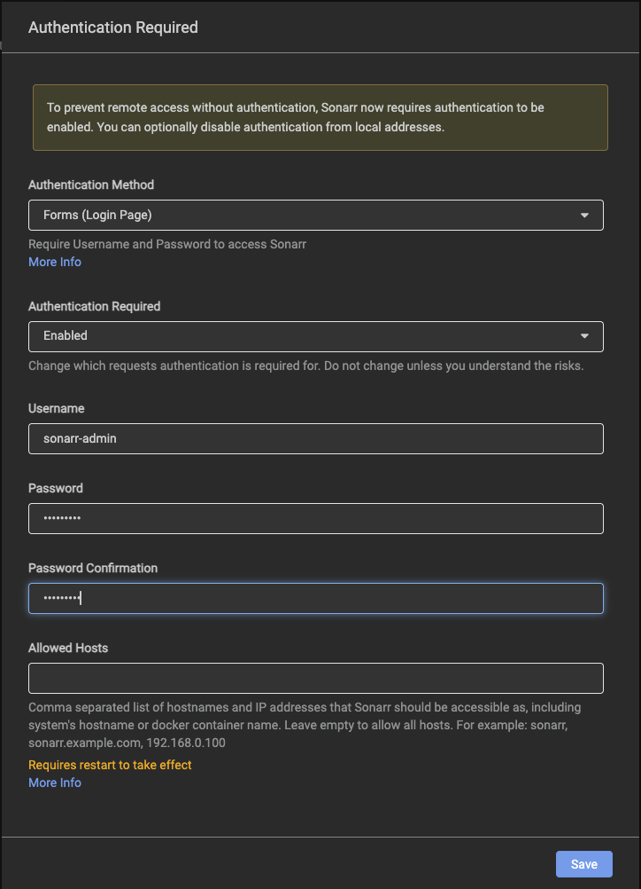
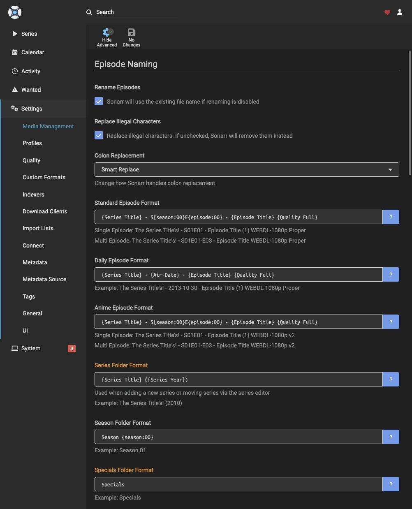
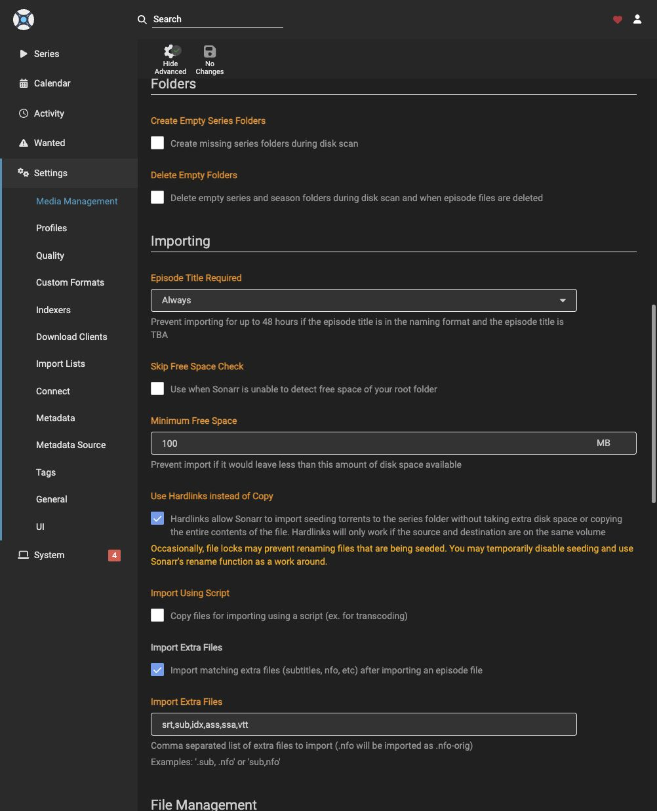
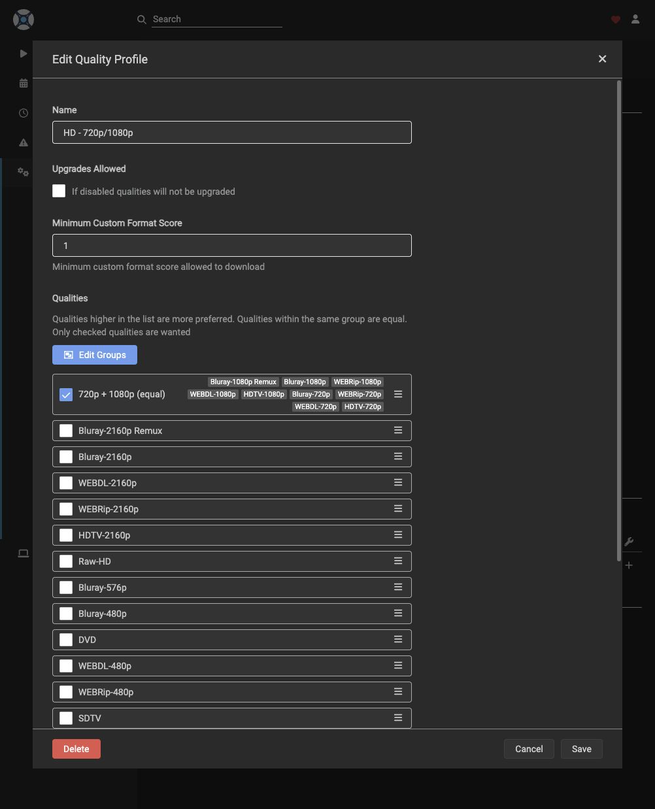
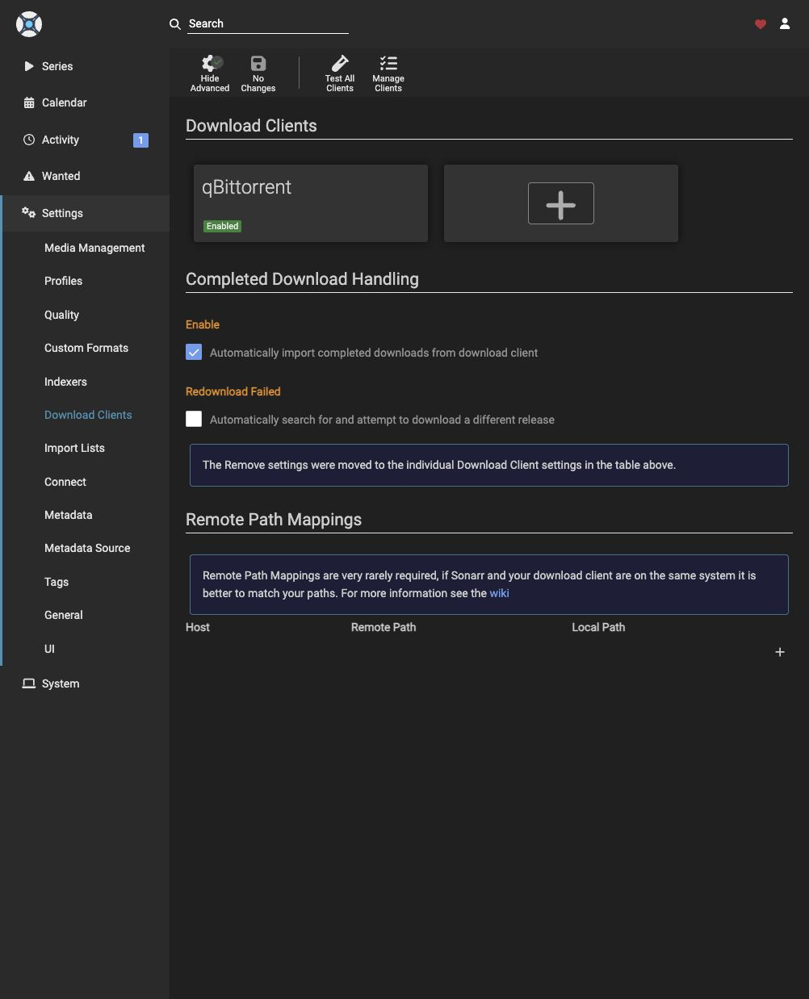
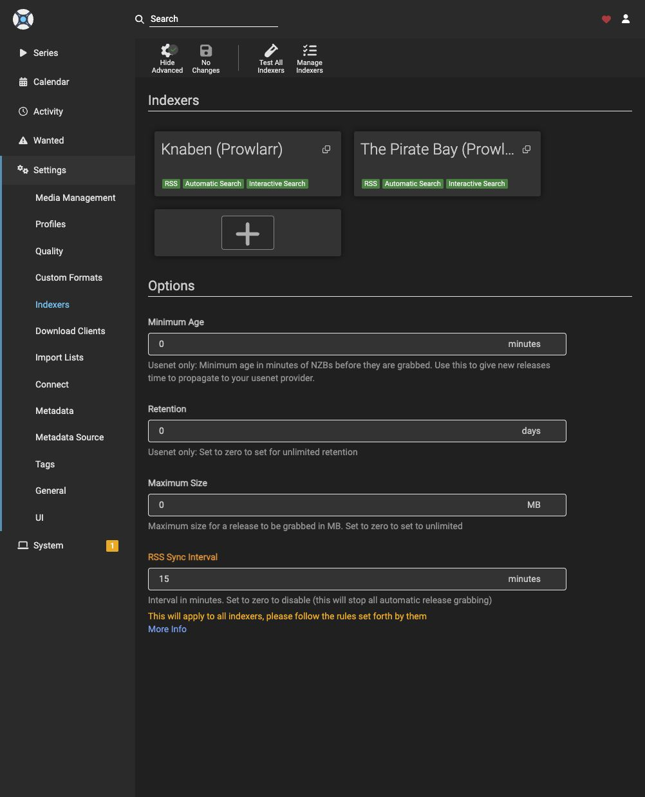

# Sonarr Service Guide

**Comprobado:** despliegue, autenticación, perfil HD, qBit/Prowlarr, adopción de descargas previas por hardlink real y detección posterior en Jellyfin. Completed Download Handling ON. Subtítulos automáticos y SRT manuales en series gestionadas comprobados en [Bazarr](bazarr.md), sujetos a disponibilidad/cuotas. **Pendiente:** registrar la colección copiada y validar una nueva adquisición de series iniciada por Sonarr. Adoptar archivos no prueba esa última etapa.

## First Deployment

Sólo para una instalación nueva en la **VM Debian `media-server`, como root**; no ejecutar en Proxmox ni en el Mac. Requiere Docker/Compose, Python3, UID1000, grupo media GID2000 y la guarda `/usr/local/sbin/check-media-storage`. `/data/downloads/tv` y `/data/media/tv` deben existir en el mismo HDD ext4/RW, con escritura de grupo. El script exige 2GiB libres en SO y 1GiB en HDD para arrancar; no es un límite operativo suficiente para descargas.

1. Revisar [Compose](../compose/sonarr/compose.yaml), [lock](../compose/sonarr/image-lock.json) e [instalador](../scripts/deploy-sonarr.py). Versión **4.0.20.3014**, build LinuxServer **4.0.20.3014-ls329**, linux/amd64. Imagen de terceros LinuxServer; actualizaciones manuales por digest.
2. Copiar la [plantilla](../compose/sonarr/.env.example) a `sonarr.env` privado, modo600; completar `SONARR_BIND_ADDRESS` con la IPv4 LAN asignada a Debian, conservar el digest. Verificar exclusión de Git **antes** de guardar valores reales.
3. Poner dentro de Debian, en `/root/media-server-scripts/`, el instalador `deploy-sonarr.py` (700), manifiesto `sonarr-compose.yaml` y entorno `sonarr.env` (600). No hace falta copiar todo el repositorio.
4. Obtener e inspeccionar la imagen exacta; comprobar plataforma/label contra el lock:

```sh
docker pull lscr.io/linuxserver/sonarr@sha256:aae7c64ef13a4055c5b00607d5f2a2997d5a03304eb96e1930f9665728192e75
docker image inspect lscr.io/linuxserver/sonarr@sha256:aae7c64ef13a4055c5b00607d5f2a2997d5a03304eb96e1930f9665728192e75
python3 /root/media-server-scripts/deploy-sonarr.py --apply \
  --compose-file /root/media-server-scripts/sonarr-compose.yaml \
  --env-file /root/media-server-scripts/sonarr.env
```

El instalador rechaza appdata/stack existentes: **no es un restaurador ni debe repetirse borrando estado**. Valida imagen, puerto8989 libre, guarda y montajes; crea sólo su proyecto y verifica versión/API vacía. Su probe oculto de hardlink se limpia; no es una importación de episodio. No añade cuentas, series, clientes o fuentes ni modifica otros servicios/DSM.

Runtime: `/srv/media-server/compose/sonarr/`; appdata NVMe: `/srv/media-server/appdata/sonarr` → `/config`. PUID1000/PGID2000/UMASK002. **Un único `/data:/data` RW**, no binds separados `/tv` y `/downloads`: éstos pueden impedir hardlinks. [Referencia LinuxServer](https://docs.linuxserver.io/images/docker-sonarr/#media-folders).

## Authentication

Abrir `http://<IP_DE_LA_VM>:8989`. Elegir **Forms (Login Page)**, **Authentication Required: Enabled**, usuario **`sonarr-admin`**; el propietario introduce/confirma su contraseña y pulsa Save. `Allowed Hosts` vacío permite cualquier nombre de host para acceder, **no elimina el login**. No poner contraseñas en Compose ni forzar autenticación None.



La captura ilustra el paso previo a Save; la persistencia de Forms/Enabled/usuario se comprobó aparte mediante la API nativa. No publica la contraseña.

## Media and Quality

En **Settings → Media Management**, añadir raíz `/data/media/tv`, no `/data/downloads/tv` ni `/media/tv` (vista de Jellyfin). Activar Show Advanced:

| Ajuste | Valor guardado |
| --- | --- |
| Rename Episodes / Replace Illegal Characters | ON / ON; Colon Replacement: Smart Replace |
| Standard Episode Format | `{Series Title} - S{season:00}E{episode:00} - {Episode Title} {Quality Full}` |
| Series / Season Folder Format | `{Series Title} ({Series Year})` / `Season {season:00}` |
| Use Hardlinks instead of Copy | ON |
| Import Extra Files | ON: `srt,sub,idx,ass,ssa,vtt`; sólo archivos coincidentes |
| Propers and Repacks | Do not Upgrade Automatically |
| Create/Delete Empty Folders / Set Permissions | OFF; sin cambios recursivos de permisos |




**Settings → Custom Formats / Profiles:** reproducir la [política declarativa](sonarr-profile-policy.json), resolviendo IDs por nombre; no enviarla directamente como payload API. Reutilizar el perfil con ese nombre si ya existe, sin crear duplicados.

- Perfil **`HD - 720p/1080p`**, **Upgrades Allowed OFF**. Un único grupo **`720p + 1080p (equal)`**: HDTV, WEBDL, WEBRip y Bluray en 720p/1080p, más **`Bluray-1080p Remux`**. Todas las otras calidades desmarcadas, incluidos 2160p/4K y Raw-HD. Usar Edit Groups: marcarlas por separado conservaría preferencias por orden.
- Custom Formats **`Prefer original audio`** (Language Original,100) y **`English fallback`** (Language English,10), mínimo de puntaje **1**. Except Language, Negate, Required e Include when Renaming OFF. Los puntajes filtran metadatos interpretados, no certifican pistas reales ni subtítulos.
- No se cambiaron los tamaños de Quality: 1080p/Remux puede ser grande. Límites de espacio/tamaño siguen pendientes de acordar.



## Connections

1. **Sonarr → Settings → Download Clients → Add → qBittorrent**: Host `<IP_DE_LA_VM>`, Port8080, SSL OFF; credencial vigente del cliente, Category **`tv`**, Imported Category vacío. Initial State Started, prioridades normales, Content Layout Default; Sequential y First/Last OFF. **Remove Completed / Remove Failed OFF**. Test → Save; tarjeta Enabled. Sin Remote Path Mappings: ambos usan `/data/downloads/tv`. Nunca copiar una contraseña enmascarada de otra API ni restablecer qBit para resolver una integración.
2. **Prowlarr → Settings → Apps → Add → Sonarr**: Name Sonarr, Full Sync; Prowlarr Server `http://<IP_DE_LA_VM>:9696`, Sonarr Server `http://<IP_DE_LA_VM>:8989`, API key privada de **Sonarr**. Categorías TV del formulario; sin tags/reverse-proxy credentials. Test → Save → Sync App Indexers; comprobar Knaben y The Pirate Bay en Sonarr. No duplicar indexadores manualmente. Entre proyectos Compose, `localhost` apunta a cada contenedor, no a los demás.




## Adopt Existing Downloads

Procedimiento probado mediante API nativa, sin búsquedas ni redescarga:

Una descarga añadida directamente en qBittorrent puede estar al 100% y en categoría `tv` sin que exista la serie en Sonarr. En ese caso permanece en descargas: Jellyfin no lee esa ubicación. Al añadirla manualmente, usar `/data/downloads/tv`; la raíz de Sonarr sigue siendo `/data/media/tv`. Ver [tabla de rutas y límites del ingreso manual](workflow.md#add-a-torrent-manually). Si ya se guardó en otra carpeta bajo `/data/downloads`, adoptar desde su ruta real sin moverla sólo para que coincida con la tabla.

1. Verificar qBit100%, archivos completos/estables y ausencia de escritores SMB en el destino. No adoptar carpetas todavía en copia ni usar archivos de `incomplete` como biblioteca. Se puede avanzar por serie terminada, sin esperar toda la colección.
2. Registrar la serie correcta por título/año, raíz TV y perfil HD. **Monitored OFF**, temporadas sin monitorizar, Monitor New Items None y ambos flags de búsqueda OFF. Si ya existe, reutilizarla; no crear duplicados.
3. Con categoría `tv` y manejo de completos ON, comprobar primero si Sonarr ya lo importó al registrar la serie: esa adopción nativa quedó probada. No duplicar una importación terminada. Si requiere intervención, revisar correspondencia serie/temporada/episodio, archivos dobles, idioma/calidad y cero rechazos. Primero un episodio. Para selección individual por API usar `folder` con ruta del archivo **sin `downloadId` ni `seriesId`**: el primero puede usar la raíz del torrent y el segundo escanea la biblioteca de la serie, no el origen elegido.
4. Importar mediante **ManualImport, `importMode: copy`**, con IDs de episodios confirmados. Con hardlinks ON y bind común se verificó dispositivo/inode iguales y origen intacto. La ruta UI es **Wanted → Manual Import → Interactive Import**; no elegir Move Automatically para un torrent que debe conservarse. No reutilizar scripts temporales de una adquisición particular.
5. Verificar con [stat](validation.md#hardlink-import); incorporar el resto saltando episodios ya importados, sin sobrescribirlos. Comparar cobertura con metadatos, no número de archivos: uno puede contener dos episodios. Comprobar Jellyfin mediante el monitor ya [inicializado](validation.md#library-discovery).
6. Reconciliar también las series cuyo torrent sigue pendiente, sin buscar ni importar contenido parcial. Dejar **Completed Download Handling ON**, redescargas de fallidos OFF y ambas opciones Remove OFF. La cola existente quedó vinculada y sin avisos; no se retiraron torrents del cliente.

Una carpeta copiada directamente por SMB requiere **Library Import sobre su ubicación existente**, no otra descarga ni moverla desde qBit. Ese registro de la colección copiada aún es pendiente. Mantener el contenido no deseado sin monitorizar hasta decidir qué adquirir. La integración de subtítulos tiene su [guía propia](bazarr.md); [pendientes técnicos](../TODO.md).
