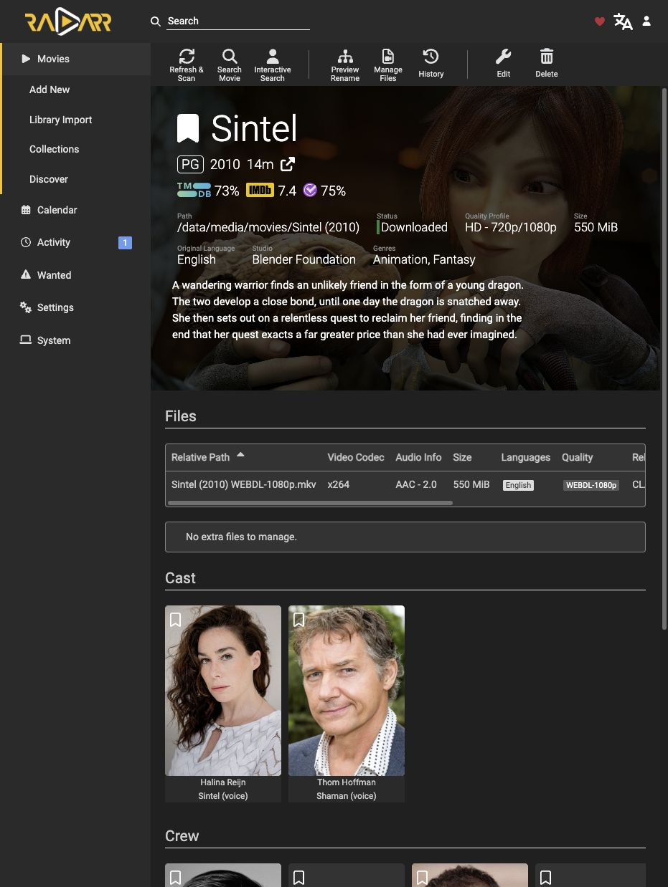
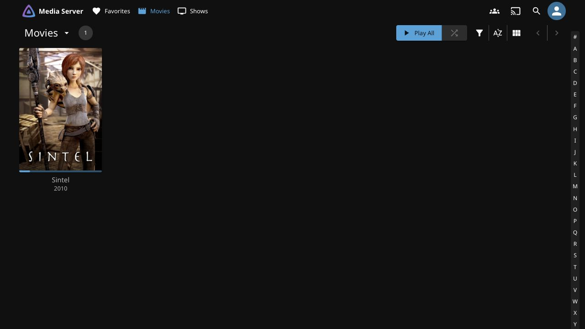

# Validate the Media Pipeline

Este procedimiento comprueba las etapas por separado. Se verificaron adquisición de una película, importación/renombrado automáticos por hardlink y reproducción desde tablet con selección de subtítulos incluidos. También se verificaron adopción de series existentes por hardlink y detección automática de un episodio nuevo tras inicializar TV. **No están validados** una adquisición nueva de series iniciada por Sonarr ni una restauración de backup.

## Search and Transfer

1. Usar contenido de prueba autorizado y el perfil configurado de Radarr.
2. Revisar Interactive Search y seleccionar un resultado admitido. Comprobar que qBittorrent recibe un trabajo con categoría `movies` y ruta en el HDD.
3. Verificar **bytes recibidos y peers conectados**, no sólo los seeders anunciados por el índice. Dos indexadores con el mismo infohash describen el mismo enjambre; sus contadores no se suman.
4. Esperar descarga completa y verificar el archivo importado en Radarr. `stalledDL` y `stalledUP` son estados distintos: el segundo puede indicar una descarga completa sin solicitudes de subida activas.

## Hardlink Import

Dentro de Debian, comparar la ruta de descarga y la ruta organizada del mismo video:

```sh
stat -c 'device=%d inode=%i links=%h bytes=%s %n' -- "$DOWNLOAD_FILE" "$LIBRARY_FILE"
```

Ambos nombres deben compartir **dispositivo e inode**, con al menos dos enlaces. Igual tamaño o hash no basta: dos copias también pueden coincidir. Si se produjo una copia, revisar filesystem, permisos, configuración de hardlinks y bind común `/data`; no mover ni borrar archivos para simular la prueba.



Las capturas usan como ejemplo la obra abierta [Sintel, Blender Foundation, CC BY3.0](https://durian.blender.org/sharing/); conservar su atribución. El título concreto no forma parte del procedimiento. El screenshot no demuestra por sí solo el hardlink: se comprobó con `stat`.

## Library Discovery

Jellyfin lee `/data/media` como `/media:ro`, nunca descargas. **Movies → `/media/movies`; Shows → `/media/tv`**. Una serie copiada a Movies puede ser tratada como películas. Usar nombres identificables de serie/temporada y `SxxExx`.

1. Mantener Realtime Monitor ON. El retardo configurado es60s: agrupa cambios, no garantiza un alta al minuto.
2. **Inicialización:** una raíz sin contenido puede quedar omitida por vacía. Aunque la opción esté ON, eso no demuestra un watch activo. Tras el primer archivo completo, ejecutar una vez **Dashboard → Libraries → Scan all libraries** y esperar a que termine. En el caso comprobado, el escaneo individual de Shows no inicializó esa raíz; el general sí.
3. **Aceptar automatización:** incorporar otro episodio completo después de finalizar ese escaneo, sin pedir otro; confirmar su aparición en Shows. Se probó así, además de un lote posterior de temporadas, manteniendo las descargas originales. Refrescar la página web no equivale a escanear el servidor.
4. Si falla: comprobar rutas y lectura como1000:2000 dentro del contenedor; revisar logs de LibraryMonitor y errores de acceso antes de cambiar permisos o reiniciar. Mantener montaje RO, sin claves API nuevas ni otra integración para ocultar el fallo.

Durante SMB, trabajar con carpetas ya terminadas; no renombrar, mover ni importar las que tengan escritores. Jellyfin puede mostrar episodios completos mientras llegan otros, pero no reproducir un archivo aún en copia. Registrar después la colección en el gestor evita búsquedas duplicadas; Jellyfin no la registra por sí solo en Sonarr/Radarr.

## Playback

Reproducir desde la tablet, comprobar audio y seleccionar una pista de subtítulos. Esta operación está probada con pistas incluidas; no implica compatibilidad con todos los códecs ni que cualquier archivo contenga los idiomas deseados.



Guardar resultados puntuales y logs en el área temporal/local. La guía conserva el procedimiento y sus límites, no velocidades, hashes o cronologías por descarga.
