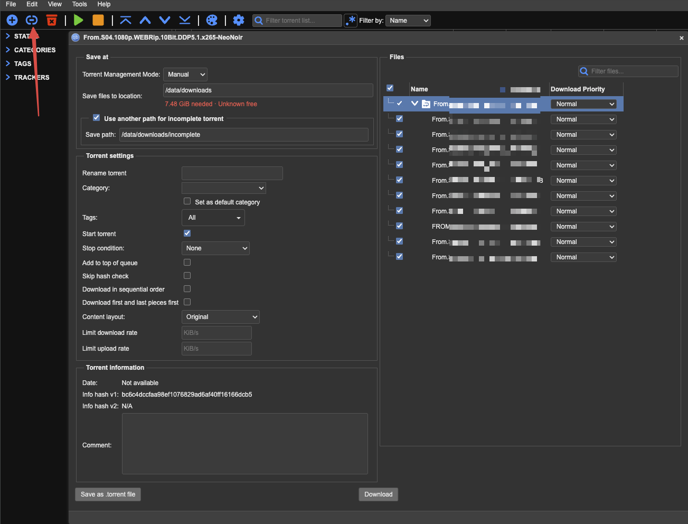
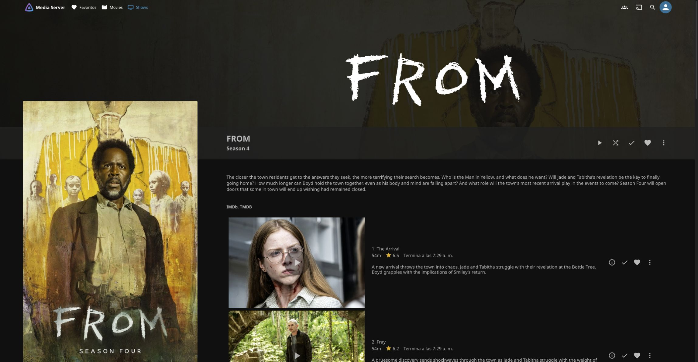

# Everyday Workflow

## Add and Watch

1. En **Radarr → Add New**, buscar la película, elegir raíz `/data/media/movies` y perfil `HD - 720p/1080p`.
2. Añadir sin búsqueda automática si se quiere revisar primero **Interactive Search**. Comprobar idioma, tamaño, calidad y disponibilidad antes de elegir un resultado admitido; no forzar un rechazo sin entenderlo.
3. Radarr consulta las fuentes de Prowlarr y envía la descarga a qBittorrent, categoría `movies`.
4. qBittorrent descarga en `/data/downloads/movies`. Al terminar, Radarr importa y renombra en `/data/media/movies` mediante hardlink, conservando la descarga mientras se comparte.
5. Abrir **Jellyfin → Movies** desde la tablet y reproducir. Elegir las pistas de audio y subtítulos disponibles.

No usar `downloads` como biblioteca Jellyfin ni mover videos a mano para completar el flujo gestionado de descargas. Los nombres de descarga y biblioteca pueden ser distintos sin duplicar datos. [Verificación del hardlink](validation.md#hardlink-import).

## Add a Torrent Manually

Preferir iniciar adquisiciones desde Radarr/Sonarr. Si se añade un magnet/torrent directamente en qBittorrent, revisar **Category** y **Save at** antes de aceptar:

| Contenido | Category | Save at: descarga | Root Folder en el gestor: biblioteca |
| --- | --- | --- | --- |
| Series | `tv` | `/data/downloads/tv` | Sonarr: `/data/media/tv` |
| Películas | `movies` | `/data/downloads/movies` | Radarr: `/data/media/movies` |

**Category no registra el título en el gestor ni convierte la descarga en biblioteca.** Registrar la serie/película correcta en Sonarr/Radarr sin búsquedas adicionales; comprobar luego **Activity → Queue** e importación. El manejo de completos está habilitado, pero un torrent manual puede quedar sin asociar o requerir resolver nombres/episodios. Para series completas ya descargadas, usar la [adopción revisada de Sonarr](sonarr.md#adopt-existing-downloads), conservando el origen mediante hardlink. No prometer importación de cualquier nombre/paquete sin revisar la correspondencia.

### Worked Example: Manual Season

Ejemplo comprobado con **FROM (2022), temporada 4**:

La flecha señala el botón de **añadir enlace** (icono de cadena). El formulario muestra **Torrent Management Mode: Manual**, **Save files to location: `/data/downloads`**, **Category vacía** e incompletos en `/data/downloads/incomplete`. Es el paso **antes de Download**, no la configuración final comprobada.

**Por qué no aparecía en Jellyfin:** al revisar la descarga terminada, ya tenía categoría `tv`, pero la serie todavía no estaba registrada en Sonarr y sus archivos no habían sido importados a la biblioteca. Jellyfin lee `/data/media/tv` (como `/media/tv` dentro de su contenedor), **no `/data/downloads`**. Llegar al 100% o cambiar sólo la ruta de descarga no completa ese paso.

1. **Para una nueva alta desde ese formulario:** elegir **Category `tv`**, **Save files to location `/data/downloads/tv`** y conservar incompletos en `/data/downloads/incomplete`; después pulsar Download. Para películas, usar `movies` y `/data/downloads/movies`, según la tabla anterior. En la prueba, el torrent ya estaba completo bajo `/data/downloads`, con categoría `tv`: se conservó ese origen, sin moverlo ni volver a descargarlo.
2. Registrar **FROM (2022)** en Sonarr, raíz `/data/media/tv`, perfil HD, sin búsquedas adicionales ni monitorizar otras temporadas. El año es el de la serie, no el de la temporada.
3. Con **Completed Download Handling ON**, Sonarr reconoció el torrent y lo importó automáticamente a `/data/media/tv/FROM (2022)/Season 04/`. No hizo falta ejecutar otra importación manual. Si no ocurre, revisar Queue y la correspondencia antes de usar Interactive Import.
4. Comprobar origen y destino con `stat`: mismo dispositivo/inode, sin segunda copia física. Jellyfin incorporó los episodios automáticamente; si la pantalla conserva una lista anterior, recargar **la página**, no volver a importar. Bazarr recibió la serie con su perfil bilingüe.

**El paso extra fue registrar la serie y dejar que Sonarr la importara**, no dirigir qBittorrent a la biblioteca. El caso prueba **adopción de una descarga manual existente**, no una adquisición nueva iniciada desde Sonarr ni la disponibilidad de subtítulos del proveedor.

**En la configuración comprobada, Torrent Management Mode es Manual** (`auto_tmm: false`) y la ruta predeterminada es `/data/downloads`. Por eso seleccionar categoría `tv` no hizo que una descarga manual usara automáticamente la ruta de esa categoría. Revisar **Save at** explícitamente; no cambiar globalmente el modo de gestión para corregir un solo caso.

Si el diálogo guardó en `/data/downloads` aunque Category sea `tv`, no se perdió el contenido: comprobar la ruta real en qBit y usarla como **origen**, no volver a descargar. La biblioteca final debe seguir bajo `/data/media`. No cambiar la ubicación/categoría de un torrent existente a ciegas: según el modo de gestión, qBit puede mover sus archivos. No guardar directamente en la biblioteca para saltarse la importación ni añadir `downloads` como otra biblioteca Jellyfin.

## Add Existing Files

Para contenido que ya existe en otro equipo, conectar desde Finder a **Movies** o **TV** mediante SMB y copiar la carpeta organizada a su biblioteca. No requiere qBittorrent, búsquedas ni Sonarr. Las rutas finales son las mismas que Jellyfin ya lee; no crear otra biblioteca ni añadir `downloads`. [Acceso, autenticación, nombres y copia segura](samba.md#copy-from-finder).

Esto no registra automáticamente los archivos en Radarr/Sonarr. Si se van a gestionar después, importar primero la colección existente para evitar adquisiciones duplicadas.

## Subtitles

Jellyfin ofrece los subtítulos que ya están incrustados en el video o disponibles como pistas externas compatibles. **No hace falta un gestor adicional para seleccionar pistas existentes.** La elección de audio original/inglés en Radarr no garantiza que el archivo incluya subtítulos EN/ES ni cambia el audio del reproductor.

**Bazarr** ya inventaría películas de Radarr y series de Sonarr con el perfil **English + Spanish**, contando las pistas integradas y sin excluir inglés por coincidir con el audio. OpenSubtitles.com busca faltantes al incorporar archivos y cada 6 horas; conserva EN/ES existentes y escribe SRT externos. Bazarr avisa a Jellyfin: un episodio con español nuevo apareció sin escaneo manual. Disponibilidad y cuotas pueden dejar faltantes para otra pasada. [Configuración, nombres de archivos externos y límites](bazarr.md).

Para contenido copiado por SMB, registrarlo primero como existente en Radarr/Sonarr, sin búsqueda ni redescarga. Jellyfin puede reproducirlo antes de ese registro, pero Bazarr no lo incorpora sólo por verlo en Jellyfin. Comprobar idioma y sincronización al reproducir; no inferirlos por el nombre del archivo.

Si se copian subtítulos manualmente, **misma carpeta y nombre base completo del video + `.es.srt`/`.en.srt`**; el nombre original del torrent puede no coincidir. Jellyfin puede incorporarlos con demora; para actualizar inmediatamente el inventario de Bazarr usar **Scan Disk** de esa serie, no Search. [Receta, versiones alternativas y alcance del automatismo](bazarr.md#manual-sidecars).

Si ya existe inglés y se desea traducirlo, usar la [ruta asistida de exportación y traducción por lotes](bazarr.md#translate-english-exports-with-google), independiente del proveedor de Bazarr y sólo por petición del propietario.

## If Content Does Not Appear

1. Si procede de Radarr, confirmar importación; si se copió por SMB, esperar a que la copia termine. Descarga completa no equivale a importación completa.
2. Comprobar que existe dentro de `/data/media/movies` o `/data/media/tv` y que Jellyfin lo puede leer bajo `/media`.
3. Verificar la [inicialización de la raíz y el monitor](validation.md#library-discovery). Un episodio posterior al escaneo inicial apareció sin otro escaneo manual; actualizar la página si conserva una vista antigua.

No cambiar credenciales, puertos o permisos recursivos para resolver un problema de detección sin identificar primero la etapa que falla. [Procedimiento de diagnóstico](validation.md).

## Series

En [Sonarr](sonarr.md), raíz `/data/media/tv` y perfil HD. La adopción de descargas previas por hardlink está probada, con los originales conservados; el manejo automático de completos está ON. Para contenido existente, registrar sin monitor/búsquedas y revisar la importación antes de adquirir nada. Una adquisición nueva iniciada desde Sonarr sigue pendiente de validación.

Para copiar desde otro equipo, usar **TV** para series y **Movies** para películas. No hace falta esperar toda la colección: procesar cada carpeta una vez terminada. Jellyfin lee estos destinos y su monitor ya detectó episodios nuevos; no reproducir ni renombrar archivos todavía en copia. Verlos en Jellyfin no los registra automáticamente en Sonarr/Bazarr.
